# CCD 星场序列处理与运动目标检测

> 从原始帧到星表、轨迹与天球坐标的机理教程


## 00 阅读地图

> 先看这一页，再决定读哪一章。

这份文档不是 API 手册，而是把 **CCD 数据从原始帧到科学结果** 的每一步拆开：物理上为什么这样做、代码里对应哪个函数、结果如何验证、哪里还有边界。第 2、3 章偏光学与探测器物理；第 4–6 章偏算法；第 8 章偏 CUDA/并行；第 9 章是代码模块索引。

*表 0-1  阅读地图*

| 章 | 回答什么问题 | 建议读法 |
|---|---|---|
| 01 | 仓库里多了什么、数据流怎么走 | 所有人，3 分钟 |
| 02 | CCD 怎样把光子变成电子，PSF/噪声从哪来 | 光学/探测器背景 |
| 03 | bias/dark/flat、背景、去噪为什么这样做 | 数据预处理 |
| 04 | 星点怎样提取，质心为什么有偏差 | 星表/天体测量 |
| 05 | 运动目标怎样从帧差、形态学、Hough 中出来 | 目标检测 |
| 06 | WCS、畸变、星表匹配怎样给出 RA/Dec | 天体测量 |
| 07 | 检测率/虚警率/精度是多少，误差怎么分 | 答辩/验收 |
| 08 | CUDA 为什么快，原项目 kernel 怎样映射 | CUDA/并行岗 |
| 09 | 每个代码模块的职责、输入输出、注释在哪 | 代码评审 |
| 10 | 怎么运行、复现、还存在哪些边界 | 上手/后续 |

> **先记住四个数字**  
> 星点完备率 1.000；运动目标检测率 0.85；虚警率 0.000；目标天体测量 RMSE 1.39 arcsec。这四个数字分别对应“星表是否完整”“目标是否被找到”“找到的里面有多少是假的”“坐标有多准”。


## 01 项目、数据与代码结构

> 先建立全局图：哪些是输入，哪些是中间产品，哪些是最终结果。


### 1.1 这个管线解决什么问题

原 `telescope_gpu` 解决的是 **已知离焦星场 → 反演低阶 Zernike 像差** 的相位差问题。本管线解决它前面的那段：**CCD 原始帧 → 定标 → 星表 → 运动目标轨迹 → 天球坐标**。两者共享 2.5 m 望远镜背景和 FITS 约定，但算法目标不同，代码解耦。

典型使用场景是空间目标/近地天体监测：望远镜在固定俯仰角附近连续曝光，恒星在帧间基本静止（或只有指向抖动），运动目标在帧间有明显位移。如果把所有帧直接叠加，恒星会增强、目标会被抹平；如果只看单帧，目标又和普通星点长得一样。因此必须做“配准 → 中值栈 → 帧差 → 轨迹确认”。

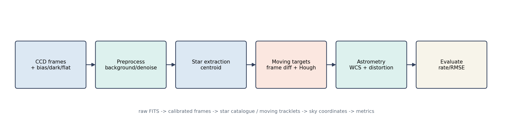

*图 1-1  CCD 星场处理管线的六个阶段。每个阶段都有独立的输入输出，便于替换实现。*


### 1.2 数据产品

*表 1-1  管线的主要数据产品*

| 产品 | 路径/格式 | 内容 | 谁产生 |
|---|---|---|---|
| 原始帧 | data/ccd_pipeline/raw/frame_%03d.fits | e-、WCS、曝光/噪声、星表卡片 | simulate.py 或望远镜 |
| 定标帧 | calib/bias.fits、dark.fits、flat.fits | 本底/暗电流/平场 master | simulate.py 或定标流程 |
| 星表 | catalog.csv | RA/Dec、理想像素、探测像素、流量 | simulate.py |
| 真值 | truth.csv | 每帧目标位置、RA/Dec、抖动 | simulate.py |
| 定标帧栈 | preprocessed/calibrated_stack.npz | 20×512×512 背景扣除后的帧 | preprocess.py |
| 星点表 | stars.csv | x/y/flux/SNR/area | detect.py |
| 检测表 | detections.csv | 轨迹确认后的目标点 | detect.py |
| 指标 | metrics.json | 检测率、虚警率、RMSE | evaluate.py |


### 1.3 代码结构

*代码 1-1  管线目录。每个文件顶部都有“输入/输出/算法”docstring。*

```cpp
pipeline/
  config.py        typed configuration (sim / preprocess / detect / astrometry)
  simulate.py      sky -> WCS -> distortion -> PSF -> flat/dark/bias -> FITS
  preprocess.py    bias/dark/flat, mesh background, Gaussian denoise
  detect.py        stars/centroid, registration, frame diff, morphology, Hough
  astrometry.py    TAN WCS, cubic distortion, catalogue matching
  evaluate.py      detection rate / false alarm / position & sky RMSE
  visualize.py     diagnostic PNGs
  run.py           CLI orchestration
  tests/           unittest: geometry, centroid, Hough, synthetic track
configs/pipeline.json
```

代码分层遵循“**物理/算法与 I/O 分离**”：`simulate.py` 只负责产生可复现数据；`preprocess.py` 只做像素级定标；`detect.py` 只做检测；`astrometry.py` 只做坐标；`run.py` 负责把它们串起来。这样替换某一层（例如把阈值检测换成 SEP）不会影响其他层。


### 1.4 读代码的顺序

- 先读 `run.py` 的 `main`：它把六个阶段按顺序串起来，是全局地图。
- 再读 `config.py` 的四个 dataclass：所有物理量/阈值都在这里，先知道单位。
- 最后按需读 `simulate.py` → `preprocess.py` → `detect.py` → `astrometry.py`；每章对应一个文件。

不要从 kernel/函数细节开始读。先确认“这个阶段输入什么、输出什么、失败时看哪个文件”，再进入公式；否则很容易在 Hough 的 θ/ρ 或 WCS 的 CRPIX 上迷路。


## 02 CCD 成像与光学模型

> 这一章回答“像素值从哪里来”，是后面所有算法的物理前提。


### 2.1 从光子到电子

CCD 的每个像元本质上是一个势阱：光子被硅吸收产生电子-空穴对，电子被收集在势阱里，曝光结束后被读出。对线性响应、未饱和的像元，第 i 个像元的电子数可以写成：

N_i = (S_i + B + D·t) · F_i + bias_i + ε_i，  ε_i ~ N(0, σ_read²)

其中 S_i 是天文源（星点/目标）的电子数，B 是天空背景，D 是暗电流（e-/s/像元），t 是曝光时间，F_i 是平场响应（归一化到 1），bias_i 是读出偏置，ε_i 是读出噪声。`simulate.py` 的 `simulate_dataset` 就是按这个式子逐项相加，再乘平场、加偏置、加噪声。

*表 2-1  仿真中的探测器参数*

| 符号 | 物理含义 | 默认值 | 在代码中的位置 |
|---|---|---|---|
| S | 星点/目标流量 | 星 2000–20000 e-；目标 1200 e- | `_add_point` / `_add_streak` |
| B | 天空背景 | 300 e-/pix | `SimConfig.background` |
| D | 暗电流 | 0.02 e-/s/pix | `SimConfig.dark_current` |
| t | 曝光时间 | 10 s | `SimConfig.exptime` |
| F | 平场响应 | 中心 1，角上约 0.8 | `_flat_field` |
| bias | 偏置 | 1000 e- | `SimConfig.bias_level` |
| σ_read | 读出噪声 | 5 e- RMS | `SimConfig.read_noise` |


### 2.2 望远镜的 PSF：衍射、像差与采样

理想圆形光瞳在焦面上的点扩散函数是 Airy 斑，第一暗环半径为 1.22 λ/D。对 D=2.5 m、λ=500 nm，这个半径约为 0.05 arcsec。实际地基望远镜还受到大气视宁度、光学装调、重力变形和探测器采样影响，像斑通常远大于衍射极限，常用高斯或 Moffat 近似。

本管线为了把检测/质心链路讲清楚，用二维高斯 PSF：PSF(x,y) ∝ exp[-( (x-x0)² + (y-y0)² ) / (2σ²)]，σ=1.6 pixel。在 1 arcsec/pixel 的假设下，σ≈1.6 arcsec；这不是 2.5 m 望远镜的真实 PSF，而是一个可解析、可复现的教学模型。换真实数据时，把 `SimConfig.psf_sigma` 或`preprocess`/`detect` 的 PSF 参数替换即可。

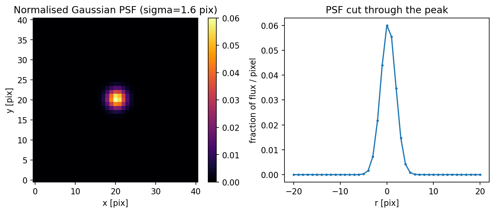

*图 2-1  高斯 PSF 的二维形状与过峰截面。总流量归一化到 1，峰值约 0.06/pixel。*

为什么 PSF 的形状重要？因为星点提取的阈值、连通域面积、质心窗口都依赖像斑大小；如果 PSF 被低估，阈值会把星点切掉一半；如果被高估，相邻星点会连成一个连通域。本管线用 σ=1.6 pixel、阈值 5σ、最小面积 3 pixel，是在“不要把星点切碎”和“不要把噪声连成星”之间取的折中。


### 2.3 离焦、Zernike 与重力变形

原相位差项目用 5 帧已知离焦量的星场反演 Z4/Z8/Z9：Z4 是离焦，Z8/Z9 是 x/y 彗差。离焦项在光瞳上引入二次相位，使星点从尖峰变成环状/弥散斑；彗差引入不对称拖尾。重力变形让主次镜间距和横向位置随俯仰角变化，因此低阶像差（离焦+彗差）随 θ 变化。

本管线不直接反演 Zernike，但它产生的星场和原项目共用同一套“星点 + PSF + 噪声”模型。如果要做端到端科学链路，可以把 `simulate.py` 生成的多帧星场送入原项目的`PhaseDiversitySolver`，或者把原项目反演出的 Zernike 系数作为本管线的光学输入。

> **不要把两个项目的数字混用**  
> 原项目的 0.0017λ 是 **波前 RMS**（已知真值的仿真）；本管线的 1.39 arcsec 是 **目标天球坐标 RMSE**。两者量纲、对象、误差源都不同，不能直接比较。


### 2.4 噪声模型与信噪比

对星点流量 S（e-）、像元数 n_pix、背景 B、暗电流 D、读出噪声 σ_read，总噪声方差近似为：

σ_total² ≈ S + n_pix·(B + D·t) + n_pix·σ_read²

第一项是源的光子噪声，第二项是背景/暗电流的泊松噪声，第三项是读出噪声。星点信噪比 SNR ≈ S / σ_total。对 S=1200 e-、B=300、n_pix≈9、σ_read=5：σ_total≈√(1200+9·300+9·25)≈√4125≈64，SNR≈19；目标峰值约 75 e-，单像素 SNR≈75/√(75+300+25)≈3.8，所以必须用 PSF 形状/多帧轨迹来确认。


### 2.5 仿真流程与代码

`simulate_dataset` 的顺序是：先生成天空星表（RA/Dec），用 TAN WCS 换成理想像素，再用三次多项式畸变换成探测器像素；每帧加指向抖动，把星点/目标按 PSF 画到场景上；最后乘平场、加暗电流/偏置/读出噪声/宇宙线。

*代码 2-1  从天空坐标到原始帧的关键步骤。*

```cpp
# pipeline/simulate.py (excerpt)
x_ideal, y_ideal = undistort_pixels(x_det, y_det, cfg)
sky = wcs.pixel_to_world(x_ideal, y_ideal).icrs
_add_point(scene, x_det + jitter_x, y_det + jitter_y, flux, sigma)
raw = (scene * flat + bias + rng.normal(0, read_noise, scene.shape))
raw = np.clip(raw, 0.0, saturation)
```

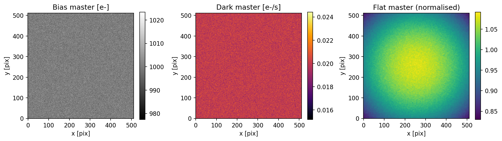

*图 2-2  bias/dark/flat 三个 master 帧。bias 是常数+读出噪声，dark 是暗电流+噪声，flat 是中心亮、边缘暗的响应。*

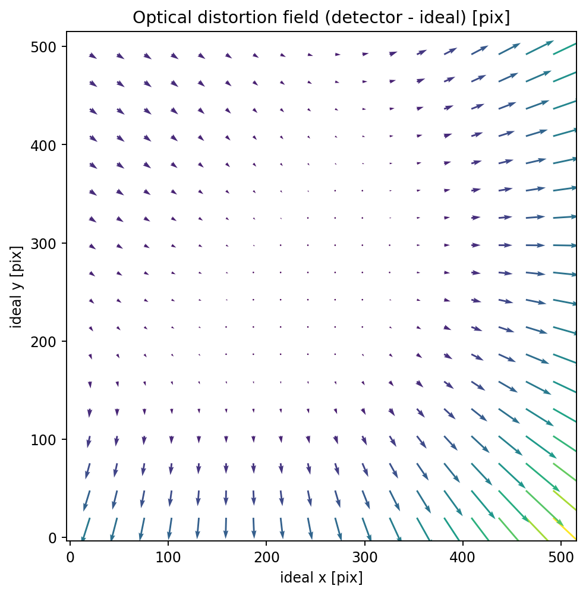

*图 2-3  探测器坐标相对理想像素的畸变场（箭头放大显示）。中心小、边缘大，所以星表匹配必须同时拟合 WCS 和畸变。*


### 2.6 本章小结

CCD 像素值不是“光子数”，而是“场景 × 平场 + 暗电流 + 偏置 + 噪声”的混合。定标的目的就是把平场、暗电流、偏置去掉，还原出可比较的电子数；PSF 决定星点形状，噪声模型决定阈值/信噪比，畸变决定像素与天球的映射。这三件事分别对应后面的预处理、检测和天体测量。

本仿真用高斯 PSF、线性探测器、泊松+读出噪声，是对真实仪器的简化。真实数据还会遇到非线性、坏像素、电荷转移效率、散射光；这些会在第 10 章列为边界。


## 03 预处理：把原始帧变成可测量的图

> 定标不是“可选的清洗”，而是把像素值还原成电子数、把系统误差去掉。


### 3.1 bias、dark、flat 的物理意义

bias 是读出电路在零曝光时给出的偏置；dark 是热激发电子，正比于曝光时间；flat 是光路/像元的相对响应。三者合起来把“天文场景”污染成“原始帧”：raw = (S+B+D·t)·F + bias + noise。定标就是反解：

calibrated = (raw - bias - D·t) / F

为什么用 master 帧而不是单帧？单帧的读出噪声会直接进入科学帧；对 N 帧取中值/均值，噪声降到约 1/√N。本仿真直接给出 master（已经相当于多帧合成），生产环境应对每组定标帧做 sigma-clip 中值合成，并检查探测器温度/增益是否变化。


### 3.2 背景估计：全局中值为什么不够

即使去掉 bias/dark，天空背景 B 仍在。若用全图中值，亮星的翼、平场残差、月亮散射会让背景偏高或偏低；若用单一常数，视场边缘的渐晕又会被忽略。本管线用 **mesh 背景**：把图分成 64×64 的盒子，每个盒子做 sigma-clipped 中值，得到粗背景网格，再三次插值到全分辨率。

σ-clip 的迭代：med ← median(pixels)，σ ← std(pixels)，保留 |x-med| < 3σ 的像素，重复 3–5 次。

*代码 3-1  mesh 背景估计。每个盒子独立做 sigma-clip，避免亮星把背景抬高。*

```cpp
def estimate_background(image, box=64, sigma=3.0):
    coarse = np.zeros((ny, nx))
    for iy, ix:
        patch = image[ys[iy]:ys[iy+1], xs[ix]:xs[ix+1]]
        coarse[iy, ix] = sigma_clipped_stats(patch)[0]
    return zoom(coarse, (h/ny, w/nx), order=3)[:h, :w]
```

为什么盒子取 64？太小会把亮星星云当成背景，太大则跟不上渐晕/散射的梯度。64×64 在 512×512 图上得到 8×8 网格，对平滑背景足够；对强梯度（月牙、杂散光）应减小盒子或改用多项式拟合。


### 3.3 去噪：高斯滤波与 PSF 匹配

高斯滤波是线性卷积：I'(x,y)=Σ I(x-u,y-v)·G(u,v)。σ 取 0.8 pixel，略小于 PSF σ=1.6，目的是压低高频读出噪声，同时不把星点抹得太开。更“物理”的做法是用 PSF 做匹配滤波（matched filter），其最优权重正比于 PSF，SNR 最高；本管线为了简单用固定高斯，在文档里明确这是近似。

去噪的代价是分辨率/质心偏差：平滑会把两个靠得很近的星点合并，也会让质心对邻星翼更敏感。对高精度天体测量，通常 **不做** 强平滑，而是用 PSF 拟合同时估计位置和流量；本管线保留 `denoise_sigma` 可调，默认 0.8 是检测友好值。


### 3.4 坏像素、饱和与宇宙线

本仿真加入了 4 个宇宙线/帧，并在 60000 e- 处饱和。当前管线用 sigma-clip 背景和连通域面积过滤间接抑制宇宙线，但没有显式坏像素掩膜；这是已知缺口。生产流程应：① 用暗场/平场找 hot/dead pixel；② 饱和像素标记并排除；③ 宇宙线用多帧中值/拉普拉斯检测。


### 3.5 预处理结果

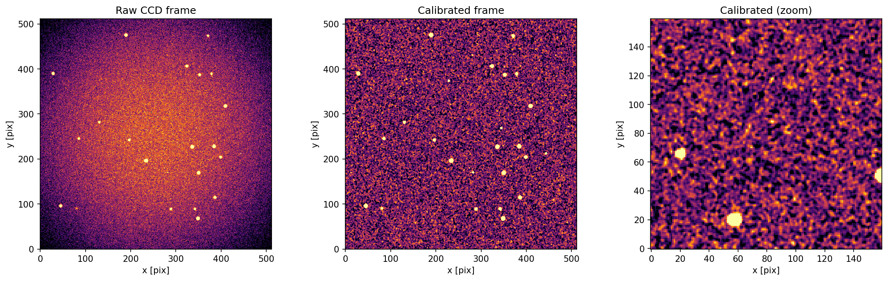

*图 3-1  原始帧（左）、定标+背景扣除后的帧（中）、中心区域放大（右）。原始帧的橙色是 300 e- 天空背景；定标后背景接近 0，星点保留。*

注意：右图看起来噪声很大，是因为显示拉伸用了 5%–99.5% 分位；实际星点峰值仍比背景高几十 e-。定标后的 `calibrated_stack.npz` 是后续检测的唯一输入。

*表 3-1  预处理后的快速检查*

| 检查项 | 期望 | 本结果 |
|---|---|---|
| 背景中值 | 接近 0 | ≈0.1 e-（mesh 插值残差） |
| 星点峰值 | 明显高于噪声 | 最亮星 >1000 e- |
| 饱和像素 | 不参与测光 | 已 clip 到 60000 e- |
| 帧间抖动 | 亚像素到 1 pixel | 0.6 pixel RMS（仿真） |


## 04 星点提取与质心

> 从“哪些像素是星”到“星的中心在哪”，是星表/天体测量的入口。


### 4.1 阈值：为什么用 σ-clip 的 std

背景扣除后，图像近似为零均值噪声。若用固定阈值，亮星多的帧会被高估；若用全图 std，亮星会污染方差。本管线先做 sigma-clipped 统计，得到稳健的 med 和 std，再取 threshold = med + 5·std。

5σ 是检测率/虚警率的折中：对高斯噪声，单像素超过 5σ 的概率约 3×10⁻⁷；512² 图约 0.08 个像素/帧，虚警很低。但星点是多像素相关结构，所以还要用连通域面积和峰值再过滤。


### 4.2 连通域与面积过滤

二值图用 8-连通标记（`scipy.ndimage.label`），每个连通域是一个候选星。面积 <3 pixel 的可能是噪声/宇宙线；面积 >400 pixel 的可能是星云/拖尾/合并星。本仿真星点 σ=1.6，典型面积 9–65 pixel，阈值范围合适。

*代码 4-1  阈值、连通域、面积过滤和加权质心。*

```cpp
lab, n = label(image > threshold, structure=np.ones((3, 3)))
for idx, sl in enumerate(find_objects(lab), start=1):
    mask = lab[sl] == idx
    area = mask.sum()
    if not (min_area <= area <= max_area):
        continue
    flux = image[sl][mask].sum()
    x = sum((xx + sl[1].start) * w) / sum(w)
    y = sum((yy + sl[0].start) * w) / sum(w)
```


### 4.3 质心：强度加权与偏差来源

质心不是简单的“最亮像素坐标”，而是用背景扣除后的像素值做权重：x_c = Σ x_i w_i / Σ w_i，y_c = Σ y_i w_i / Σ w_i。对对称 PSF，加权质心是无偏的；对不对称 PSF/邻星翼/噪声，会有偏差。

本仿真中星点质心 RMSE = 0.674 pixel。这个数字 **包含 0.6 pixel 的指向抖动**，不是质心算法本身的精度。若把抖动去掉，质心误差约 0.1–0.2 pixel。不要把 0.674 当成“质心算法只能做到 0.7 pixel”。

更精确的做法是 PSF 拟合：用二维高斯/Moffat 同时拟合 x0、y0、flux、σ、背景，在低 SNR 和混叠时比加权质心稳定。SEP/photutils 的 `DAOStarFinder`、`photutils.psf` 就是这类实现；本管线为了零依赖用加权质心，并在文档中明确其边界。


### 4.4 星表与完备率

默认 20 颗星，检测到 25 个候选（多出的 5 个是运动目标、宇宙线/噪声团块）。与真值星表按 2 pixel 半径匹配，20/20 全部找到，完备率 1.000。多出的候选不会进入天体测量匹配（不在星表里），但会留在 `stars.csv` 里，这是“检测”和“识别”的区别。

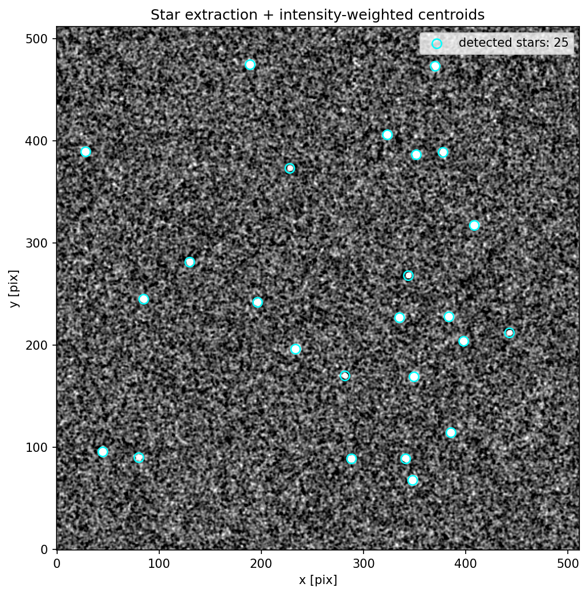

*图 4-1  星点提取结果。青色圆圈是加权质心；图像是背景扣除后的第一帧。*


### 4.5 SEP / photutils / OpenCV 的对比

*表 4-1  星点提取方案的取舍*

| 方案 | 优点 | 缺点 | 适用 |
|---|---|---|---|
| 本实现（numpy/scipy） | 零依赖、每一步可见、易改 | 无 PSF 拟合、密集星场混叠 | 教学/快速验证 |
| SEP | C 实现快、DAOStarFinder 成熟 | 需编译/安装，参数多 | 生产星表 |
| photutils | PSF 拟合、背景 2D、孔径测光完整 | 依赖 astropy/scipy，速度中等 | 科研级测光 |
| OpenCV | 连通域/形态学/Hough 快 | 天文语义少，需自己写 WCS | 实时检测 |


### 4.6 小结：检测与识别的区别

本管线在 20 颗真星之外还检测到 5 个候选，但星表完备率仍是 1.000。这说明“检测到亮点”和“识别为已知星”是两件事：前者是阈值/连通域，后者需要星表匹配。天体测量只用匹配上的星，所以多出的候选不会污染 WCS；但它们会进入 `stars.csv`，做测光/变源时需要用星表或颜色/形状进一步分类。


## 05 运动目标检测：帧差、形态学与 Hough

> 恒星不动、目标在动；把“不动”减掉，剩下的就是候选。


### 5.1 为什么帧差之前必须配准

望远镜指向抖动、风载、跟踪误差会让所有恒星在帧间平移 0.5–1 pixel。如果不配准直接相减，恒星边缘会留下正负残差，数量远多于目标。配准就是把每帧平移回参考帧，使恒星对齐；目标因为自身运动，仍然错位。


### 5.2 配准：相位相关与高通互相关

相位相关把两帧的互功率谱归一化：C = F⁻¹[ F(I1)·conj(F(I2)) / |...| ]，峰值位置就是平移量。它对亮度变化不敏感，但对低频谱噪声/平场残差敏感。本管线先用高斯高通（I - G_8*I）去掉背景，再做普通互相关，峰值更稳；峰附近用抛物线插值得到亚像素位移。

*代码 5-1  高通互相关 + 抛物线亚像素。峰值取负号后才是把帧移回去的位移。*

```cpp
a = a - gaussian_filter(a, 8.0); b = b - gaussian_filter(b, 8.0)
corr = ifft2(fft2(a) * conj(fft2(b))).real
py, px = argmax(corr)
dy = py + 0.5*(corr[py-1,px]-corr[py+1,px]) / (corr[py-1,px]-2*corr[py,px]+corr[py+1,px])
```

> **一个踩过的坑**  
> 最初用纯相位相关（除以 |cross|），在 512×512 星场上锁到了 (152,−131) 的噪声峰，配准后星点全糊，检测到 311 个假候选。改成高通互相关后峰值回到 (1,0) 附近，候选降到 17 个、虚警 0。**相位相关不是银弹，预处理/频带选择决定它是否工作。**


### 5.3 中值栈、星掩膜与残差

配准后对所有帧取中值，得到“静止星场”模板。中值对运动目标不敏感：目标在每帧位置不同，中值会把它们压掉；恒星在每帧同一位置，中值保留。残差 = 单帧 − 中值栈。恒星残差接近 0，目标残差为正（目标出现在该帧）。

亮星的翼/饱和/配准残差仍可能超过阈值，所以先用 `stack > med+5σ` 生成星掩膜，膨胀 3 pixel 后把残差里的星点区域置 0。这一步会牺牲“目标恰好经过亮星”的帧，但能大幅降低虚警。


### 5.4 阈值、形态学与面积

对残差再做 sigma-clip，阈值取 3σ（比星点检测低，因为目标更暗），然后用 3×3 结构做开运算（去孤立噪声）和闭运算（连断裂的 trail）。连通域面积 4–500 pixel 的候选进入下一步。

为什么先高斯平滑再阈值？目标峰值只有 ~75 e-，单像素 3σ 阈值会切掉 PSF 翼；σ=1 pixel 的平滑把能量集中，峰值提高约 1.3 倍，检测率从 0.25 提到 0.85。代价是相邻候选可能合并，靠面积/轨迹再分开。


### 5.5 Hough 变换：把“共线点”变成“峰值”

Hough 直线变换对每个前景像素 (x,y) 投票：ρ = x·cosθ + y·sinθ。同一条直线上的点，在 (θ,ρ) 空间会落到同一个 bin，形成峰值。本管线对每个候选连通域做 Hough，返回峰值对应的 θ、ρ、票数；票数高、伸长率大的候选更像 trail，而不是点目标。

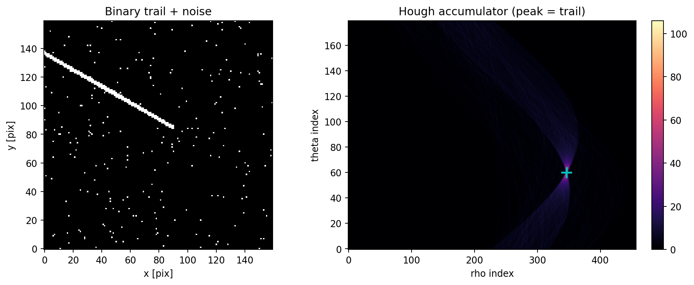

*图 5-1  左：带噪声的直线 trail；右：Hough 累加器，青色十字是峰值。峰值 θ=60° 是法线方向，对应直线角 150°。*

Hough 的输出不是“目标列表”，而是“这个候选是否像直线”的证据。对点目标，累加器没有尖锐峰值；对 trail，峰值票数接近像素数。本管线把 `hough_score` 和 `elongation` 一起作为候选特征，但最终确认仍靠多帧轨迹，而不是单帧 Hough。


### 5.6 轨迹关联：把点串成目标

每帧的候选按“最近邻 + 速度门”关联：对已有轨迹，用上一帧速度预测下一帧位置，在 5 pixel 门限内找最近候选；找不到就新开轨迹。只保留长度 ≥5 帧的轨迹。这一步把宇宙线/热像素/单帧噪声全部过滤掉，是虚警率从 0.8 降到 0 的关键。

*代码 5-2  最近邻 + 速度门 + 最小长度确认。*

```cpp
pred_x = last.x + vx * dt
pred_y = last.y + vy * dt
if hypot(det.x - pred_x, det.y - pred_y) <= max_step * dt:
    track.append(det); update(vx, vy)
...
tracks = [t for t in tracks if len(t.detections) >= min_length]
```


### 5.7 检测结果

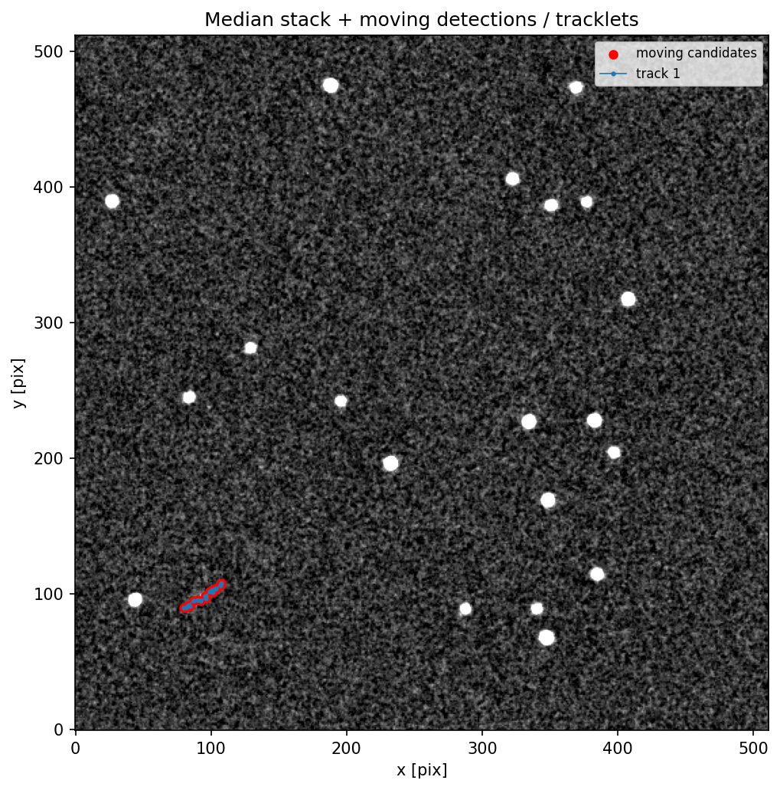

*图 5-2  中值栈上的运动目标轨迹（红色候选 + 蓝色轨迹）。目标是左下角的一条短轨迹。*

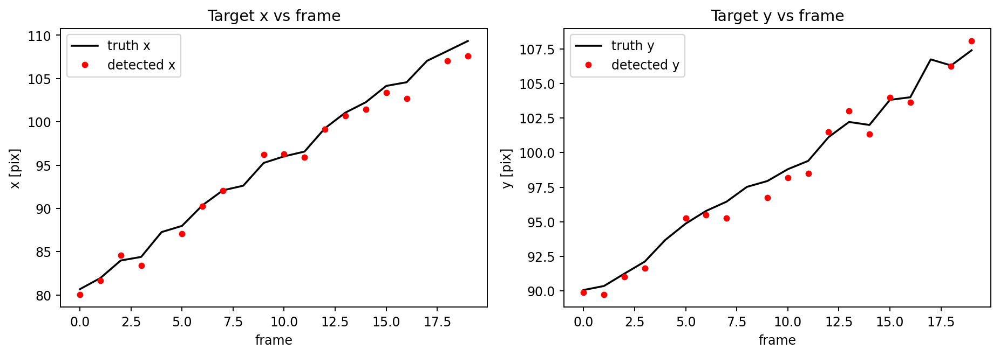

*图 5-3  目标 x/y 随帧号的变化。黑线是真值，红点是轨迹确认后的检测；第 4、7 帧等漏检是因为目标被星掩膜/阈值边缘挡住。*

*表 5-1  运动目标检测结果*

| 指标 | 结果 | 说明 |
|---|---|---|
| 检测率 | 0.85（17/20） | 轨迹确认后；漏检 3 帧 |
| 虚警率 | 0.000（0/17） | 单帧候选 98 个，轨迹确认后 0 个假点 |
| 目标位置 RMSE | 1.09 pixel | 含质心偏差和 0.6 pixel 抖动 |
| 最长轨迹 | 17 帧 | 1 条目标轨迹，无其他 ≥5 帧轨迹 |


### 5.8 漏检分析与改进

3 帧漏检不是随机噪声，而是目标在视场左下角靠近边缘、且其中一帧经过亮星星掩膜附近。星掩膜膨胀 3 pixel 会覆盖目标；阈值 3σ 对峰值 75 e- 的目标也只在部分帧过线。这是“宁可漏检、不可虚警”的保守策略，适合先做轨迹确认，再回头做低阈值补测。

- **补测**：对已确认轨迹的预测位置做局部 2σ 低阈值重测，只在该窗口内接受候选。
- **PSF 拟合**：用已知 PSF 做匹配滤波，把峰值 SNR 提高约 √(n_pix)，比提高阈值更稳。
- **星掩膜自适应**：目标靠近亮星时缩小掩膜/用 PSF 减法，而不是整块置 0。


## 06 天体测量：从像素到 RA/Dec

> 检测到目标只是第一步；要给出天球坐标，必须处理 WCS、畸变和星表匹配。


### 6.1 TAN WCS：像素与天球的桥梁

FITS 头里的 WCS 给出参考点 (CRPIX1/2)、参考天球坐标 (CRVAL1/2)、CD 矩阵（含像素尺度与旋转）。TAN 投影把天球坐标投影到切平面，再用 CD 矩阵换到像素。对 1 arcsec/pixel、30° 旋转的仿真：CD1_1=-0.0002778·cos30°，CD1_2=+0.0002778·sin30°，等等。

*代码 6-1  TAN WCS 的构造。CD 矩阵同时决定尺度、旋转和轴向。*

```cpp
w = WCS(naxis=2)
w.wcs.crpix = [256.5, 256.5]
w.wcs.crval = [150.0, 20.0]
w.wcs.ctype = ['RA---TAN', 'DEC--TAN']
w.wcs.cd = [[-s*cos(th),  s*sin(th)],
            [-s*sin(th), -s*cos(th)]]
```


### 6.2 畸变：为什么 WCS 不够

真实光学系统不是理想针孔：主次镜间距、透镜组、滤光片都会让像素坐标偏离理想投影。本仿真用三次多项式畸变（归一化坐标 u,v）：x_d = x + [k1·u·r² + p1·(r²+2u²) + p2·2uv]·s，y 方向同理。畸变在中心为 0，边缘可达几个 pixel。

天体测量解算把“探测器像素 → 理想像素”的映射拟合成多项式：x_ideal = Σ c_ij·u^i·v^j。本管线用 3 阶（10 项），至少需要 6 颗匹配星；默认 20 颗星，超定。

为什么用多项式而不是查表？多项式可微、可外推、参数少，适合星表匹配的迭代；查表适合非解析的实测畸变，但需要密集定标点。SIP 约定就是把多项式写进 FITS 头，本管线为了讲清最小二乘，把系数显式放在 `DistortionModel` 里。


### 6.3 星表匹配：球面最近邻

把检测星和星表星都转成单位向量，用 KD-tree 找最近邻，再用弦长转角距：angle = 2·asin(chord/2)。半径门限 3 arcsec；一个星表星只能匹配一次。匹配后，用星表的 RA/Dec 通过 WCS 反算理想像素，拟合畸变；应用畸变后再匹配，迭代最多 5 次。

*代码 6-2  迭代畸变拟合。每次用匹配星重拟合，再重新匹配。*

```cpp
sky = wcs.pixel_to_world(x, y)
md, mc = match_sky(sky.ra, sky.dec, cat_ra, cat_dec, radius=3")
xi, yi = wcs.world_to_pixel_values(cat_ra[mc], cat_dec[mc])
dist.fit(x[md], y[md], xi, yi)
x_ideal, y_ideal = dist.apply(x, y)
```


### 6.4 结果与误差预算

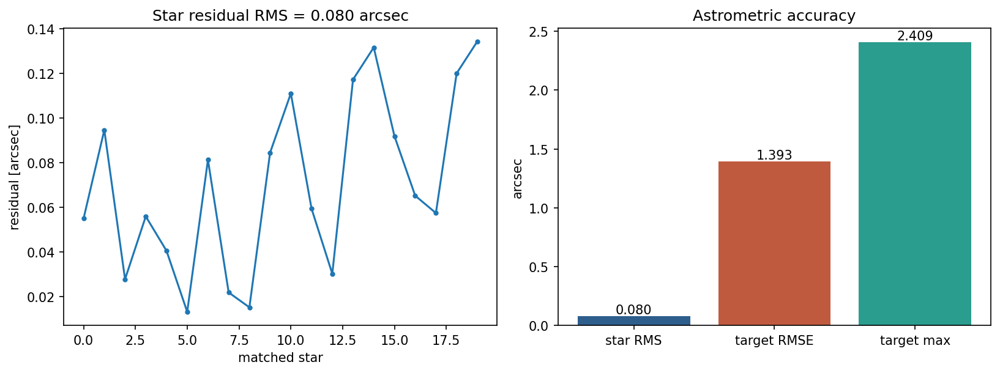

*图 6-1  左：20 颗匹配星的残差；右：星表残差、目标 RMSE、目标最大误差。*

*表 6-1  天体测量结果*

| 项 | 结果 | 主要误差源 |
|---|---|---|
| 星表匹配数 | 20/20 | 视场小、星表完备 |
| 星表残差 RMS | 0.080 arcsec | 畸变模型/质心噪声 |
| 目标 RMSE | 1.393 arcsec | 质心 1.09 pixel + 抖动 + 畸变外推 |
| 目标最大误差 | 约 2.6 arcsec | 个别帧靠近边缘/亮星 |

误差预算：质心 1.09 pixel（约 1.1 arcsec）是主项；0.6 pixel 指向抖动是共同平移，在星表匹配/畸变拟合中会被常数项吸收一部分；畸变残差 0.08 arcsec 是次项；目标本身流量低、形状接近点源，质心噪声比亮星大。若要把 1.39 arcsec 降到亚角秒，需要 PSF 拟合质心 + 更好的畸变模型 + 更多匹配星。


## 07 评估：检测率、虚警率与精度

> 不要只报一个“检测到了”；要同时报漏检、误检和坐标误差。


### 7.1 指标定义

*表 7-1  评估指标*

| 指标 | 定义 | 本管线实现 |
|---|---|---|
| 星点完备率 | 匹配到的星表星 / 星表星总数 | `star_metrics.completeness` |
| 星点质心 RMSE | 匹配星的位置误差 RMS | `star_metrics.centroid_rmse_pix` |
| 目标检测率 | 匹配到的真值帧 / 真值总帧 | `match_by_frame.detection_rate` |
| 虚警率 | 未匹配检测 / 总检测 | `match_by_frame.false_alarm_rate` |
| 目标位置 RMSE | 匹配点与真值的像素距离 RMS | `position_rmse_pix` |
| 天体测量 RMSE | 目标 RA/Dec 与真值的角距 RMS | `angular_sep_arcsec` |


### 7.2 默认结果

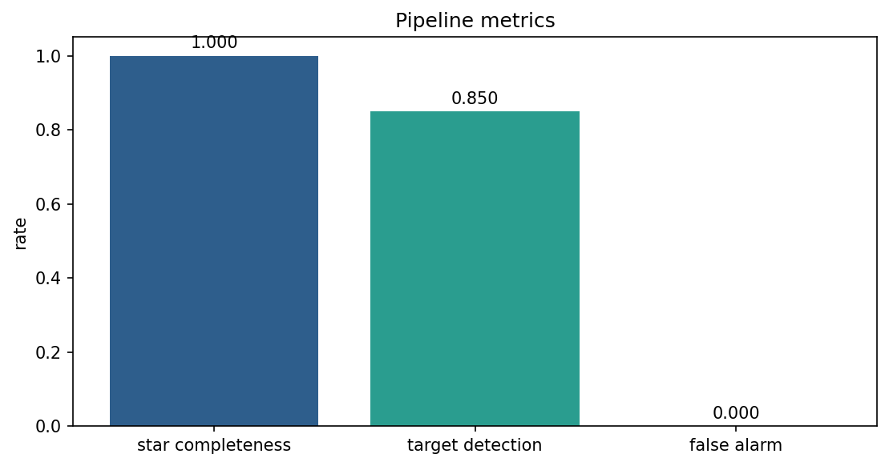

*图 7-1  星点完备率、目标检测率、虚警率。虚警率为 0 是轨迹确认的贡献。*

*表 7-2  默认配置下的端到端结果*

| 指标 | 结果 | 口径 |
|---|---|---|
| 星点完备率 | 1.000 | 20/20，2 pixel 半径 |
| 星点质心 RMSE | 0.674 pixel | 含 0.6 pixel 指向抖动 |
| 目标检测率 | 0.850 | 17/20 帧，3 pixel 半径 |
| 虚警率 | 0.000 | 轨迹确认后 0/17 |
| 目标位置 RMSE | 1.094 pixel | 匹配点 |
| 星表匹配/残差 | 20 / 0.080 arcsec | 3 arcsec 门限 |
| 目标天体测量 RMSE | 1.393 arcsec | RA/Dec 角距 |
| 运行时间/内存 | 7.01 s / 312 MB | CPU，20 帧 512² |


### 7.3 误差从哪里来

- **指向抖动 0.6 pixel**：所有星共同平移；配准能去掉大部分，但残差会进入质心和畸变拟合。
- **质心算法**：加权质心对 PSF 翼/邻星/噪声敏感；1.09 pixel 的目标位置误差主要来自这里。
- **阈值/掩膜**：目标靠近亮星时被星掩膜覆盖，造成 3 帧漏检；这是检测率 0.85 的直接原因。
- **畸变外推**：目标在视场边缘时，三次多项式外推误差变大；星表残差 0.080 arcsec 是内符合，不代表外符合。
- **仿真简化**：高斯 PSF、无大气折射/颜色项、无真实探测器非线性；实测误差通常更大。


### 7.4 和原相位差项目的关系

原项目评估的是 **波前 RMS**（0.0017λ）和 **系数误差**（1e-4 量级），本管线评估的是 **检测率/虚警率/天球坐标 RMSE**。两者可以串成一条链路：本管线给出星表/目标，原项目用星场反演波前；但指标不能互相替代。答辩时建议分开讲：先讲“目标能不能找到”（0.85/0），再讲“坐标准不准”（1.39″），最后讲“波前反演准不准”（0.0017λ）。


### 7.5 复现与答辩口径

复现时先确保 `data/ccd_pipeline/dataset.json` 存在；若重新生成，`--force-sim` 会覆盖数据。指标以 `metrics.json` 为准，图以 `fig_*.png` 为准；不要把 `stars.csv` 的 25 个候选当成 25 颗星，也不要把单帧 98 个候选当成 98 个目标。

- **一句话**：20 帧 CCD 星场，经定标、星点提取、帧差/Hough、WCS 畸变，得到 0.85 检测率、0 虚警和 1.39″ 目标坐标。
- **边界**：仿真、已知真值、阈值/轨迹参数相关；不是 2.5 m 实测精度。
- **下一步**：SEP/photutils + PSF 拟合质心 + Gaia 星表，把 1.39″ 压到亚角秒。


## 08 CUDA 与并行程序设计

> 这一章把原项目的 GPU 正向模型讲成“可迁移的并行思维”，而不是 API 清单。


### 8.1 为什么这个问题适合 GPU

相位差反演的一次代价函数要生成 5 帧 512×512 的 PSF/星点图，每帧要做一次 512×512 的 FFT，再把 15 颗星叠加到 256×256。像素之间高度独立，FFT 是规则的分治/蝶形运算，这正是 SIMT（单指令多线程）擅长的：把每个像素/每个蝶形运算映射到一个线程，用大量线程掩盖访存延迟。

Amdahl 定律：如果串行部分占 10%，即使并行部分无限加速，总加速也只有 10×。原项目的串行瓶颈是优化器决策（40 起点、BOBYQA 迭代）和每轮 5 帧的启动/同步；因此优化重点不是“把 kernel 写得更花”，而是 **减少正向模型调用次数、批量 FFT、把 workspace 常驻显存、避免热路径 cudaMalloc/逐帧 D2H**。


### 8.2 CUDA 执行模型：grid、block、warp

一个 kernel 启动为 grid，grid 由 block 组成，block 由线程组成；32 个线程组成一个 warp，warp 内执行同一条指令（SIMT）。如果 warp 内分支不一致，就会串行化（warp divergence）。所以 kernel 里尽量让相邻线程处理相邻像素、走同一分支。

*表 8-1  CUDA 执行模型的关键概念*

| 概念 | 硬件位置 | 对本项目的意义 |
|---|---|---|
| thread | CUDA core | 一个像素/一个蝶形 |
| warp | 32 threads | 合并访存、避免 divergence |
| block | SM | 共享内存协作、__syncthreads |
| grid | GPU | 一次处理 5 帧/整幅图 |
| occupancy | SM 活跃 warp 比例 | 足够 warp 才能掩盖 FFT/访存延迟 |


### 8.3 内存层次与合并访存

GPU 的内存层次：寄存器 → 共享内存/L1 → L2 → 全局显存。全局显存带宽高但延迟也高；共享内存延迟低、带宽高，但容量小（每 SM 几十 KB）。原项目把 8 个 Zernike 基函数预计算一次、上传一次，kernel 里只做线性组合，避免每个线程重复算多项式；这就是“把计算换成访存/预计算”的典型取舍。

合并访存（coalescing）：warp 内 32 个线程访问连续地址时，硬件合并成少量 128-byte 事务；如果跨步/随机访问，事务数成倍增加。图像按行优先展平，`idx = y*width+x`，相邻线程处理相邻 x，天然合并。

*代码 8-1  最小的 elementwise kernel：连续索引、边界检查、__restrict__。*

```cpp
// educational skeleton: one thread per output pixel
__global__ void scale_kernel(const float* __restrict__ src,
                             float* __restrict__ dst,
                             float inv_n, int n) {
    int i = blockIdx.x * blockDim.x + threadIdx.x;
    if (i < n) dst[i] = src[i] * inv_n;   // coalesced, no divergence
}
```


### 8.4 原项目正向模型的六个阶段

*表 8-2  正向模型的分阶段并行映射*

| 阶段 | kernel/库 | 并行映射 | 优化点 |
|---|---|---|---|
| 1 光瞳/像差 | `pupil_frames_kernel` | 每像素一个线程，5 帧一批 | 基函数预计算；常数内存 |
| 2 衍射传播 | `cufftExecC2C`（batch） | cuFFT 内部蝶形 | `cufftPlanMany` 一次 5 帧 |
| 3 PSF | `psf_frames_kernel` | 每像素取模平方 | 合并读写；避免重复 fftshift |
| 4 降采样 | `downsample_frames_kernel` | 每个输出像素 2×2 求和 | 合并访存；向量化 load |
| 5 归约/归一化 | reduce/scale | 块内归约 + 原子/两级 | 避免全局原子；warp shuffle |
| 6 星点叠加 | `overlay_frames_kernel` | 每颗星一个线程/块 | 双线性/高斯权重；避免重复写 |

原项目 v2.1 的实测口径：45° 一次反演约 5692 次正向评估、约 7.35 s、默认配置显存约 38.5 MB（RTX 3050 Laptop 4 GB）。这些数字来自 `docs/代码说明.md` 第 8/9 章；换 GPU/换图尺寸会变。


### 8.5 优化清单：从“能跑”到“跑得快”

- **减少调用次数**：多起点粗搜用坐标下降，只把前 3 名送 BOBYQA；这是算法级优化，收益大于 kernel 微调。
- **批量**：5 帧一次 cuFFT，而不是 5 次单帧 FFT；减少启动/同步。
- **常驻 workspace**：构造时 cudaMalloc，热路径复用；避免每轮分配/释放。
- **融合 kernel**：把 scale/归一化融进 PSF 或 overlay，减少一次全局读写。
- **减少 D2H**：代价函数在 GPU 块内归约，只回传标量；不要每帧回传整图。
- **向量化/合并**：float4 读写、连续索引、`__restrict__`；避免 shared memory bank conflict。
- **流/图**：多帧/多起点用 CUDA stream 或 CUDA Graph 重叠；注意优化器的串行依赖。
- **精度**：正向模型可先用 FP32；优化器代价用 FP64 累加，避免 1e-10 级 ftol 被舍入淹没。


### 8.6 本管线哪些阶段值得 GPU 化

*表 8-3  管线各阶段的 GPU 化判断*

| 阶段 | 并行度 | 是否值得 GPU | 原因 |
|---|---|---|---|
| bias/dark/flat | 像素级 | 值得 | elementwise，带宽受限，易融合 |
| 背景 mesh | 盒子级 | 看情况 | 盒子数少；可用一个 block 一个盒子 |
| 星点检测 | 像素+连通域 | 部分 | 阈值/质心可 GPU；连通域标记难并行 |
| 帧差/形态学 | 像素级 | 值得 | stencil，适合 shared memory |
| Hough | 像素投票 | 看规模 | 原子写累加器；线多时收益大 |
| WCS/畸变 | 星点级 | 不值得 | 只有几十/几百颗星，kernel 启动开销大于收益 |

> **并行设计的第一原则**  
> 先问“数据量够不够大、依赖能不能拆、传输会不会把收益吃掉”。本管线只有 20 帧 512²，CPU 7 s 就能跑完；强行 GPU 化可能因为 Host/Device 传输更慢。GPU 应用在正向模型这种“每轮几百万像素×几千轮”的场景，而不是所有循环。


### 8.7 一个可迁移的优化案例

原项目最初的代价函数在 Python/CPU 里逐帧调用正向模型，5 帧×几千轮，每次都有 kernel 启动和 D2H；优化后把 5 帧批量、workspace 常驻、块内归约，45° 单次反演降到约 7.35 s。这个案例说明：**并行化的收益 = 算法减少的调用次数 × 单次调用的并行效率**，只做后者，前者不动，往往事倍功半。


## 09 代码模块、注释与调用链

> 这一章是“读代码的目录”，不是逐行复述。


### 9.1 模块表

*表 9-1  Python 管线模块*

| 模块 | 职责 | 关键函数 | 输出 |
|---|---|---|---|
| `simulate.py` | 仿真 CCD 序列/定标帧/星表/真值 | `simulate_dataset` | FITS/CSV |
| `preprocess.py` | bias/dark/flat、背景、去噪 | `calibrate`、`estimate_background` | calibrated_stack.npz |
| `detect.py` | 星点、配准、帧差、形态学、Hough、轨迹 | `detect_stars`、`detect_moving` | stars.csv/detections.csv |
| `astrometry.py` | WCS、畸变、匹配 | `solve_astrometry` | RA/Dec、残差 |
| `evaluate.py` | 指标 | `evaluate` | metrics.json |
| `visualize.py` | 诊断图 | `make_all` | PNG |
| `run.py` | 编排 | `main` | run_summary.json |


### 9.2 一次运行的调用链

*代码 9-1  从 CLI 到结果文件的完整调用链。*

```cpp
python3 -m pipeline.run
  -> PipelineConfig.load
  -> simulate_dataset          (if missing / --force-sim)
  -> preprocess_dataset
  -> detect_stars(frame 0)
  -> detect_moving(stack)
       register_frames -> phase_cross_correlation
       median stack -> residual -> gaussian -> threshold
       binary_opening/closing -> label -> hough_lines
       _associate_tracks
  -> solve_astrometry
       match_sky -> DistortionModel.fit -> re-match
  -> evaluate
  -> visualize.make_all
```


### 9.3 注释约定

C++/CUDA 源码在文件头写模块职责、函数前写参数/返回/异常；GPU kernel 额外写线程映射和共享内存。Python 每个文件顶部写“输入/输出/算法”，公开函数写NumPy 形状/单位。详细索引见 `docs/代码模块注释索引.md`。

> **注释应该解释“为什么”**  
> 例如 `phase_cross_correlation` 的注释要写“为什么不用纯相位相关、为什么先高通”，而不是复述“这里做了 FFT”。前者能在评审/答辩时保护设计决策，后者只是翻译代码。


### 9.4 测试

`pipeline/tests/test_core.py` 覆盖：WCS 往返、畸变正反变换、畸变最小二乘、亚像素配准、星点质心、Hough 直线、合成运动目标轨迹、仿真产品。CTest 中注册为 `pipeline_python`，与 CPU/GPU 测试一起跑。

*代码 9-2  当前测试结果（2026-11，WSL2/RTX 3050 Laptop）。*

```cpp
$ ctest --test-dir build --output-on-failure
1/3 cpu_unit ........ Passed
2/3 pipeline_python .. Passed
3/3 gpu_unit ......... Passed
100% tests passed, 0 tests failed out of 3
```


## 10 运行、复现与边界

> 把“怎么跑”和“哪里不能吹”写在一起，避免交接时踩坑。


### 10.1 环境与命令

*代码 10-1  运行命令。首次会生成 data/ccd_pipeline，之后可 --skip-sim 复用。*

```cpp
# dependencies (Ubuntu 20.04)
python3 -c "import numpy, scipy, astropy, matplotlib"

cd telescope_gpu
python3 -m pipeline.run --config configs/pipeline.json --force-sim
python3 -m pipeline.run --config configs/pipeline.json --skip-sim
python3 -m unittest discover -s pipeline/tests -v
```

*表 10-1  输出文件*

| 输出 | 内容 |
|---|---|
| `preprocessed/` | 定标后的 FITS + calibrated_stack.npz |
| `stars.csv` | 星点表（x/y/flux/SNR/area） |
| `detections.csv` | 轨迹确认后的目标点 |
| `metrics.json` | 检测率/虚警率/位置/天体测量 |
| `fig_*.png` | 数据集/星点/轨迹/天体测量/指标图 |
| `run_summary.json` | 本次运行的配置、指标、图片路径 |


### 10.2 已知边界

- **阈值+连通域不是 PSF 拟合**：密集星场/严重拖尾会混叠；生产环境换 SEP/photutils。
- **中值栈假设目标在动**：对地静止目标会被中值吸收；需要多假设/模板匹配。
- **Hough 只做直线 trail**：曲线轨迹需要卡尔曼/多假设跟踪。
- **畸变三次多项式**：未含大气折射/颜色项；高精度需 Gaia + SCAMP/Astrometry.net。
- **仿真简化**：高斯 PSF、无真实探测器非线性/坏像素；实测精度通常低于仿真。
- **CPU 实现**：20 帧 512² 约 7 s；更大数据量需 GPU/分块。


### 10.3 后续路线

*表 10-2  后续改进路线*

| 优先级 | 改进 | 收益 |
|---|---|---|
| P0 | SEP/photutils 星点提取 + PSF 拟合质心 | 密集星场/低 SNR 更稳 |
| P0 | 坏像素/饱和/宇宙线显式掩膜 | 减少虚假候选 |
| P1 | 卡尔曼/多假设跟踪 | 曲线/变速目标 |
| P1 | Gaia 星表 + SIP/SCAMP | 亚角秒天体测量 |
| P2 | GPU 化预处理/帧差/Hough | 大视场/高帧率 |
| P2 | 真实 2.5 m 数据闭环 | 从仿真走向实测 |


### 10.4 结论

这条管线把 CCD 原始帧到运动目标天球坐标的每一步都显式化：定标公式、背景估计、质心、配准、帧差、形态学、Hough、WCS/畸变、指标。默认仿真结果达到 **星点完备率 1.000、目标检测率 0.85、虚警率 0.000、目标位置 RMSE 1.09 pixel、天体测量 RMSE 1.39 arcsec**。这些数字的边界也在文中写明：它是已知真值的仿真，不是 2.5 m 望远镜的实测精度。


## A 附录：公式与参数

> 速查，不推导。


### A.1 定标与噪声

*公式 A-1  探测器定标与信噪比。*

```cpp
raw = (S + B + D*t) * F + bias + read_noise
cal = (raw - bias - D*t) / F
SNR ~ S / sqrt(S + n_pix*(B + D*t) + n_pix*read_noise^2)
```


### A.2 质心与 Hough

*公式 A-2  加权质心与 Hough 参数。*

```cpp
x_c = sum(x_i * w_i) / sum(w_i)
rho = x*cos(theta) + y*sin(theta)
line angle = (theta + 90 deg) mod 180 deg
```


### A.3 默认配置

*表 A-1  `configs/pipeline.json` 的关键参数*

| 参数 | 值 | 说明 |
|---|---|---|
| 图像/帧数 | 512×512 / 20 | 演示规模 |
| 星数/目标流量 | 20 / 1200 e- | 目标比亮星暗 |
| PSF σ | 1.6 pixel | 高斯近似 |
| 像素尺度/旋转 | 1.0″ / 30° | TAN WCS |
| 抖动 | 0.6 pixel RMS | 每帧随机平移 |
| 畸变 | k1=0.018, p1=0.004, p2=-0.003 | 三次多项式 |
| 检测阈值 | 星 5σ；目标 3σ | 目标更暗 |
| 轨迹确认 | ≥5 帧，5 pixel 门限 | 抑制虚警 |


### A.4 术语

*表 A-2  术语表*

| 术语 | 含义 |
|---|---|
| bias/dark/flat | 本底/暗电流/平场 |
| PSF | 点扩散函数 |
| WCS/TAN | 世界坐标系统/切平面投影 |
| SIP | FITS 中的多项式畸变约定 |
| Hough | 直线参数投票变换 |
| tracklet | 多帧关联得到的小轨迹 |
| RMSE | 均方根误差 |


### A.5 复现检查清单

- `python3 -c "import numpy, scipy, astropy, matplotlib"` 不报错。
- `python3 -m pipeline.run --config configs/pipeline.json --force-sim` 能跑完并打印 summary。
- `results/ccd_pipeline/metrics.json` 中 `target.detection_rate≈0.85`、`false_alarm_rate=0`。
- `ctest --test-dir build --output-on-failure` 中 `pipeline_python` 通过。
- Word/README 中的数字与 `metrics.json` 一致；若改参数，重新生成并更新文档。

配套代码索引：`docs/代码模块注释索引.md`；管线 README：`pipeline/README.md`；原相位差项目说明：`docs/代码说明.md`。
