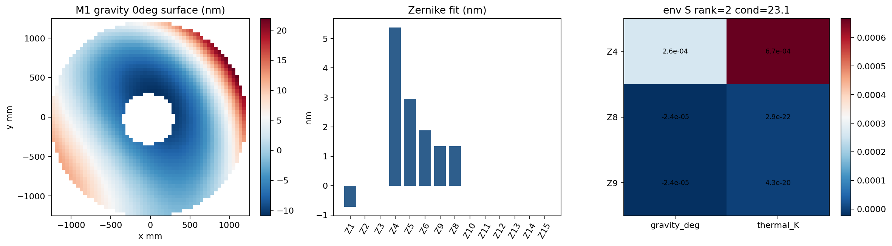

# FEA 案例与机械-光学灵敏度技术说明

> 合成参考工况 · 面形 → Zernike · 环境灵敏度


## 01 为什么先做合成工况

> 先打通软件链，再换真实 FEA。

暂时没有 FEA 文件，但设计资料已经给出了口径、支撑布局、材料、重力/热工况 RMS 和 66 项 Zernike 的工程结果。把这些锚点变成可计算的面形 map，可以先验证 surface map -> Zernike -> 灵敏度 -> Web 的全链路。

*表 1-1  设计锚点*

| 文档锚点 | 数值 | 来源 |
|---|---|---|
| M1 口径/中孔/厚度 | 2500 / 700 / 260 mm | 详细设计 p.109 |
| M1 支撑 | 36 底 + 24 侧 whiffletree | p.109-112 |
| M1 重力 RMS | 6.4873 nm / 23.199 nm | p.113-114 |
| M1 Zernike | 66 项 -> Zemax Sag | p.113-115 |
| M2 支撑 | 6 点悬挂，4.6/4.7 nm | p.124 |
| M3 支撑 | 45° 4.230 nm；竖直 1.726 nm | p.131 |
| 镜筒热变形 | 0.77 mm / 2.68 mm | p.137 |


## 02 生成的文件

> 可替换的数据契约。

*代码 2-1  目录*

```cpp
data/fea_cases/
  manifest.json
  README.md
  perturb.yaml
  M1_gravity_0deg.csv
  M1_gravity_90deg.csv
  M1_thermal_plus20K.csv
  M1_thermal_minus20K.csv
  M2_gravity_0deg.csv
  M2_gravity_90deg.csv
  M3_gravity_45deg.csv
  M3_gravity_90deg.csv
```

*代码 2-2  CSV 格式*

```cpp
x_mm,y_mm,dz_nm
-1250.0,-1250.0,0.123
```

manifest 记录 surface、load_case、口径/遮拦、目标/实际 RMS、来源页、假设、synthetic 标志。真实 FEA 只需替换 CSV 和改 synthetic=false。

*表 2-1  manifest 字段*

| 字段 | 用途 |
|---|---|
| synthetic | 禁止把合成结果当实测 |
| source_page | 回到设计文档核对 |
| aperture_radius_mm | Zernike 归一化半径 |
| obscuration_ratio | M1 环形遮拦 |
| load_case | 重力/热/支撑工况 |
| target/actual_rms_nm | 缩放与验收 |


## 03 面形 -> Zernike

> 15 项合成拟合，66 项是升级点。

在口径内对 z(x,y) 做最小二乘：A c = z；A 的列是 Zernike 多项式。当前实现 15 项 Noll-like 基，工程标签 j4->Z4、j7->Z9、j8->Z8；正式版扩展到 66 项，并同时输出工程标签/Noll 编号。

*代码 3-1  拟合*

```cpp
mask, A = zernike_basis(x, y, radius, n_terms=15)
coeff = lstsq(A, z[mask])
residual = z[mask] - A @ coeff
```

*表 3-1  标签映射*

| 项 | 工程标签 | 物理意义 |
|---|---|---|
| j4 | Z4 | 离焦 |
| j7 | Z9 | y 彗差（项目约定） |
| j8 | Z8 | x 彗差 |
| j5/j6 | Z5/Z6 | 像散 |

注意：项目 Z8/Z9 是 x/y 彗差，不是 Noll 的 Z8/Z9；输出必须双标签，避免和 Zemax 的 Noll 序号混用。



*图 3-1  M1 合成面形、15 项 Zernike 拟合、环境 S。*


## 04 环境灵敏度

> 重力角与温度的差分。

*代码 4-1  差分*

```cpp
S_gravity = (z(90deg) - z(0deg)) / 90
S_thermal = (z(+20K) - z(-20K)) / 40
```

*表 4-1  当前合成 S*

| target | gravity [waves/deg] | thermal [waves/K] |
|---|---|---|
| Z4 | 2.63e-4 | 6.67e-4 |
| Z8 | -2.36e-5 | ~0 |
| Z9 | -2.36e-5 | ~0 |

rank=2、condition≈23.07。热列接近零是因为合成热工况只有对称离焦；真实 FEA 后会变化。这不是 M2 5-DOF 的 Zemax 灵敏度，后者仍需 ZMX/ZOS-API。


## 05 API 与前端

> 可直接看效果。

*表 5-1  接口*

| 接口 | 输出 |
|---|---|
| GET /api/fea/cases | 工况列表/设计锚点/合成警告 |
| GET /api/fea/cases/{id} | 面形网格 + Zernike + Z4/Z8/Z9 |
| GET /api/fea/sensitivity | 3x2 环境 S + rank/condition |

前端“④ FEA 案例”区域：工况下拉、面形热力图、15 项 Zernike 柱状图、Z4/Z8/Z9 卡片、环境 S 热力图、合成参考黄条。


## 06 替换真实 FEA

> 只换数据，不改架构。

保持 manifest 字段，替换 CSV；synthetic=false；补 surface_id/coordinate_system/units；可选输出 66 项 Zernike；重新跑 /api/fea/sensitivity。

Web 服务不直接跑 ANSYS；建议离线求解后上传结果包，避免 license/大文件/沙箱问题。


## 07 边界

> 不要把合成数据写成实测。

- 不是 FEA 求解器，也不是 Zemax 光学模型；
- 当前 S 是环境变量差分，不是 M2 5-DOF 控制灵敏度；
- 热工况 RMS 是占位值；
- M3 矩形口径用圆口径近似；
- 66 项、刚体位移分离、镜面 2 倍光程是下一阶段验证点；
- 真实灵敏度必须用真实 FEA + Zemax 重新计算。
