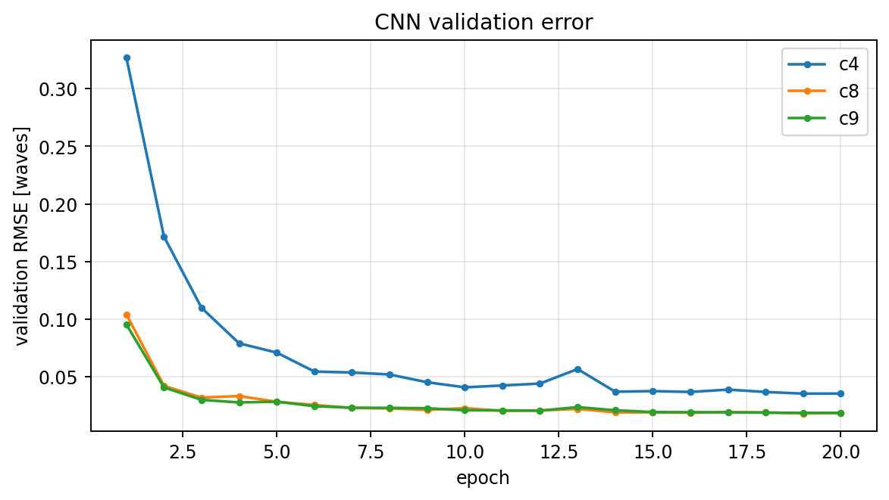

# CNN 从 5 帧 PSF 预测 Zernike 系数

> 代码：`ml/dataset.py`、`ml/model.py`、`ml/train_cnn.py`
> 目标：训练一个轻量 CNN，把 `(5, 64, 64)` 的离焦 PSF 堆栈映射到 `(c4, c8, c9)`，作为传统多起点优化的快速代理。

## 1. 为什么用 CNN

相位差反演是非线性最小二乘：每次评估都要做 5 次 FFT，传统多起点要几千次评估。CNN 把“反演”变成一次前向：

```
5 帧 PSF --CNN--> (c4,c8,c9)
```

它不一定比优化器更准，但**推理时间从秒级降到毫秒级**，适合：

- 实时/准实时监测；
- 给传统优化器提供初值（two-stage）；
- 大样本统计/异常检测。

本实验要回答三个问题：

1. CNN 能不能学到低阶像差与 PSF 形状的映射？
2. 在相同测试集上，精度和传统多起点差多少？
3. 速度差多少？

## 2. 数据

`PhaseDataset` 在线生成，不存大张量：

| 项 | 设置 |
|---|---|
| 网格/输出 | 64×64，oversample=2 |
| 帧数 | 5（d = -2,-1,0,1,2 waves） |
| c4 | U(-1.5, 1.5) waves |
| c8/c9 | U(-0.5, 0.5) waves |
| 噪声 | 每帧峰值的 1% 高斯 |
| 训练/验证 | 2048 / 256（不同 seed） |
| 归一化 | 每帧除以峰值；标签除以量程 |

为什么标签要归一化？三个系数量程差 3 倍（1.5 vs 0.5），不归一化会让 MSE 被 c4 主导；归一化后三项权重相当。

为什么输入要按峰值归一化？PSF `sum=1` 时峰值约 `1/n² ≈ 2.4e-4`，直接喂 CNN 会导致第一层梯度极小；按峰值归一化后输入 ~1，训练稳定。这个坑在第一次训练时表现为 loss 一直等于标签方差（模型输出常数）。

## 3. 模型

```text
input 5×64×64
  Conv(5→16,3)+ReLU + MaxPool2   → 16×32×32
  Conv(16→32,3)+ReLU + MaxPool2  → 32×16×16
  Conv(32→64,3)+ReLU + MaxPool2  → 64×8×8
  Conv(64→64,3)+ReLU
  AdaptiveAvgPool2d(4)           → 64×4×4
  Flatten + Linear(1024→128)+ReLU + Linear(128→3)
```

约 15 万参数。没有 BatchNorm/Dropout：数据量小、任务简单，先看 baseline；过拟合再补。

## 4. 训练

```bash
cd telescope_gpu
python3 -m ml.train_cnn --epochs 20 --samples 2048 --batch 64 --n 64
```

- 损失：归一化标签的 MSE；
- 优化器：Adam，lr=1e-3，CosineAnnealing；
- 验证：每轮算 denormalized RMSE（waves）；
- 保存验证集平均 RMSE 最好的 `ml/runs/cnn.pt`。

本机 CPU（4 线程）结果：

| epoch | val RMSE c4 | c8 | c9 | 累计时间 |
|---:|---:|---:|---:|---:|
| 1 | 0.327 | 0.104 | 0.095 | 9 s |
| 4 | 0.079 | 0.033 | 0.028 | 30 s |
| 8 | 0.052 | 0.022 | 0.023 | 59 s |
| 12 | 0.044 | 0.021 | 0.020 | 88 s |
| 16 | 0.037 | 0.019 | 0.019 | 117 s |
| 20 | **0.035** | **0.018** | **0.019** | 149 s |

解读：

- c8/c9 很快降到 0.02 waves（量程 0.5 的 4%）；
- c4 误差更大（0.035 waves），因为它的量程 1.5、且离焦与 defocus 帧的耦合更强；
- 继续训练/加数据还能降，但 MVP 先看趋势。



## 5. 推理

```python
import torch
from ml.model import ZernikeCNN
from ml.phase_torch import ForwardConfig, forward_stack

ckpt = torch.load("ml/runs/cnn.pt", map_location="cpu")
model = ZernikeCNN(); model.load_state_dict(ckpt["state_dict"]); model.eval()
c = torch.tensor([0.6, -0.2, 0.1])
stack = forward_stack(c, ForwardConfig(n=64), add_noise=True)
stack = stack / stack.amax(dim=(-2,-1), keepdim=True)
pred = model(stack.unsqueeze(0)).squeeze(0) * torch.tensor(ckpt["scales"])
print(pred)
```

注意：推理前的预处理必须和训练完全一致（峰值归一化、帧顺序、d 值）；否则精度会掉。

## 6. 边界

- 训练/测试同分布（均匀随机系数），不是真实望远镜统计；
- 只有 3 项低阶像差，不能外推到高阶；
- 1% 峰值噪声是简化模型；真实 CCD 是泊松+读出+背景；
- 没有星点叠加/质心误差，输入是理想 PSF 堆栈；
- CNN 不给不确定度；可用于初值/筛查，不能单独作为科学级反演。

单元测试（4 项）：

```bash
python3 -m unittest discover -s ml/tests -v
```

## 7. 和传统方法的关系

CNN 预测可以作为传统优化的初值：

```
CNN 一次前向 (ms) → 取 top-k 附近 → BOBYQA/least_squares 精修 (百 ms–s)
```

这通常比 40 个随机起点更高效，也比单独 CNN 更准；是后续最值得做的 two-stage 方案（见第 4 篇）。
