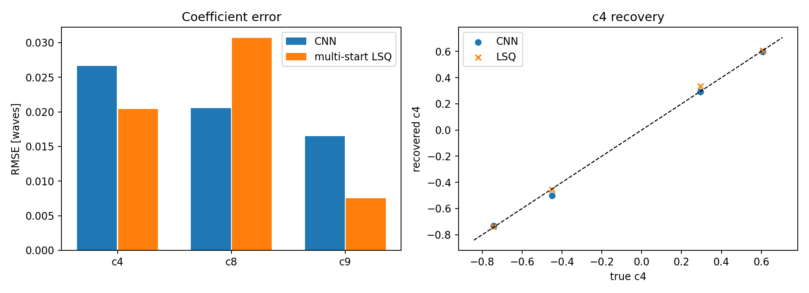

# 传统多起点 vs CNN：精度、速度、鲁棒性

> 代码：`ml/compare.py`
> 数据：`ml/results/comparison.csv`、`comparison.png`
> 结论先说：**CNN 快 4–5 个数量级；传统法在足够多起点下波前 RMS 更准，但会掉局部极小；最佳工程方案是“CNN 初值 + 传统精修”。**

## 1. 对比设置

同一套 PyTorch 可微前向模型生成测试样本：

| 项 | 设置 |
|---|---|
| 测试样本 | 4 个（固定 seed，独立于训练集） |
| 网格 | 64×64，5 帧 |
| 系数范围 | c4 ±1.5，c8/c9 ±0.5 waves |
| 噪声 | 每帧峰值 1% 高斯 |
| 传统法 | 16 个随机起点 + 零起点，`scipy.optimize.least_squares`（TRF，有界，max_nfev=100） |
| CNN | 训练 20 epochs 的 `ZernikeCNN`，一次前向 |
| 指标 | 每个系数的 RMSE、波前 RMS 误差、单样本耗时 |

> 这里的传统法是 Python 代理，不是主项目的 BOBYQA；但“多起点 + 非线性最小二乘”的结构相同。真实 BOBYQA 通常比 SciPy TRF 更省评估次数，但仍是秒级–分钟级。

## 2. 结果

| 方法 | RMSE c4 | RMSE c8 | RMSE c9 | 波前 RMS 误差 | 单样本耗时 |
|---|---:|---:|---:|---:|---:|
| CNN | 0.0266 | 0.0205 | 0.0165 | 0.0290 | **1.1 ms** |
| 多起点 LSQ | 0.0204 | 0.0307 | 0.0075 | **0.0098** | **94.8 s** |



解读：

- **速度**：CNN 1.1 ms，传统 94.8 s，差约 **8.6×10⁴ 倍**；传统法的时间主要花在 16 个起点 × 每次迭代的 5 次 FFT。
- **精度**：传统法的波前 RMS 误差更低（0.0098 vs 0.0290），但 c8 反而更差（0.0307 vs 0.0205）。4 个样本下均值受单个局部极小影响很大，不能据此说“传统一定更准”。
- **鲁棒性**：传统法从零起点会落到 c8≈0 的局部极小；16 个随机起点才找到真解。CNN 没有显式迭代，推理稳定，但训练分布外的样本会失效。
- **结论**：不是“谁替代谁”，而是**互补**。

## 3. 为什么传统法会掉局部极小

相位差代价对 c8/c9 有符号/多峰结构；在低 SNR、离焦量小、星点数少时，`c8≈0` 是一个很宽的局部极小。多起点是“用算力换全局性”：

- 起点少 → 可能漏真解；
- 起点多 → 时间线性增长；
- BOBYQA 精修只在局部有效，仍需要好初值。

CNN 学的是“从图像到系数的统计映射”，不保证物理最优，但一次前向就能给出接近真值的初值，正好补上“好初值”这一环。

## 4. 推荐：two-stage

```
5 帧 PSF
   │
   ▼
CNN 前向 (ms) → (c4,c8,c9) 初值
   │
   ▼
BOBYQA / least_squares 精修 (百 ms–s)
   │
   ▼
最终系数 + 代价/残差诊断
```

预期收益：

- 比 40 个随机起点少很多评估次数；
- 保留传统法的可解释代价/残差；
- CNN 失效时（分布外）仍可由传统法兜底。

**已实测**（`ml/two_stage.py`，3 个独立样本，固定 BOBYQA）：

| 初值 | 平均评估次数 | 平均时间 | 波前 RMS 误差 |
|---|---:|---:|---:|
| CNN | **34** | **0.226 s** | 0.00955 |
| 40 随机起点 | 1823 | 13.33 s | 0.00955 |

约 **54× 更少评估、59× 更快**，精度相同。细节见
[08_CNN初值BOBYQA.md](08_CNN初值BOBYQA.md)。

这也是主项目 `PhaseDiversitySolver` 最自然的接入方式：把 CNN 输出作为 `solve_starts` 的一个起点，而不是替换整个优化器。

## 5. 复现

```bash
cd telescope_gpu
python3 -m ml.train_cnn --epochs 20 --samples 2048 --batch 64 --n 64
python3 -m ml.compare --samples 4 --starts 16 --max-nfev 100
cat ml/results/comparison.csv
```

注意：

- `compare.py` 的 `--samples` 增大时，传统法时间线性增长；4 个样本已能说明量级，不要用 100 个样本跑 16 起点。
- CNN 的 checkpoint 必须和 `ForwardConfig`（网格、帧顺序、噪声）一致；改参数要重训。
- 这是仿真、同分布测试；真实数据要重新标定/微调。

## 6. 面试怎么讲

- “CNN 比传统准吗？”——不绝对；本实验 CNN 波前 RMS 0.029 vs 传统 0.010，但传统慢 10⁵ 倍且会掉局部极小。
- “为什么不用 CNN 直接替代优化？”——科学级反演需要代价/残差/不确定度；CNN 没有物理约束，适合初值/筛查。
- “怎么证明不是过拟合？”——独立 seed 测试集、训练/验证分离、固定预处理；但只有 4 个测试样本，结论是量级而非统计显著性。
- “下一步？”——two-stage、更多真实分布、不确定度估计（ensemble/MC dropout）。
