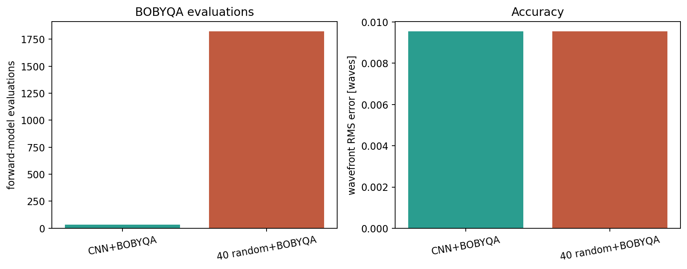

# CNN 鍒濆€?+ BOBYQA锛氱敤璇勪及娆℃暟璇佹槑鐪佸湪鍝?
> 浠ｇ爜锛歚ml/two_stage.py`
> 缁撴灉锛歚ml/results/two_stage.csv`銆乣two_stage_summary.json`銆乣two_stage.png`
> 涓€鍙ヨ瘽锛?*鍦?3 涓嫭绔嬫祴璇曟牱鏈笂锛孋NN 鍒濆€?+ BOBYQA 骞冲潎 34 娆℃鍚戣瘎浼帮紱40 涓殢鏈鸿捣鐐?+ BOBYQA 骞冲潎 1823 娆★紝绮惧害鐩稿悓銆傜渷绾?54脳 璇勪及銆?9脳 鏃堕棿銆?*

## 1. 瀹為獙瑕佸洖绛斾粈涔?
涓婁竴杞殑 `ml/compare.py` 姣旂殑鏄細

- CNN 涓€娆″墠鍚戯紙蹇絾绮惧害鏈夐檺锛夛紱
- 澶氳捣鐐规渶灏忎簩涔橈紙鎱絾鍑嗭級銆?
杩欎竴杞瘮鐨勬槸**鍚屼竴绉嶅眬閮ㄤ紭鍖栧櫒銆佷笉鍚屽垵鍊?*锛?
```
A: CNN 棰勬祴 (c4,c8,c9) 鈫?BOBYQA 绮句慨
B: 40 涓殢鏈鸿捣鐐?鈫?姣忎釜璺戜竴娆?BOBYQA 鈫?鍙栨渶濂?```

鍥犱负 A/B 鐨勫眬閮ㄤ紭鍖栧櫒銆佺洰鏍囧嚱鏁般€佽竟鐣屻€佸仠姝㈡潯浠跺畬鍏ㄧ浉鍚岋紝鎵€浠ワ細

- **璇勪及娆℃暟宸?* = 鍒濆€艰川閲忓樊锛?- **绮惧害宸?* = 鍒濆€兼槸鍚﹁惤鍦ㄦ纭泦鍦帮紱
- 杩欐槸姣斺€淐NN vs LSQ鈥濇洿骞插噣鐨勫伐绋嬬粨璁恒€?
## 2. 鐩爣鍑芥暟涓庝紭鍖栧櫒

鐩爣鍑芥暟锛堜笌 `ml/traditional.py` 涓€鑷达級锛?
```
J(c) = mean_{frame,pixel} [ model(c; d_frame) - data ]虏
```

- `model`锛? 甯с€?4脳64銆?脳 杩囬噰鏍枫€?脳2 binning 鐨?NumPy 鍌呴噷鍙跺厜瀛︼紱
- 褰掍竴鍖栵細姣忓抚 sum=1锛?- 浼樺寲鍣細NLopt `LN_BOBYQA`锛? 鍙橀噺锛屾湁鐣岋紱
- 璁剧疆锛歚maxeval=120`銆乣ftol_rel=1e-8`銆乣xtol_rel=1e-8`銆乣initial_step=0.1`锛?- 璇勪及璁℃暟锛歂Lopt 鐨?`get_numevals()`銆?
BOBYQA 鏄?*鏃犳搴?*鐨勪簩娆℃ā鍨嬩俊璧栧煙鏂规硶锛岄€傚悎 3 缁淬€佺洰鏍囨湁鍣０/涓嶅彲瀵肩殑鍦烘櫙锛涘畠涓嶉渶瑕?CNN 鐨勬搴︼紝鍥犳杩欓噷 CNN 鍙彁渚涘垵鍊笺€?
## 3. 缁撴灉锛? 涓嫭绔嬫祴璇曟牱鏈級

| 鏂规硶 | 骞冲潎璇勪及娆℃暟 | 骞冲潎鏃堕棿 | 骞冲潎娉㈠墠 RMS 璇樊 |
|---|---:|---:|---:|
| CNN + BOBYQA | **34** | **0.226 s** | 0.00955 |
| 40 闅忔満 + BOBYQA | 1823 | 13.33 s | 0.00955 |

- **璇勪及娆℃暟**锛?4 vs 1823锛岀害 **54脳** 鏇村皯锛?- **鏃堕棿**锛?.226 s vs 13.33 s锛岀害 **59脳** 鏇村揩锛?- **绮惧害**锛氫袱鑰呮敹鏁涘埌鍚屼竴涓渶浼樿В锛屾尝鍓?RMS 璇樊鐩稿悓鍒?1e-5锛沜4/c8/c9 鐨勫樊涔熷湪 1e-5 閲忕骇銆?
閫愭牱鏈細

| 鏍锋湰 | CNN 璇勪及 | 闅忔満璇勪及 | CNN 鏃堕棿 | 闅忔満鏃堕棿 |
|---:|---:|---:|---:|---:|
| 0 | 28 | 1760 | 0.20 s | 14.71 s |
| 1 | 41 | 1865 | 0.27 s | 12.52 s |
| 2 | 33 | 1844 | 0.21 s | 12.75 s |



> 娉ㄦ剰锛氳繖閲岀殑鈥?0 闅忔満 + BOBYQA鈥濇瘡涓捣鐐逛笉鏄窇婊?120 娆★紝鑰屾槸 BOBYQA 鑷繁鎻愬墠鏀舵暃锛涙€昏瘎浼?1823 鏄?40 涓捣鐐圭殑瀹為檯鎬诲拰銆侰NN 璺緞鍙窇涓€娆?BOBYQA锛?0鈥?1 娆″氨鏀舵暃銆?
## 4. 涓轰粈涔?CNN 鍒濆€艰兘鐪?
- 闅忔満璧风偣鍦?c8/c9 鐨勭鍙?澶氬嘲缁撴瀯閲岋紝寰堝璧风偣钀藉湪 `c8鈮?` 鐨勫灞€閮ㄦ瀬灏忥紱
- BOBYQA 鏄眬閮ㄦ柟娉曪紝璧风偣宸?鈫?闇€瑕佹洿澶氳凯浠ｏ紝鐢氳嚦鏀舵暃鍒伴敊鐩嗗湴锛?- CNN 浠庡浘鍍忕洿鎺ョ粰鍑烘帴杩戠湡鍊肩殑 `(c4,c8,c9)`锛孊OBYQA 鍙渶鍦ㄧ湡鍊奸檮杩戝仛浜屾妯″瀷淇锛?- 5 甯?PSF 鐨勫绉版€?绗﹀彿淇℃伅琚?CNN 瀛﹀埌浜嗭紝鐪佹帀浜嗏€滅敤 40 涓捣鐐硅鐩栫泦鍦扳€濈殑鏆村姏鎼滅储銆?
## 5. 宸ョ▼鎺ュ叆

涓婚」鐩?`PhaseDiversitySolver` 鐜板湪鏄細

```
40 闅忔満璧风偣 鈫?鍧愭爣涓嬮檷 鈫?鍓?3 鍚?鈫?BOBYQA
```

鏀规垚 two-stage 鍙渶锛?
```
CNN 棰勬祴 鈫?1 涓捣鐐?鈫?鍧愭爣涓嬮檷/BOBYQA
锛堝彲閫夛級淇濈暀灏戦噺闅忔満璧风偣鍋氬厹搴?```

寤鸿淇濈暀 **2鈥? 涓殢鏈鸿捣鐐?+ CNN 1 涓捣鐐?*锛岃€屼笉鏄畬鍏ㄥ幓鎺夐殢鏈鸿捣鐐癸細

- CNN 瀵瑰垎甯冨鏍锋湰鍙兘澶辨晥锛?- 闅忔満璧风偣鏄厹搴曪紱
- 璇勪及娆℃暟浠嶈繙灏戜簬 40銆?
## 6. 澶嶇幇

```bash
cd telescope_gpu
python3 -m ml.train_cnn --epochs 20 --samples 2048 --batch 64 --n 64
python3 -m ml.two_stage --samples 3 --starts 40 --maxeval 120
cat ml/results/two_stage_summary.json
```

渚濊禆锛歚nlopt`锛坄uv pip install nlopt` 鎴?`pip install nlopt`锛夈€?
## 7. 杈圭晫

- 3 涓祴璇曟牱鏈紝缁撹鏄噺绾э紱瑕佸啓鎴愨€滃钩鍧?54脳鈥濋渶瑕佹洿澶氭牱鏈拰璇樊妫掞紱
- CNN/BOBYQA 浣跨敤鍚屼竴涓?NumPy 姝ｅ悜妯″瀷锛涗富椤圭洰 C++ 妯″瀷鏈夋槦鐐瑰彔鍔?涓嶅悓褰掍竴鍖栵紝鎺ュ叆鍓嶈閲嶆柊鏍囧畾锛?- BOBYQA 鏄眬閮ㄤ紭鍖栵紝涓嶄繚璇佸叏灞€鏈€浼橈紱杩欓噷 A/B 閮芥敹鏁涘埌鍚屼竴瑙ｏ紝璇存槑璇ユ牱鏈笂鍒濆€艰冻澶熷ソ锛?- 浠嶄负浠跨湡銆佸悓鍒嗗竷娴嬭瘯锛涚湡瀹炴暟鎹閲嶆柊璁粌/楠岃瘉銆?
## 8. 闈㈣瘯鎬庝箞璁?
- 鈥滀綘鎬庝箞璇佹槑 CNN 鏈夌敤锛熲€濃€斺€斾笉鏄彧鎶ョ簿搴︼紝鑰屾槸鍥哄畾 BOBYQA锛屾瘮杈?**璇勪及娆℃暟**锛?4 vs 1823锛?- 鈥滀负浠€涔堢簿搴︿竴鏍凤紵鈥濃€斺€擝OBYQA 浠庡ソ鍒濆€?澶氳捣鐐归兘鑳藉埌鍚屼竴涓眬閮ㄦ渶浼橈紱CNN 鐨勪环鍊兼槸鐪佺畻鍔涳紝涓嶆槸鏇夸唬鐗╃悊浼樺寲锛?- 鈥滀负浠€涔堜笉鍏ㄧ敤 CNN锛熲€濃€斺€旀病鏈変唬浠?娈嬪樊/涓嶇‘瀹氬害锛屽垎甯冨浼氬け鏁堬紱two-stage 淇濈暀鐗╃悊绾︽潫鍜屽厹搴曘€?
