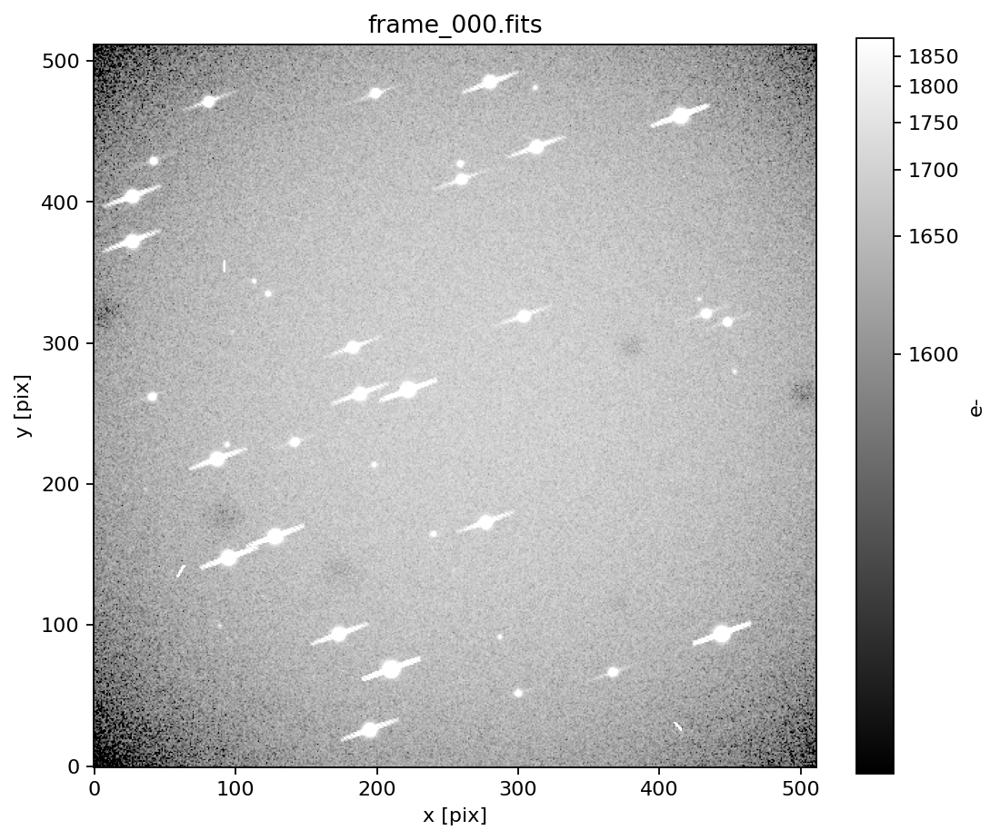

# CCD 图像真实感：从高斯 PSF 到 phosim 风格

> 代码：`pipeline/realistic.py`
> 命令：`python3 -m pipeline.realistic --out data/realistic --frames 5 --stars 40`
> 预览：`docs/figs/fig_realistic_preview.png`

## 1. 为什么默认仿真看起来“不像 CCD”

默认 `pipeline/simulate.py` 为了检测/质心/天体测量的可复现性，用了：

- 二维高斯 PSF（σ=1.6 pixel）；
- 单像素宇宙线；
- 简单渐晕平场；
- 没有饱和/ blooming；
- 1″/pixel 的欠采样像元。

这会让星点像“模糊圆点”，没有真实 CCD 的：

- 大气seeing 的重翼（Moffat）；
- 亮星的衍射星芒；
- 饱和溢出/ blooming；
- 宇宙线轨迹；
- 热像素/坏像素；
- 背景梯度/散射光；
- 平场灰尘/照明不均。

## 2. `realistic.py` 加了什么

| 效应 | 实现 | 物理依据 |
|---|---|---|
| Moffat PSF | `(1+r²/α²)^(-β)`，β=3.5 | 大气 seeing 的重翼比高斯更真实 |
| 衍射星芒 | 亮星沿 4 个方向加细线 | 次镜支撑/光阑衍射 |
| 饱和 + blooming | 超过 full well 的电荷沿行/列扩散 | CCD 势阱溢出 |
| 宇宙线轨迹 | 随机方向、长度 3–14 pixel 的线段 | 高能粒子穿过探测器 |
| 热/坏像素 | 随机 hot pixel 加暗电流，dead pixel 置零 | 探测器缺陷 |
| 背景梯度 | 线性梯度 + 散射光 | 天空/杂散光 |
| 平场灰尘 | 6 个高斯凹陷 + 渐晕 + 小尺度增益 | 滤光片/窗口灰尘 |
| 噪声 | 泊松 + 暗电流 + 读出噪声 + 偏置 | CCD 标准噪声链 |



## 3. 运行

```bash
cd telescope_gpu
python3 -m pipeline.realistic --out data/realistic --frames 5 --stars 40
```

输出：

```
data/realistic/raw/frame_*.fits
data/realistic/calib/bias.fits, dark.fits, flat.fits
data/realistic/catalog.csv, truth.csv, dataset.json
data/realistic/preview.png
```

预览用 `astropy.visualization` 的 ZScale + Asinh 拉伸，避免亮星把暗背景压黑；FITS 里仍是线性 e−。

## 4. 怎么继续逼近 phosim

phosim 的“真实感”不是单一 PSF，而是 **光学设计 + 探测器 + 电子学** 的组合。按收益排序：

1. **PSF**：用 Zemax/poppy 的真实光瞳（含次镜支撑、孔径、像差）生成 PSF 立方；或至少用 Moffat + 星芒。
2. **采样**：0.2″/pixel + 过采样 4，避免欠采样；当前默认 1″/pixel 是为检测可读性。
3. **探测器**：full well、增益（e−/ADU）、CTE、电荷扩散、像素响应非均匀、persistence。
4. **噪声**：泊松 + 暗电流 + 读出 + 1/f；偏置/平场要有多帧 master。
5. **宇宙线/热像素**：轨迹而不是单点；hot pixel 随温度/时间变化。
6. **背景**：月相/气辉/散射光/杂散光；不是常数。
7. **显示**：ZScale/Asinh/log，不要让预览的线性拉伸误导“图像质量”。

## 5. 和主项目/报告的关系

- 默认 `simulate.py` 仍用于 CCD 管线的可复现指标（0.85 检测率等）；
- `realistic.py` 是 **视觉/数据真实感** 扩展，不改变主报告 256²/15 星相位差结果；
- 用 `realistic.py` 生成的数据可以送 `preprocess.py`/`detect.py`，但阈值/星表匹配要重新调；
- 若要把真实感图像用于科学级反演，必须用真实光学 PSF，而不是 Moffat 近似。

## 6. 边界

- 不是 phosim：没有真实 Zemax 光路、没有 CTE/电荷扩散/非线性；
- Moffat β/FWHM 是经验参数，不是 2.5 m 望远镜实测；
- 饱和/blooming 是简化模型，真实 CCD 还受读出模式/antiblooming 影响；
- 预览是显示拉伸，FITS 数据仍是线性 e−；不要用预览图做测光。
