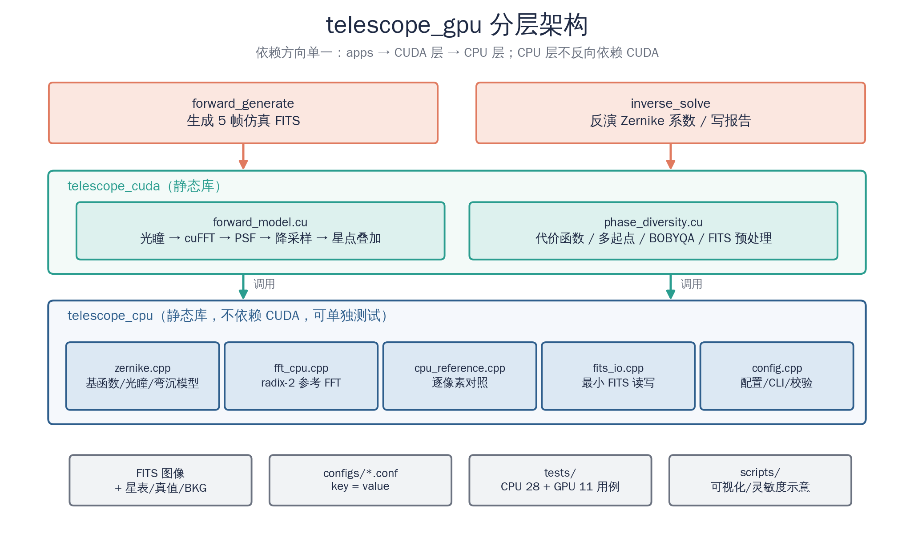
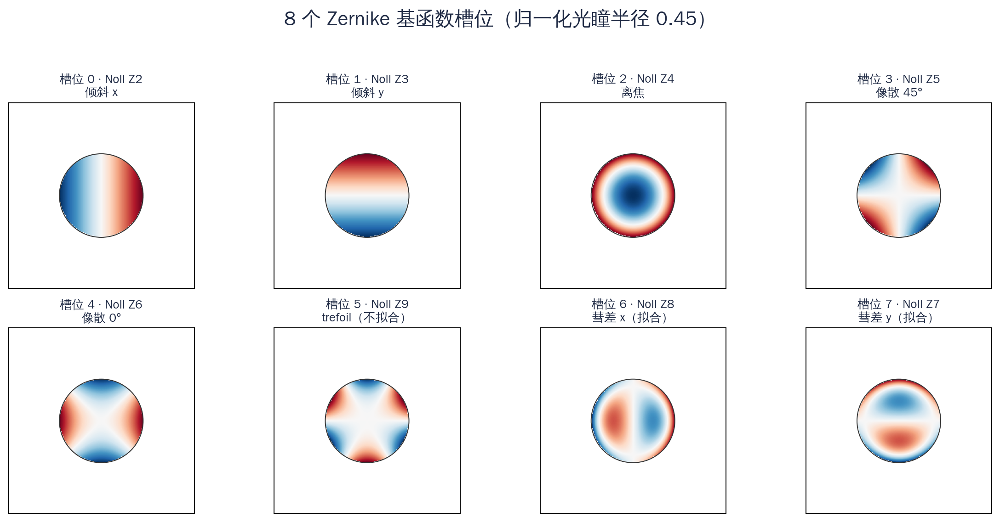
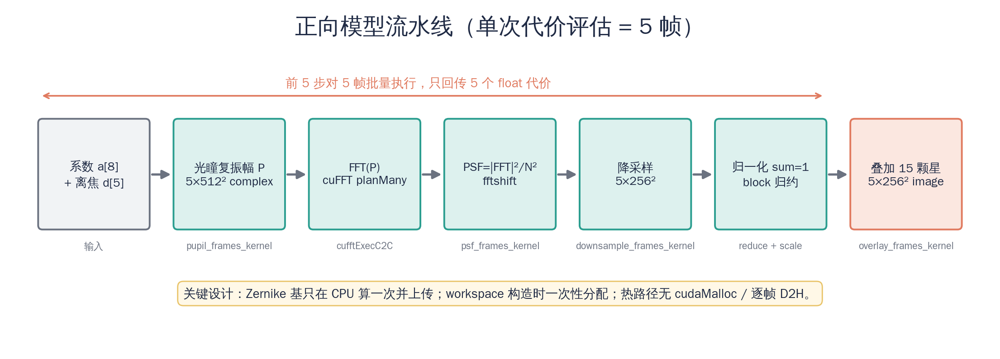
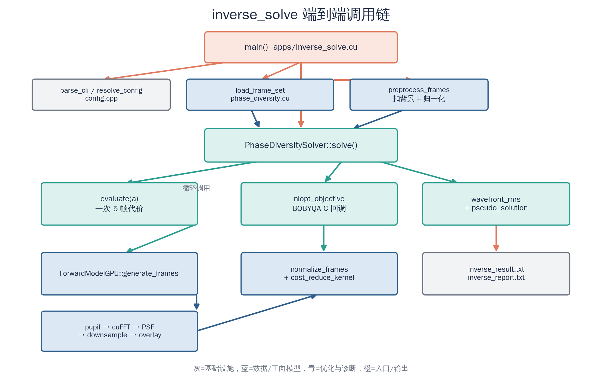
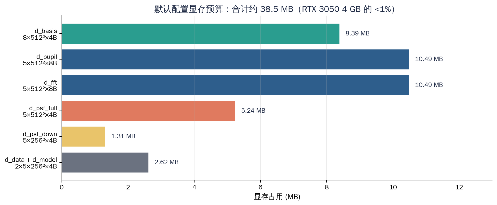
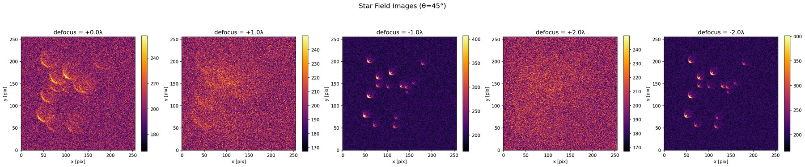
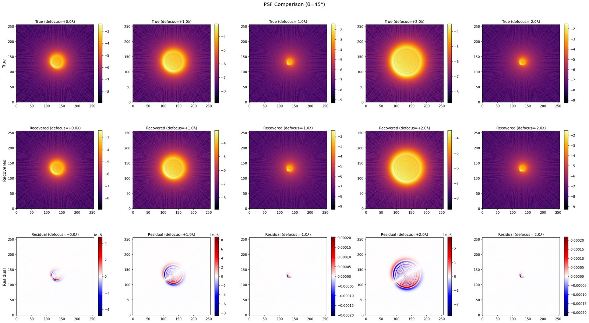
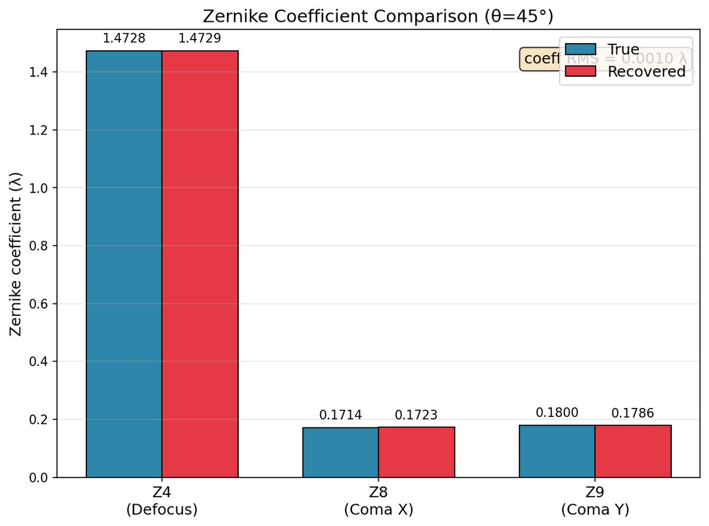
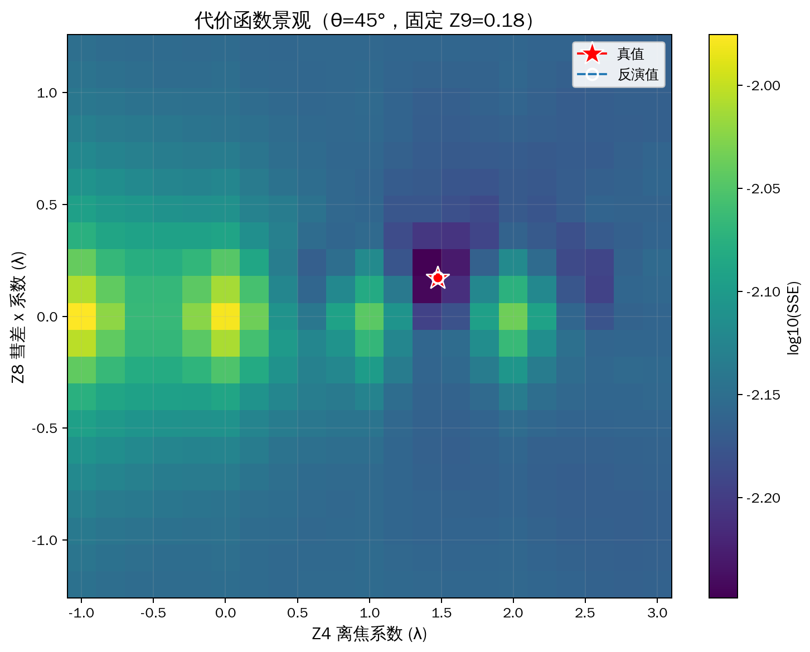

# 大口径望远镜重力变形标定

> telescope_gpu v2.1 代码说明 · 架构复盘 · 面试讲解


## 序 阅读地图

> 这不是一份 API 手册，而是一份“能讲出来”的代码复盘。

*表 0  阅读地图。时间紧就读 00 → 01 → 02 → 08.4 → 11.2 → A.6。*

| 章节 | 回答什么问题 | 什么时候读 |
|---|---|---|
| 00 一页速览 | 项目是什么、结果多少、边界在哪 | 先读，3 分钟 |
| 01 科学问题 | 为什么需要标定、为什么选相位差法 | 面试前必须能讲 |
| 02 总体架构 | 为什么分层、目录/构建/数据流 | 建立全局图 |
| 03 数学基础 | 正向模型、Zernike、代价函数、RMS | 看不懂代码时回来查 |
| 04 逐模块精读 | 每个文件/函数在做什么 | 精读，配合源码 |
| 05 调用链 | 一次反演从 main 到 kernel 的完整路径 | 讲框架时用 |
| 06 设计决策 | 为什么这样设计、替代方案/代价 | 面试“为什么”题库 |
| 07 代码审查 | 发现了什么 bug、怎么修、怎么验证 | 最值钱的一章 |
| 08 数值实验 | 结果、多角度、与 PPT 的差异 | 答辩/面试前核对数字 |
| 09 性能 | 工作量、实测、优化、下一步 | CUDA 岗重点 |
| 10 测试 | 测试金字塔、不变量、怎么加测试 | 工程岗重点 |
| 11 面试训练 | 3/8/20 分钟稿、白板、30+ 追问 | 面试前反复练 |
| 12 方法论 | 从脚本到工程、四周计划、第二个项目 | 长期提升 |
| 附录 | 术语/配置/API/命令/行号/一页纸 | 速查 |

> **三种读法**  
> **30 分钟**：00、01、02、08.1–08.4、11.2、A.6；**2 小时**：全部，跳过代码细节；**面试前**：03.5（RMS 定义）、07（bug 故事）、08.4（PPT 差异）、11（问答）、A.6。

文中的“行号”以 2026-10-28 的 v2.1 源码为准；代码继续演进后行号会漂移，以函数名为准。所有数字都可以用第 8.5 节的命令复现。


## 00 一页速览

> 先用 3 分钟建立全局印象：这个项目解决什么问题、代码怎么分层、哪些数字可信、哪些地方不能吹。

**一句话**：在没有波前传感器和主动光学的工程约束下，用 5 帧已知离焦量的星场图，通过 GPU 加速的傅里叶光学正向模型与多起点优化，反演出重力变形引起的低阶 Zernike 像差（离焦 + x/y 彗差），并用已知真值的仿真闭环验证整条链路。

*表 0-1  当前仓库的可复现结果。注意：这是仿真精度，不是实测精度。*

| 维度 | 当前结果（v2.1，θ=45°） | 说明 |
|---|---|---|
| 反演变量 | Z4 / Z8 / Z9（3 个） | 工程编号；物理上是离焦 + x 彗差 + y 彗差 |
| 波前 RMS | **0.0017 λ** | 仿真、已知真值、含泊松+读出噪声 |
| 系数误差 | 0.0001 / 0.0009 / 0.0014 λ | Z4 / Z8 / Z9 |
| 单次反演 | 约 7.3 s，5692 次正向评估 | RTX 3050 Laptop 4 GB |
| 数据规模 | 5 帧 × 256²，15 颗星 | FFT 512²，2 倍过采样 |
| 测试 | CPU 28 + GPU 11，全部通过 | ctest；含错误路径与交叉验证 |

> **先记住三个数字**  
> 0.0017 λ 是波前 RMS；5692 是 45° 一次反演调用正向模型的次数；38.5 MB 是默认配置的显存占用。面试时用这三个数字把“精度、代价、资源”讲清楚，比堆砌“我用了 CUDA”有说服力。


### 0.1 五个设计决策

- **CPU/GPU 分层**：Zernike、FFT 参考实现、FITS、配置不依赖 CUDA，可以在没有 GPU 的机器上编译和测试；CUDA 层只放正向模型和优化器。依赖方向单一。
- **基函数预计算**：8 个 Zernike 基在 CPU 上算一次、上传一次；GPU 每次评估只做线性组合，不在 kernel 里重复算多项式。
- **批量 + 常驻显存**：5 帧一次 `cufftPlanMany`，workspace 构造时分配，热路径没有 `cudaMalloc`、没有逐帧 D2H。
- **数据自描述**：FITS 头部写入星点表、真值、背景、角度、离焦量；反演端不靠“猜生成参数”，并校验帧间一致性。
- **正确性优先**：用 `cost(true)` 作为下界、用伪解标记做诊断、用 CPU 参考实现逐像素对照 GPU；先保证数值链路正确，再谈性能。


### 0.2 三条面试主线

*表 0-2  面试时按“问题—实现—判断”三层讲，不要从 CMake 开始讲。*

| 主线 | 一句话讲法 | 支撑材料 |
|---|---|---|
| 科学问题 | 重力让主次镜相对位置变化，产生离焦/彗差；没有波前传感器，所以用相位差法从图像反演。 | 第 1 章、第 3 章 |
| 工程实现 | 把 AI 辅助生成的单文件脚本重构成 CPU/GPU 两层库，加配置、FITS 自描述、测试和错误处理。 | 第 2、4、5、6 章 |
| 数值判断 | 端到端结果比真值代价还低，用交叉代价矩阵和半波整流偏置分析定位到预处理 clamp 负值。 | 第 7 章、第 11 章 |


### 0.3 诚实边界（先主动说，别被追问）

- 这是**已知真值的仿真**，不是实测望远镜数据；真实数据的背景/平场/暗场、星点提取、模型失配都没有覆盖。
- 仓库只实现技术路线的第 ① 步（相位差反演）；灵敏度矩阵 IM 和 19 点查找表是外部/后续工作，代码里没有。
- 只拟合 3 个低阶项；没有噪声加权、没有目标谱解析消元、没有多候选批量评估。
- 性能只做了“去掉明显浪费”的工程优化，没有系统的 roofline / Nsight 前后对比，简历不要写“加速 X 倍”。
- 代码是在 AI 辅助生成的基线上重构和修复的；面试时要能解释每个关键函数，而不是只说“我跑通了”。


## 01 科学问题与系统边界

> 先把“为什么需要这套代码”讲清楚。技术细节可以后面补，问题定义错了，后面全错。


### 1.1 重力变形为什么会变成波前误差

大口径望远镜在俯仰过程中，主镜、次镜和支撑桁架受到的**重力方向相对镜面在变化**。即使结构刚度很高，仍会产生微米级的弹性变形和刚体位移：主次镜间距变化、横向错位、光轴倾斜，以及镜面面形自身的低阶弯曲。这些变化叠加到光波上，就是波前误差。

对 2.5 m 级望远镜，重力变形的主要成分集中在低阶：**离焦（Z4）**和**彗差（Noll Z7/Z8，本项目的 Z8/Z9）**。高阶项幅值小、与低阶耦合弱，所以本项目只反演这 3 项。这不是“只能做 3 项”，而是“先用 3 项把闭环跑通”。

*表 1-1  从结构变形到图像的链路。代码从“Zernike 真值”开始，结构力学不在仓库内。*

| 环节 | 物理量 | 在代码中的位置 |
|---|---|---|
| 俯仰角变化 | θ（0°~90° 等） | `Config::theta_deg`、`make_aberration_model(theta)` |
| 结构变形 | 主次镜间距/偏心/倾斜 | 被参数化为 Zernike 系数真值 |
| 波前误差 | Φ(x,y)=Σ aₖZₖ | `ZernikeCoeffs`、`PupilGrid::basis` |
| 成像结果 | 离焦星点图 | `ForwardModelGPU::generate_frames` |
| 观测量 | CCD 强度图 + 噪声 | FITS 文件 |


### 1.2 为什么选相位差法，而不是 Shack-Hartmann 或干涉

*表 1-2  方案对比。相位差法的优势是“不依赖额外硬件”，代价是“计算换硬件”。*

| 方案 | 原理 | 优点 | 代价 / 为什么不用 |
|---|---|---|---|
| 干涉测量 | 参考光与测试光干涉，解算条纹相位 | 精度高、直接测相位 | 需要额外参考光路，对振动/气流敏感，工程改造大 |
| Shack-Hartmann | 微透镜阵列测波前斜率 | 实时、成熟 | 需要专用波前传感器和分光光路；本项目工程约束里没有 |
| 相位差法 | 拍多帧已知离焦的星场图，用正向模型拟合 | 只用焦面/离焦 CCD，不改光路 | 需要多帧采集和迭代反演；对噪声/模型误差敏感 |

面试时不要只说“相位差法先进”。更准确的说法是：**在“没有波前传感器、但有离焦机构和科学 CCD”的约束下，相位差法是硬件改动最小、能落地的一种选择；它的风险转移到算法和标定上。**


### 1.3 系统的输入、输出与成功标准

*表 1-3  输入输出与验收标准。*

| 项目 | 内容 | 备注 |
|---|---|---|
| 输入 | 5 帧不同离焦量的星场 FITS + 头部星表/真值/背景 | 仿真由 `forward_generate` 生成；实测需替换为相机图像 |
| 输出 | Z4/Z8/Z9、波前 RMS、代价、伪解标记、报告 | `inverse_result.txt` + `inverse_report.txt` |
| 成功标准（仿真） | 反演系数接近真值；`cost(true)` 接近最小；RMS 远小于 0.01 λ | 不是“图好看”，而是数值可检验 |
| 失败信号 | 最终代价显著低于 `cost(true)`；系数顶在边界；帧间代价异常 | 程序会打印/标记，见第 7 章 |


### 1.4 仓库在全链条中的位置

研究报告的技术路线是四步：**测量 → 建模 → 求解 → 标定**。仓库实现的是第 ① 步（相位差波前反演），并把第 ② 步需要的接口留出来；灵敏度矩阵 IM 和 19 点查找表目前不在代码里。

*表 1-4  代码边界。面试时主动说“我只做了第 ① 步”，比被问出来好。*

| 步骤 | 报告中的内容 | 仓库状态 |
|---|---|---|
| ① 测量 | 5 帧离焦星点 → 相位差反演 Zernike | **已实现**，`forward_generate` + `inverse_solve` |
| ② 建模 | Zemax 逐自由度扰动 → 3×5 灵敏度矩阵 IM | **未实现**；`scripts/plot_sensitivity.py` 只画示意图 |
| ③ 求解 | 最小二乘 û=(IMᵀW IM)⁻¹IMᵀW z | 公式在文档中，代码未接入 |
| ④ 标定 | 19 个俯仰角 → 查找表 → 前馈补偿 | **未实现**；当前只做单角度反演 |

> **报告与代码的一个关键差异**  
> PPT 第 17 页写的是 Gonsalves 形式的解析代价函数（消去目标谱 S），而仓库实现的是图像域 SSE：先逐帧归一化，再算 Σ(d̃−m̃)²。两者不是同一个公式。原因见 3.3 节：本项目的“目标”就是星场本身，图像域 SSE 更直接，也更容易加噪声权重；但面试时如果被问“你的代价函数和报告公式为什么不一样”，必须能解释清楚，不能混为一谈。


## 02 总体架构：为什么不是一个 main.cpp

> 架构不是“文件多”，而是“依赖方向清楚、每一层可独立验证、坏数据早失败”。



*图 2-1  分层架构。apps 只负责编排；CUDA 层只放必须上 GPU 的正向模型和优化器；CPU 层可单独编译测试。*


### 2.1 三层职责

*表 2-1  分层职责。依赖方向只有 apps → CUDA → CPU，没有反向依赖。*

| 层 | 目标文件 | 职责 | 不做什么 |
|---|---|---|---|
| 应用层 | `forward_generate`、`inverse_solve` | 读配置、编排流程、写结果/报告 | 不实现算法，不直接写 kernel |
| CUDA 层 | `libtelescope_cuda.a` | 正向模型、代价函数、预处理、优化器、FITS 帧加载 | 不解析命令行，不打印业务报告 |
| CPU 层 | `libtelescope_cpu.a` | Zernike/光瞳、CPU FFT、参考正向模型、FITS、配置 | 不依赖 CUDA/cuFFT/NLopt |

这样拆的直接收益：**没有 GPU 的 CI/笔记本也能编译 CPU 层并跑 28 个单元测试**；GPU 层的问题可以用 CPU 参考实现逐像素对照，而不是“只能看最终图”。


### 2.2 目录与文件地图

*表 2-2  文件地图。面试前至少能说出每个目录“为什么存在”。*

| 路径 | 作用 | 关键符号 |
|---|---|---|
| `include/telescope/types.hpp` | 参数、系数、星场、边界、槽位标签 | `OpticalParams`、`ZernikeCoeffs`、`ZernikeBounds` |
| `include/telescope/zernike.hpp` / `src/zernike.cpp` | 光瞳网格、8 个基函数、弯沉模型、波前 RMS | `make_pupil_grid`、`make_aberration_model` |
| `include/telescope/fft_cpu.hpp` / `src/fft_cpu.cpp` | radix-2 Cooley-Tukey CPU FFT | `fft1d`、`fft2d` |
| `include/telescope/cpu_reference.hpp` / `src/cpu_reference.cpp` | 与 GPU 逐步骤对应的参考正向模型 | `CpuForwardModel` |
| `include/telescope/fits_io.hpp` / `src/fits_io.cpp` | 最小 FITS 读写（float32 + 星表卡片） | `write_fits_image`、`read_fits_image` |
| `include/telescope/config.hpp` / `src/config.cpp` | key=value 配置、CLI 覆盖、参数校验 | `Config`、`resolve_config` |
| `include/telescope/forward_model.cuh` / `src/forward_model.cu` | GPU 正向模型与 5 个 kernel | `ForwardModelGPU` |
| `include/telescope/phase_diversity.hpp` / `src/phase_diversity.cu` | 预处理、代价、三阶段优化、帧加载 | `PhaseDiversitySolver` |
| `apps/forward_generate.cu` | 生成仿真数据 | `main` |
| `apps/inverse_solve.cu` | 反演入口 | `main` |
| `tests/` | 自建轻量测试框架 + 39 个用例 | `TEST`、`CHECK_NEAR` |
| `configs/default.conf` | 默认参数 | — |
| `scripts/` | 可视化和灵敏度矩阵示意图 | `visualize.py` |


### 2.3 构建目标与依赖

*CMake 的核心结构：CPU 层无条件构建，CUDA 层可选。*

```cpp

add_library(telescope_cpu STATIC
    src/zernike.cpp src/fft_cpu.cpp src/fits_io.cpp
    src/cpu_reference.cpp src/config.cpp)

if(TEL_BUILD_CUDA)
    add_library(telescope_cuda STATIC
        src/forward_model.cu src/phase_diversity.cu)
    target_link_libraries(telescope_cuda PUBLIC
        telescope_cpu CUDA::cudart CUDA::cufft ${NLOPT_LIBRARY})
endif()

```

`TEL_BUILD_CUDA=OFF` 时只构建 CPU 库和 CPU 测试；找不到 CUDA 或 NLopt 时也会自动降级并给出警告。这修正了原 README “CPU 层可独立构建”但 CMake 强制 `LANGUAGES CXX CUDA` 的矛盾。


### 2.4 端到端数据流

- `forward_generate`：配置 → 真值 `make_aberration_model(θ)` → 星点表 → GPU 生成 5 帧 → 加泊松/读出噪声 → 写 FITS（含星表/真值/BKG）。
- `inverse_solve`：配置 → `load_frame_set`（校验 θ/离焦/尺寸/星表/真值）→ `preprocess_frames`（扣背景、保留负值、逐帧归一化）→ `PhaseDiversitySolver::solve` → 写 6 数结果 + 报告。
- `solve`：`cost(true)`/`cost(zero)` 诊断 → 40 起点坐标下降 → 前 3 名 BOBYQA → 波前 RMS / 伪解标记。
- `evaluate`：`generate_frames`（5 帧）→ `normalize_frames` → `cost_reduce_kernel` → 只回传 5 个 float。


### 2.5 错误处理策略

*表 2-3  错误处理。科学软件最怕“静默给一个看起来合理的结果”。*

| 层次 | 策略 | 例子 |
|---|---|---|
| 参数 | 早失败，抛 `std::runtime_error`，带文件名/行号 | 未知键、FFT 尺寸非 2 的幂、star_count>100 |
| 数据 | 返回 `false` + `error` 字符串，由 app 打印 | FITS 读失败、θ/离焦不一致、星表缺失 |
| 数值 | 抛异常或显式标记 | 背景扣完总信号 ≤0、数据含 NaN、边界非法 |
| GPU | `TEL_CUDA_CHECK` / `TEL_CUFFT_CHECK` 带表达式和行号 | cudaMalloc、cufftExec 失败 |
| 优化 | 局部失败不拖垮全局 | 某个 BOBYQA 起点异常 → 保留粗搜候选 |


### 2.6 配置与可复现性

所有可调参数集中在 `configs/default.conf`，命令行 `--key value` 覆盖。优先级是：**代码默认值 < 配置文件 < 命令行**。`Config::validate()` 在合并后统一检查，避免“配置文件能读、运行时才崩”。

*configs/default.conf（节选）。改参数不需要重新编译。*

```cpp

img_size = 256          # 探测器像素
oversample = 2          # 过采样；img_size*oversample 必须是 2 的幂
pupil_radius = 0.45
theta_deg = 45
defocus = 0, 1, -1, 2, -2
star_count = 15
background = 200
read_noise = 5
solve_starts = 40
solve_refine = 3

```


## 03 数学基础：只讲代码里真正用到的

> 这一章的目标不是推导光学，而是让你能对着代码解释每一个符号。


### 3.1 正向模型：从波前到星场

代码里的正向模型可以写成四步，和 `src/forward_model.cu` 的 5 个 kernel 一一对应：

*正向模型的四个公式。a_k 单位是波长，d 是离焦量（波长）。*

```cpp

① 波前展开   Φ(ρ,θ) = Σ_k a_k · Z_k(ρ,θ) + d · Z4(ρ,θ)
② 光瞳函数   P(ρ,θ) = A(ρ,θ) · exp( j·2π·Φ )
③ 衍射 PSF   PSF = |FFT(P)|² / N²
④ 星场叠加   I(x,y) = Σ_s F_s · PSF(x - x_s, y - y_s)

```

其中 `A` 是光瞳掩膜（圆孔内 1、外 0），`N = img_size × oversample = 512`。`/N²` 是离散 FFT 的归一化；后面还会对降采样后的 PSF 再做一次 `sum=1` 归一化，所以绝对尺度不影响最终结果。

*表 3-1  正向模型符号表。*

| 符号 | 代码位置 | 含义 | 默认值 |
|---|---|---|---|
| `img_size` | `OpticalParams` | 探测器像素 | 256 |
| `oversample` | `OpticalParams` | FFT 过采样倍数 | 2 |
| `fft_size` | `OpticalParams::fft_size()` | 光瞳/FFT 网格 | 512 |
| `pupil_radius` | `OpticalParams` | 归一化光瞳半径 | 0.45 |
| `a_k` | `ZernikeCoeffs` | 8 个槽位的系数 | 真值/待反演 |
| `d` | `defocus[f]` | 第 f 帧的离焦量 | 0, ±1, ±2 λ |
| `F_s` | `StarField::flux` | 第 s 颗星的总通量 | 3000~15000 |

> **为什么要有 oversample**  
> PSF 在焦面附近很窄，直接在 256² 网格上采样会欠采样。代码在 512² 光瞳上做 FFT，再把 2×2 像素块求和降采样到 256²，相当于用更高的频域分辨率换更平滑的 PSF。`img_size*oversample` 必须是 2 的幂，因为 CPU 参考 FFT 是 radix-2。


### 3.2 Zernike 基与编号：必须澄清的一件事

Zernike 多项式是单位圆上的正交完备基，适合描述圆形光瞳的波前。代码固定 8 个槽位，下标 `i` 对应“槽位编号 i+2”。**但槽位号不是严格的 Noll 编号**，这是历史遗留，必须在答辩/面试时主动说明。



*图 3-1  代码实际使用的 8 个基函数（归一化光瞳半径 0.45）。第 6/7 个槽位（下标 6/7）才是本项目拟合的 x/y 彗差。*

*表 3-2  槽位与 Noll 编号对照。报告里的“Z9”对应文献的 Noll Z7。*

| 数组下标 | 本项目标签 | 真实 Noll | 物理含义 | 是否拟合 |
|---|---|---|---|---|
| 0 | Z2 | 2 | x 方向倾斜 | 否 |
| 1 | Z3 | 3 | y 方向倾斜 | 否 |
| 2 | Z4 | 4 | 离焦 | **是** |
| 3 | Z5 | 5 | 45° 像散 | 否 |
| 4 | Z6 | 6 | 0° 像散 | 否 |
| 5 | Z7 | 9 | trefoil（三叶草） | 否 |
| 6 | Z8 | 8 | x 方向彗差 | **是** |
| 7 | Z9 | 7 | y 方向彗差 | **是** |

为什么会出现这个错位？原始代码把第 6/7 个基函数写成了 `(3r³−2r)cosθ` 和 `(3r³−2r)sinθ`，分别对应 Noll Z8/Z7，但标签沿用了 Z8/Z9；第 5 个槽位写的是 `r³sin3θ`，对应 Noll Z9，却标成了 Z7。**数值上自洽**（拟合的确实是离焦 + 两个彗差），**命名上不严格**。本次修复没有重排基函数（那会改变所有已有结果），而是把对照表写进 `types.hpp`、README 和本文档。

> **如果面试官追问“你的 Z9 是 Noll Z9 吗”**  
> 正确回答：不是。本项目的 Z9 是工程编号，对应 Noll Z7（y 彗差）；Noll Z9 是 trefoil，在代码槽位 5，没参与拟合。拟合集合的物理含义是“离焦 + x 彗差 + y 彗差”，这一点没有问题；错的是标签，不是模型。


### 3.3 相位差代价函数：代码与报告公式的区别

单帧成像模型是 `d_i = S * h_i(Φ) + n_i`，其中 `S` 是目标（星场），`h_i` 是第 i 帧的 PSF，`n_i` 是噪声。相位差法要同时处理未知的 `S` 和 `Φ`。经典做法（Gonsalves）是先对给定 `Φ` 求 `S` 的闭式解，代回后得到只关于 `Φ` 的代价；报告第 17 页写的就是这个形式。

**仓库实现的是更直接的一步**：因为仿真里每帧的星点位置/通量已知，目标 `S` 不需要估计；把每帧图像按总能量归一化后，直接比较数据 `d̃_i` 与模型 `m̃_i(a)`：

*代码实际使用的图像域 SSE（`phase_diversity.cu` 的 `evaluate`）。*

```cpp

d̃_i = d_i / Σ d_i
m̃_i(a) = overlay( PSF(a, defocus_i), stars ) / Σ ...
J(a) = Σ_i Σ_pixels ( d̃_i - m̃_i(a) )²
â = argmin_a J(a)

```

两者不是同一个公式：报告的形式消掉了目标谱，理论上更通用（目标未知也能用）；代码的形式依赖“星表已知 + 逐帧归一化”，实现简单、可直接加噪声权重，但目标幅度信息被归一化掉了。面试时要把这个区别说清楚，不要说“我实现了报告里的解析代价”。

> **为什么归一化不会把问题变简单**  
> 归一化消掉的是每帧的总通量（一个 nuisance 参数），不是波前信息。PSF 的形状、能量分布、不同离焦帧之间的相对变化仍然保留；代价对系数仍然非凸。


### 3.4 优化：为什么是多起点 + BOBYQA

代价函数对 Zernike 系数是非线性的（相位在复指数里），而且存在旁瓣/局部极小。代码用三阶段：**多起点粗搜 → 按代价取前 3 → BOBYQA 精修**。

*表 3-3  三阶段优化。*

| 阶段 | 做什么 | 参数 | 目的 |
|---|---|---|---|
| 1 粗搜 | 40 个随机起点；每个起点做坐标下降，步长 0.3 开始，不改进就减半，直到 1e-4 | `n_starts=40` | 覆盖搜索空间，避免单起点陷局部极小 |
| 2 筛选 | 按代价排序，取前 3 | `n_refine=3` | 把计算留给有希望的盆地 |
| 3 精修 | NLopt `LN_BOBYQA`，有界无梯度信赖域 | `maxeval=2000`, `ftol=1e-10`, `xtol=1e-6` | 在局部把系数磨到 1e-3 量级 |

为什么用 BOBYQA 而不是梯度法？代价函数的一次评估很贵（5 次 FFT），数值梯度要 2×3 次评估；BOBYQA 用二次模型逼近，适合“变量少、评估贵、无解析梯度”的场景。为什么不用遗传算法/模拟退火？3 个变量、有界、评估贵，全局种群方法更浪费；多起点已经能覆盖。


### 3.5 波前 RMS：一个容易被讲错的指标

代码的 `wavefront_rms` 不是“三个系数误差的 RMS”，而是**光瞳内波前残差的均方根**：

*`src/zernike.cpp` 的 `wavefront_rms`。*

```cpp

RMS = sqrt( mean_{pupil} [ Σ_k (rec_k - truth_k) · Z_k(x,y) ]² )

```

由于 Zernike 基在单位圆上正交（近似），当只有 3 个系数非零时，RMS ≈ sqrt(Σ e_k²)。以 45° 为例：sqrt(0.00013² + 0.000856² + 0.001423²) ≈ 0.00167 λ，和报告的 0.0017 一致。而“三个系数误差的算术 RMS”是 sqrt((e4²+e8²+e9²)/3) ≈ 0.00096 λ。两者差 √3 倍。

> **PPT 第 27 页的 0.0631 是什么**  
> 把 0.0960、0.0401、0.0337 三个系数误差做算术 RMS：sqrt((0.0960²+0.0401²+0.0337²)/3)=0.0631。所以 PPT 的 0.0631 是“系数误差的 RMS”，不是波前 RMS；如果按波前 RMS 算，应该是 sqrt(0.0960²+0.0401²+0.0337²)=0.109 λ。这是答辩时很容易被追问的一个点。


### 3.6 灵敏度矩阵：代码没有，但要知道定义

报告第 ② 步是 Zemax 标定：对次镜 5 个自由度（uz, ux, uy, uα, uβ）逐个施加扰动，记录 Zernike 系数变化，线性拟合得到矩阵 `IM`：

*灵敏度矩阵的定义。报告第 19 页写成 5×5 是笔误，实际是 3×5。*

```cpp

z = IM · u + ε
z ∈ R³ : [Z4, Z8, Z9] 的变化量
u ∈ R⁵ : [uz, ux, uy, uα, uβ]
IM ∈ R^{3×5}

```

求解补偿量就是加权最小二乘 `û = (IMᵀW IM)⁻¹ IMᵀW z_target`。仓库没有实现 IM 的计算，也没有 19 点查找表；`scripts/plot_sensitivity.py` 只是画示意图。面试时如果被问“你的最小二乘在哪里”，要区分：**反演内部的优化是 3 变量非线性最小二乘；报告里的 IM 最小二乘是另一个阶段的线性最小二乘，代码尚未接入。**


## 04 逐模块源码精读

> 按“职责 → 接口 → 关键实现 → 设计点 → 可能被问什么”的顺序读。看不懂公式时，回到第 3 章。


### 4.1 types.hpp：把“魔法数字”收进类型

这个头文件只有 80 多行，但决定了整个项目的坐标：8 个 Zernike 槽位、帧数上限、光学参数、星点表、搜索边界。它的价值是**让其他文件不再各自定义常量**。

*types.hpp：参数与系数的唯一来源。*

```cpp

constexpr int kNumZernike = 8;
constexpr int kMaxFrames = 16;

struct OpticalParams {
    int img_size = 256;
    int oversample = 2;
    float pupil_radius = 0.45f;
    int fft_size() const { return img_size * oversample; }
    int img_total() const { return img_size * img_size; }
    int fft_total() const { return fft_size() * fft_size(); }
};

using ZernikeCoeffs = std::array<float, kNumZernike>;

```

`ZernikeBounds::default_bounds()` 只给下标 2/6/7 非零边界，其余是 `{0,0}`。`valid()` 检查 `lower <= upper`，同时能识别 NaN（NaN 比较恒为 false）。`kZernikeLabels` 和 `kZernikeNoll` 只用于日志/报告，不参与数值计算。

> **为什么用 `std::array<float, 8>` 而不是 `std::vector`**  
> 系数长度固定、频繁拷贝、要放在栈上；`std::array` 没有堆分配，`sizeof` 固定，传参和 kernel 拷贝都简单。代价是扩展项集合时要改编译期常量，这是有意的约束。


### 4.2 zernike.cpp：基函数只算一次

`make_pupil_grid` 在 `[-1,1]²` 的 `fft_size` 网格上采样：

*光瞳网格。`scale` 用 `n-1` 是为了让端点正好落在 ±1。*

```cpp

const float scale = 2.0f / (n - 1);
nx = -1 + x*scale;  ny = -1 + y*scale;
r  = sqrt(nx² + ny²);
grid.rho[idx]   = r / pupil_radius;
grid.theta[idx] = atan2(ny, nx);
grid.mask[idx]  = (r <= pupil_radius);

```

基函数按**列主序**存：`basis[k * total + idx]`。这样 GPU 里同一个线程访问 8 个基函数时，地址间隔是 `total`，不是连续 8 个 float；但每个线程只读一次，且会被只读缓存合并。如果改成 `[idx * 8 + k]` 的连续布局，单线程 8 次读会落在同一 cache line，理论上更友好——这是一个可以继续优化的点，当前不是瓶颈。

`make_aberration_model(theta)` 是课题的经验弯沉模型：`delta=|θ−90°|`，Z4=1.8sin(delta)+0.2，Z8=0.20sin(delta)+0.03，Z9=0.16sin(delta+π/4)+0.02。它不是有限元结果，只是让不同俯仰角有平滑变化的真值，用于闭环验证。

*真值模型。θ=45° 时是 1.4728 / 0.1714 / 0.1800，和报告一致。*

```cpp

c[2] = 1.8*sin(delta) + 0.2;              // Z4
c[6] = 0.20*sin(delta) + 0.03;            // Z8 彗差 x
c[7] = 0.16*sin(delta + pi/4) + 0.02;     // Z9 彗差 y

```

`wavefront_rms` 逐像素累加 `Σ(rec−truth)Z` 的平方，再除以光瞳像素数开方。它不依赖 Zernike 正交性假设，所以即使基函数数值上不完全正交，结果也可靠。


### 4.3 fft_cpu.cpp：为什么自己写 FFT

CPU 参考实现需要和 GPU 的 cuFFT 对照，但不想引入 FFTW 依赖。radix-2 Cooley-Tukey 只有 70 行，足够验证符号、归一化和 2D 分解。

*蝶形运算。正变换用 −i，逆变换用 +i 并除以 n。*

```cpp

for (int len = 2; len <= n; len <<= 1) {
    angle = 2*pi/len * (inverse ? +1 : -1);
    wlen = cos(angle) + i*sin(angle);
    for (i = 0; i < n; i += len) {
        w = 1;
        for (j = 0; j < len/2; ++j) {
            u = data[i+j];
            v = data[i+j+len/2] * w;
            data[i+j] = u+v;
            data[i+j+len/2] = u-v;
            w *= wlen;
        }
    }
}
if (inverse) data /= n;

```

`fft2d` 先做所有行、再做所有列；每行/列拷贝到 `line` 再写回。这是 O(n² log n) 但常数较大，只用于 64²/128² 的单元测试和 CPU 对照，不用于生产。


### 4.4 cpu_reference.cpp：GPU 的“可信基准”

`CpuForwardModel` 和 GPU 版本的步骤严格对应：光瞳复振幅 → FFT → `|·|²/N²` → fftshift → oversample×oversample 求和 → 归一化 → 星点叠加。

*CPU 参考实现。和 GPU kernel 的公式逐项一致。*

```cpp

for each pupil pixel:
    phase = Σ coeffs[k]*basis[k] + (k==2 ? defocus : 0)
    field = exp(i*2π*phase)

fft2d(field, n, false);
psf[y,x] = |field[(y+half)%n, (x+half)%n]|² / n²
downsample: sum over oversample×oversample
normalize: psf /= sum(psf)

```

测试 `gpu_psf_matches_cpu_reference` 用 64² 图像、oversample=2，要求 max diff < 2e-4、两边 sum 都接近 1。这个测试是“GPU 没写错”的第一道防线。


### 4.5 fits_io.cpp：让数据文件自己说明自己

项目只需要 FITS 的最小子集：单 HDU、2D、`BITPIX=-32`（float32，大端）、2880 字节块。不引入 cfitsio，是为了让数据交换无依赖、可教学。

*表 4-1  FITS 头部自描述字段。*

| 卡片 | 含义 | 谁用 |
|---|---|---|
| `SIMPLE/BITPIX/NAXIS/NAXIS1/NAXIS2` | FITS 基本结构 | astropy/DS9 |
| `THETA/DEFOCUS` | 俯仰角、离焦量 | `load_frame_set` 一致性校验 |
| `ZERN02..ZERN09` | 8 个槽位的真值 | 反演端算 `cost(true)` / RMS |
| `BKG/RDNOISE` | 背景、读出噪声 | 预处理背景选择 |
| `NSTARS/STAR00..99` | 星点表 x/y/flux | 正向模型叠加，反演端不需要猜 |
| `SEED` | 随机种子 | 复现 |

写卡的关键细节：FITS 的数值/逻辑值要**右对齐**到第 30 列，字符串从第 11 列左对齐。原实现统一从第 11 列左对齐，astropy 能读但会警告 `SIMPLE card ... doesn't respect the FITS Standard`；本次修复按类型对齐，警告消失。

*write_card 的对齐规则（修复项）。*

```cpp

// 数值/逻辑：右对齐到第 30 列（下标 29）
if (logical || numeric) start = 30 - value.size();
// 字符串：从第 11 列（下标 10）开始
else                    start = 10;

```

读卡时 `card_value` 从第 9 列开始取，先找 `=` 再取 value；同时容忍没有 `=` 的非标准卡。`parse_int/parse_float` 会检查尾部只能是空格或 `/` 注释，避免把 `256 / comment` 解析成 256 后静默接受垃圾。


### 4.6 config.cpp：参数错误要早失败

配置格式是 `key = value`，`#` 后注释。`set_value` 用一串 `if/else` 映射到 `Config` 字段，未知键直接抛异常——这比“静默忽略拼错的键”安全得多。

命令行支持 `--key value`、`--key=value`、`--config path`，以及位置参数 `theta`（兼容旧脚本）。`resolve_config` 的顺序是：默认值 → 配置文件（存在才读）→ 命令行覆盖 → 统一 `validate`。

*配置合并。显式 `--config` 不存在时失败；默认路径不存在时静默用默认值。*

```cpp

Config cfg;
if (filesystem::exists(cli.config_path)) cfg = load_config_file(cli.config_path);
else if (cli.config_explicit) throw ...;
for (auto& [k,v] : cli.overrides) set_value(cfg, k, v, "command line");
validate(cfg);

```

`validate` 覆盖：尺寸/过采样、FFT 是否 2 的幂、θ/离焦是否有限、star_count ≤100、flux 上界、background/read_noise 非负、background_mode 枚举、solve 参数 ≥1。这些检查看起来琐碎，但每一个都对应一个曾经可能“跑出垃圾结果”的入口。


### 4.7 forward_model.cu：5 个 kernel 的正向模型

这是全项目最“CUDA”的文件。先把 5 个 kernel 的职责列清楚，再看实现细节。

*表 4-2  正向模型的 5 个 kernel。*

| kernel | 输入 | 输出 | 线程映射 |
|---|---|---|---|
| `pupil_frames_kernel` | coeffs[8], basis, mask, defocus | 5×512² 复光瞳 | 每线程一个像素，blockIdx.y = 帧 |
| `psf_frames_kernel` | FFT 输出 | 5×512² PSF | 每线程一个像素 |
| `downsample_frames_kernel` | 5×512² PSF | 5×256² | 每线程一个输出像素，块内 2×2 求和 |
| `reduce_sum_kernel` | 5×256² 图像 | 5 个 sum | 每 block 一帧，块内归约 |
| `overlay_frames_kernel` | PSF + 星表 | 5×256² 星场图 | 每线程一个像素，循环 15 颗星 |

`pupil_frames_kernel` 的关键优化：8 个系数先搬到 shared memory，再让每个线程读 shared；用 `sincosf` 一次算 cos/sin。`__syncthreads()` 放在任何非一致 `return` 之前，否则最后一个不满的 block 会出现“部分线程退出、部分线程等 barrier”的未定义行为。

*光瞳 kernel 的核心。*

```cpp

__shared__ float s_coeffs[kNumZernike];
if (threadIdx.x < kNumZernike) s_coeffs[threadIdx.x] = coeffs[threadIdx.x];
__syncthreads();
if (idx >= total || frame >= n_frames) return;

float phase = 0;
for (k...) { c = s_coeffs[k]; if (k==2) c += defocus[frame]; phase += c*basis[...]; }
sincosf(2π*phase, &s, &c);
pupil[pos] = {c, s};

```

`overlay_frames_kernel` 的坐标在 `set_stars()` 里一次性 `lround` 成 `int`，kernel 里不再对每像素×每星做 `roundf`。15 颗星 × 65536 像素 × 5 帧 = 491 万次取整，这是实打实的浪费。

`reduce_sum_kernel` 用“一个 block 负责一帧 + 共享内存树形归约”，而不是全局 `atomicAdd`。每帧 65536 个 float，block 内 256 线程各累加 256 个，再 8 步归约；不需要跨 block 同步。

*块内归约。*

```cpp

float s = 0;
for (i = threadIdx.x; i < total; i += blockDim.x) s += p[i];
smem[threadIdx.x] = s; __syncthreads();
for (stride = blockDim.x/2; stride > 0; stride >>= 1) {
    if (threadIdx.x < stride) smem[threadIdx.x] += smem[threadIdx.x+stride];
    __syncthreads();
}
if (threadIdx.x == 0) sums[frame] = smem[0];

```

`ForwardModelGPU` 的构造/析构管理两类 cuFFT plan：单帧 `plan_single_` 和按 batch 缓存的 `batch_plans_`。原实现固定 `batch=max_frames`，当 `n_frames < max_frames` 时会多算无用的帧；现在按实际帧数取 plan，首次创建后缓存。

workspace 在构造时一次性分配：`d_pupil_`、`d_fft_`、`d_psf_full_`、`d_psf_down_`、`d_coeffs_`、`d_defocus_`、`d_sums_`、星点缓冲。热路径（每次 `evaluate`）只做 `cudaMemcpy` 上传 8 个系数 + 5 个离焦量，以及最后 5 个 cost 的 D2H。



*图 4-1  正向模型流水线。前 5 步对 5 帧批量执行，代价归约只回传 5 个 float。*


### 4.8 phase_diversity.cu：预处理、代价与优化

这是“算法层”的核心。按调用顺序分四块：`load_frame_set` → `preprocess_frames` → `PhaseDiversitySolver::evaluate` → `solve`。


#### 4.8.1 load_frame_set：先校验，再信任

按 `theta_%03ddeg/star_field_theta%03d_defocus_%+.1fwaves.fits` 读 5 帧，逐帧校验：图像尺寸、头部 θ（±0.5°）、头部离焦（±0.05λ）、星表完全一致、真值 Zernike 一致。任何一项不满足就返回 `false` + 具体路径。

*帧一致性校验（本次新增）。*

```cpp

if (fabs(meta.theta_deg - theta_deg) > 0.5f) { error = "theta mismatch: " + path; return false; }
if (fabs(meta.defocus - defocus[f]) > 0.05f) { error = "defocus mismatch: " + path; return false; }
if (meta.star_x != out.stars.x || ...) { error = "star table differs: " + path; return false; }

```

为什么值得做？相位差法对“帧顺序/离焦量”非常敏感。如果文件名和头部不一致，优化器仍可能收敛到一个“看起来代价很低”的解，但物理上是错的。让坏数据早失败，比在结果里解释异常便宜得多。


#### 4.8.2 preprocess_frames：保留负值

每帧：选背景（头部 BKG 优先，否则中位数）→ 逐像素减背景 → 按总能量归一化。**不 clamp 负值**，这是 v2 最重要的数值修复。

*预处理的关键三行。*

```cpp

const float v = image[i] - bg;   // 保留负值
out[...] = v;
sum += v;
if (!isfinite(sum) || sum <= 1e-12f) throw ...;
out[...] *= 1.0f / sum;

```

为什么 clamp 会出事：背景 200、泊松 σ≈14，`image-bg` 的噪声零均值；`max(·,0)` 相当于半波整流，`E[max(X,0)]≈σ/√(2π)≈5.6 count/像素`。65536 像素 × 5.6 ≈ 37 万 count 的虚假总量，而真实星点总通量约 12 万，归一化后信号被稀释约 4 倍，优化器会偏向“更锐利”的伪解。

> **为什么负数可以保留**  
> 这里的“负值”不是负光子，而是“像素值 − 背景估计”的噪声涨落。它携带零均值噪声信息，归一化后与模型在同一尺度；截断反而引入正偏置。

本次还把偶数样本的中位数改成真中位数（中间两个的平均），并在总信号 ≤0 时显式抛异常；旧实现会静默跳过归一化，导致该帧量纲和其他帧不同。


#### 4.8.3 evaluate：一次评估只回传 5 个 float

`evaluate` 是优化器调用最频繁的函数：生成 5 帧模型 → 逐帧归一化 → 逐帧 SSE → 求和。所有 GPU 工作完成后，只把 5 个 frame cost 拷回 host，避免逐帧同步。

*evaluate 的骨架。`host_costs` 复用，避免每次分配。*

```cpp

float PhaseDiversitySolver::evaluate(const ZernikeCoeffs& a) {
    ++impl_->eval_count;
    impl_->model.generate_frames(a, defocus, n_frames, d_model);
    impl_->model.normalize_frames(d_model, n_frames);
    cost_reduce_kernel<<<n_frames, 256>>>(d_data, d_model, d_costs, img_total, n_frames);
    cudaMemcpy(host_costs, d_costs, n_frames*sizeof(float), D2H);
    return sum(host_costs);
}

```

为什么不用 `atomicAdd` 做全局代价？5 帧 × 65536 像素的原子加会严重串行化；每帧一个 block、块内归约，既没有原子竞争，也没有跨 block 同步。


#### 4.8.4 solve：三阶段优化

`solve` 先算 `cost(true)` 和 `cost(zero)` 作为诊断，然后 40 个随机起点做坐标下降，按代价排序取前 3，交给 BOBYQA。

*多起点 + 坐标下降 + BOBYQA。*

```cpp

for (s = 0; s < n_starts; ++s) {
    coeffs = random_in_bounds();
    best = evaluate(coeffs); step = 0.3;
    for (iter = 0; iter < 200 && step >= 1e-4; ++iter) {
        improved = false;
        for (k : active) for (dir : {-1,+1}) {
            trial = coeffs; trial[k] = clamp(coeffs[k] + dir*step);
            if (evaluate(trial) < best) { best = ...; coeffs = trial; improved = true; }
        }
        if (!improved) step *= 0.5;
    }
    candidates.push_back({coeffs, best});
}
sort(candidates); for (rank < 3) BOBYQA(candidates[rank]);

```

`active_zernike_indices()` 返回 `{2,6,7}`，被 app、测试、报告共用；扩展变量集合时只需要改这一处（以及边界/正向模型），避免“Z4/Z8/Z9”散落在多个文件。

`SolveResult` 里除了系数/代价/RMS，还记录 `pseudo_solution` 和 `evaluations`。前者是正确性诊断，后者是性能/收敛分析的数据。


#### 4.8.5 PIMPL：让公共头文件不依赖 CUDA

`PhaseDiversitySolver` 在头文件里只有一个 `class Impl; Impl* impl_;`，CUDA/NLopt 的细节都在 `.cu` 里。这样 `inverse_solve.cu` 只 include `phase_diversity.hpp`，不需要把 `cuda_runtime.h`/`nlopt.hpp` 传播到调用方；也方便以后换后端。

*PIMPL 的接口形态。*

```cpp

class PhaseDiversitySolver {
public:
    ...
private:
    class Impl;
    Impl* impl_ = nullptr;   // 定义在 .cu，头文件保持干净
};

```


### 4.9 apps：入口只做编排

`forward_generate`：解析配置 → 生成真值 → 生成星点表 → `ForwardModelGPU` 生成 5 帧 → 加泊松/读出噪声 → 写 FITS。`inverse_solve`：解析配置 → 读帧 → 预处理 → 求解 → 写 6 数结果和报告。

入口层不实现算法，也不直接写 kernel；它负责**顺序、错误信息、输出格式**。这是“库 + app”结构的关键：算法可以被测试直接调用，不必经过命令行。

*inverse_solve 的编排。*

```cpp

const Config cfg = resolve_config(cli);
FrameSet frames;
if (!load_frame_set(data_dir, cfg.theta_deg, cfg.defocus, frames, error)) { ... }
const auto data = preprocess_frames(frames, mode, &backgrounds);
PhaseDiversitySolver solver(cfg.optics, frames.stars, data, frames.defocus, frames.truth, options);
const SolveResult result = solver.solve();

```


### 4.10 tests：没有 GTest 也能认真测试

`tests/test_framework.hpp` 只有注册表 + 断言宏（约 110 行）：`TEST` 静态注册，`main` 遍历执行，`CHECK/CHECK_NEAR/CHECK_THROWS/REQUIRE` 记录失败。没有 fixture、参数化、mock，但对这个规模足够，而且 `cmake && make && ctest` 开箱即用。

*表 4-3  测试分组。*

| 测试组 | 验证什么 | 为什么重要 |
|---|---|---|
| `test_zernike` | 光瞳面积、正交性、弯沉模型、RMS、边界非法 | 基函数错了后面全错 |
| `test_fft` | 朴素 DFT、冲激、往返、Parseval、2D | 自写 FFT 的符号/归一化 |
| `test_fits` | 图像+星表往返、错误尺寸/星表 | 数据自描述 |
| `test_config` | 覆盖、未知键、非法 FFT/离焦/NaN/星数/负种子 | 参数早失败 |
| `test_cuda` | GPU vs CPU、归一化、真值代价最小、端到端恢复、预处理、帧一致性、错误路径 | 两套实现交叉验证 |

最有价值的两个测试：`gpu_psf_matches_cpu_reference`（逐像素对照）和 `solver_cost_is_minimal_at_truth`（无噪声时 `cost(true)≈0`，`cost(0)` 更大）。前者证明 GPU 没写错，后者证明代价函数方向没写反。


### 4.11 scripts：可视化和示意图

`visualize.py` 现在支持 `--theta/--data-dir/--img-size/--defocus/--result/--out-dir`，不再硬编码 45°；输出 4 张图：5 帧星场、星点 patch、Zernike 对比、PSF 残差。`plot_sensitivity.py` 只画“Zemax → IM”的示意图，不参与数值计算。

*在 build/ 下运行可视化。*

```cpp

python3 ../scripts/visualize.py --theta 45 --out-dir figures

```


## 05 端到端调用链与 GPU 时间线

> 面试时最容易被追问“这个函数之后发生了什么”。这一章把一次反演拆成可复述的步骤。



*图 5-1  inverse_solve 调用链。青色是优化/诊断，蓝色是数据/正向模型。*


### 5.1 forward_generate：数据是怎么造出来的

- `resolve_config`：读 `configs/default.conf` + 命令行覆盖。
- `make_aberration_model(theta)`：得到真值 Z4/Z8/Z9。
- `mt19937(seed)`：生成 15 颗星的整数坐标和通量；坐标先 `round`，写入 FITS 头部。
- `ForwardModelGPU model(optics, 5)`：分配 workspace、建 plan、上传基函数。
- `model.generate_frames(truth, defocus, 5, d_frames)`：GPU 生成 5 帧无噪声图像。
- D2H 拷贝到 host；逐像素 `Poisson(signal+background)+N(0,read_noise)`，最后 `max(value,0)`。
- `write_fits_image`：图像 + 头部（θ/离焦/真值/背景/星表/种子）。

注意：`forward_generate` 不写“模型图像”，只写“带噪声的观测图像”。反演端不知道真值，只能从头部读到真值用于诊断；这模拟了仿真闭环，而不是把答案直接喂给优化器。


### 5.2 inverse_solve：一次反演的完整 trace

*表 5-1  一次反演的步骤。第 6/7 步占绝大部分时间。*

| 步骤 | 函数 | 数据规模 | CPU/GPU |
|---|---|---|---|
| 1 | `parse_cli` / `resolve_config` | — | CPU |
| 2 | `load_frame_set` → `read_fits_image` ×5 | 5×256² float = 1.31 MB | CPU/磁盘 |
| 3 | `preprocess_frames` | 5×256²，扣背景+归一化 | CPU |
| 4 | `PhaseDiversitySolver` 构造 | 上传 data 1.31 MB；建 workspace | H2D |
| 5 | `solve` → `evaluate(truth)` / `evaluate(0)` | 2 次 × 5 帧 | GPU |
| 6 | 40 起点坐标下降 | 约 5000 次 evaluate | GPU |
| 7 | 前 3 名 BOBYQA | 每次最多 2000 evals | GPU |
| 8 | `wavefront_rms` + 伪解判断 | 512² 光瞳 | CPU |
| 9 | 写 `inverse_result.txt` / `inverse_report.txt` | — | CPU/磁盘 |


### 5.3 一次 evaluate 的 GPU 时间线

*一次 evaluate 的 kernel/拷贝序列（简化）。*

```cpp

evaluate(a)
 ├─ cudaMemcpy(d_coeffs, a, 32 B)          # 8 floats
 ├─ cudaMemcpy(d_defocus, defocus, 20 B)   # 5 floats
 ├─ pupil_frames_kernel   <<<512×512/256, 256, grid.y=5>>>
 ├─ cufftExecC2C(batch_plan(5))            # 5 × 512² C2C
 ├─ psf_frames_kernel     <<<..., grid.y=5>>>
 ├─ downsample_frames_kernel <<<256²/256, 256, grid.y=5>>>
 ├─ reduce_sum_kernel     <<<5, 256>>>      # 每 block 一帧
 ├─ scale_frames_kernel   <<<5×256²/256, 256>>>
 ├─ overlay_frames_kernel <<<256²/256, 256, grid.y=5>>>
 ├─ normalize_frames: reduce + scale
 ├─ cost_reduce_kernel    <<<5, 256>>>
 └─ cudaMemcpy(host_costs, d_costs, 20 B)   # 唯一的 D2H

```

面试时可以用这句话概括：**“一次评估 = 5 帧批量 FFT + 5 次块内归约，只有 20 字节回传；系数上传 32 字节。同步点只有最后的 D2H。”**


### 5.4 显存布局



*图 5-2  默认配置显存预算。总计约 38.5 MB，RTX 3050 4 GB 的不到 1%。*

*表 5-2  显存布局。1024² 图像时按平方增长，约 600 MB，仍在 4 GB 内。*

| 缓冲 | 大小 | 用途 |
|---|---|---|
| `d_basis_` | 8×512²×4 B = 8.39 MB | 8 个 Zernike 基函数，构造时上传一次 |
| `d_pupil_` | 5×512²×8 B = 10.49 MB | 5 帧复光瞳 |
| `d_fft_` | 5×512²×8 B = 10.49 MB | 5 帧 FFT 输出 |
| `d_psf_full_` | 5×512²×4 B = 5.24 MB | 5 帧全分辨率 PSF |
| `d_psf_down_` | 5×256²×4 B = 1.31 MB | 5 帧降采样 PSF |
| `d_data_` / `d_model_` | 2×5×256²×4 B = 2.62 MB | 观测数据 / 模型图像 |


### 5.5 线程/block 配置的理由

统一用 256 线程/block：这是 occupancy 和寄存器压力的折中；对纯 elementwise kernel，256 通常能填满 SM。`fft_grid = (total+255)/256`，`grid.y = n_frames`，把“帧”放在 y 维，避免 kernel 里做除法。

归约 kernel 固定 `<<<n_frames, 256>>>`：一个 block 处理一帧，block 内 256 线程；`total=65536` 时每线程累加 256 个，再 8 步树形归约。没有跨 block 竞争，也不需要 `atomicAdd`。


### 5.6 同步点与性能含义

*表 5-3  同步点。真正的瓶颈不是 20 B 的 D2H，而是 5000+ 次 evaluate 的 FFT。*

| 同步点 | 位置 | 为什么需要 | 能否去掉 |
|---|---|---|---|
| kernel 启动错误检查 | 每次 launch 后 `cudaGetLastError` | 尽早发现非法配置 | 保留，开销可忽略 |
| cuFFT 执行 | `cufftExecC2C` | 库内部按 stream 排序 | 不能 |
| cost D2H | `evaluate` 末尾 20 B | 优化器在 CPU 上需要标量代价 | 不能（除非把优化器也放 GPU） |
| 系数 H2D | 每次 evaluate 32 B | 新的候选系数 | 可用 constant memory 合并，但收益小 |


## 06 关键设计决策与权衡

> 面试官问“为什么”时，不要背结论；要能说出替代方案、代价和适用边界。

*表 6-1  12 个设计决策。每一个都能展开成一段面试回答。*

| # | 决策 | 替代方案 | 代价/边界 |
|---|---|---|---|
| 1 | CPU/CUDA 分两层 | 单层 CMake，所有文件混在一起 | 多一层库和 include 路径；换来无 GPU 也能测 |
| 2 | Zernike 基 CPU 预计算 | kernel 里实时算多项式 | 多占 8.4 MB 显存；换来热路径简单 |
| 3 | FITS 头部写星表 | 反演端重新生成/约定星点 | 文件变大；换来数据自描述、可复现 |
| 4 | key=value 配置 | YAML/JSON + 第三方库 | 表达力弱；换来零依赖、错误信息清楚 |
| 5 | 自建测试框架 | GTest/Catch2 | 没有 fixture/参数化；换来开箱即用 |
| 6 | 3 变量、多起点 | 8 变量 + 全局优化 | 覆盖不了高阶；换来可控、可解释 |
| 7 | BOBYQA | 梯度法/遗传算法 | 无梯度、局部；适合 3 变量、评估贵 |
| 8 | 批量 cuFFT + 预分配 | 逐帧 plan/分配 | 代码复杂；换来去掉分配和 plan 开销 |
| 9 | GPU 块内归约 | atomicAdd / 逐帧 D2H | 每帧一个 block；换来无原子竞争 |
| 10 | 背景扣除不 clamp | clamp 到 0 | 负值进入后续；换来无正偏置 |
| 11 | 对称搜索边界 | 非负边界 | 搜索体积变大，需要更多起点；换来能拟合负系数 |
| 12 | 库默认不打印 | 库直接 printf | app 要显式开 verbose；换来可复用/可测试 |


### 6.1 为什么分 CPU/CUDA 两层，而不是全放 CUDA

最直接的理由是**可测试性**。Zernike、FFT、FITS、配置这些逻辑如果和 CUDA 混在一起，没有 GPU 的机器就无法编译，CI 也无法跑。分层后，CPU 层可以独立构建、独立测试；GPU 层只保留“必须上 GPU”的正向模型和优化器。第二层理由是**依赖方向**：CUDA → CPU 是单向的，不会出现“CPU 代码偷偷调用 CUDA”的循环。

替代方案是全部放一个 target，用宏隔离。缺点是宏会渗透到每个文件，测试仍然需要 CUDA 头文件；分层更彻底，但多了一层静态库链接。对这个规模，分层收益更大。


### 6.2 为什么 Zernike 基只在 CPU 算一次

8 个基函数 × 512² 像素 = 209 万次多项式求值。如果每次 evaluate 都在 GPU 上重算，就是 5000 × 209 万 ≈ 100 亿次，纯浪费。基函数只与光瞳网格有关，与系数无关，所以构造时算一次、上传一次，kernel 里只做 `Σ c_k Z_k` 的线性组合。

代价是 8.4 MB 显存和一次 H2D。这个代价在 4 GB 显卡上可以忽略，换来的是 kernel 更短、寄存器压力更小、CPU 参考实现和 GPU 使用同一份基函数（不会公式漂移）。


### 6.3 为什么用 FITS 而不是 npy/png

天文数据交换的事实标准是 FITS：自带头部元数据、支持 float32、astropy/DS9 可直接检查。本项目只实现最小子集（单 HDU、2D、BITPIX=-32、大端），不引入 cfitsio，既保证“数据能被外部工具打开”，又不增加依赖。

更重要的是**自描述**：v1 的星点表只存在于生成程序内存里，反演端靠 `srand(42)` 猜；一旦生成参数变了，星点位置对不上，反演就会“看起来收敛但结果是错的”。把星表写进头部后，数据和模型使用同一组星点，反演端不需要猜。


### 6.4 为什么用多起点，而不是更好的全局优化器

代价函数非凸（第 8 章的代价景观图能看到多个黄色旁瓣）。可选的全局方法有遗传算法、模拟退火、贝叶斯优化、差分进化。它们的问题是：**3 个变量、每次评估 5 次 FFT、评估很贵**，种群/链式方法需要成百上千次评估，收益不如“多起点 + 局部精修”。

多起点的关键是**起点数要和搜索体积匹配**。边界从非负改成对称后，体积扩大 8 倍，20 个起点会漏掉真解盆地；v2 默认改成 40。这不是“40 最优”，而是“当前边界下够用”，换数据/换角度要重新验证。


### 6.5 为什么只拟合 Z4/Z8/Z9

物理上，重力变形的主项是离焦和低阶彗差；数学上，变量少、多起点可控、BOBYQA 的二次模型容易建。其他项在仿真真值里为 0，拟合更多项会引入不必要的耦合和病态。

这是一个**有意的最小闭环**，不是能力上限。扩展路径：改 `active_zernike_indices()`、同步 `kNumZernike`/边界/正向模型/FITS 键/测试，并重新验证起点数。报告里如果写“可扩展到 8 项”，要补一句“当前只验证了 3 项”。


### 6.6 为什么库默认不打印

原实现把 `printf` 放在 `solve()` 里，测试和嵌入调用都会被日志淹没，也无法控制输出格式。现在 `SolveOptions::verbose` 默认 `false`，app 显式打开。库只返回数据，输出交给调用方。这是“库/应用分离”的一个小但典型的体现。


## 07 代码审查与修复记录

> 这一章是你面试时最值钱的部分：不是“我写了多少行”，而是“我怎么发现并修掉系统性问题”。

审查范围：全部 `include/`、`src/`、`apps/`、`tests/`、`CMakeLists.txt`、`scripts/`。分级：**P1 = 可能崩溃/给出错误结果**，**P2 = 鲁棒性/标准符合性**，**P3 = 可维护性/文档**。

*表 7-1  本次审查修复的问题。完整 diff 见仓库 git 记录。*

| # | 级别 | 问题 | 位置 | 修复 |
|---|---|---|---|---|
| 1 | P1 | `n_starts=0` 时 `candidates.front()` 是 UB | `solve` | 入口校验 `n_starts>=1` |
| 2 | P1 | 偶数像素中位数返回上中位数，背景偏高 | `median_of` | 取中间两个平均 |
| 3 | P1 | 预处理总信号 ≤0 时静默跳过归一化 | `preprocess_frames` | 抛异常，指出帧号 |
| 4 | P1 | FITS 帧的 θ/离焦/星表/真值不一致仍被接受 | `load_frame_set` | 逐帧校验，失败即返回 |
| 5 | P2 | `star_count>100` 写 FITS 失败但配置不拦 | `config.cpp` | validate 限制 0..100 |
| 6 | P2 | θ/离焦/背景可为 NaN；`solve_seed=-1` 回绕 | `config.cpp` | `isfinite` + 拒绝负号 |
| 7 | P2 | 批量 plan 固定 `max_frames`，多算无用帧 | `forward_model.cu` | 按实际 batch 缓存 plan |
| 8 | P2 | 未 `set_stars` 时生成全 0 图像 | `generate_*` | 显式抛异常 |
| 9 | P2 | FITS 数值卡左对齐，astropy 警告 | `write_card` | 数值/逻辑右对齐到第 30 列 |
| 10 | P2 | CMake 强制 CUDA，CPU-only 构建是假的 | `CMakeLists.txt` | `TEL_BUILD_CUDA` 可选 + 自动降级 |
| 11 | P2 | `parse_int/float` 接受尾部垃圾 | `fits_io.cpp` | 只允许空格或 `/` 注释 |
| 12 | P3 | 库函数直接 printf，污染调用方 | `solve` | `verbose` 开关 |
| 13 | P3 | 可视化脚本硬编码 45°/256 | `visualize.py` | argparse 参数化 |
| 14 | P3 | Zernike 槽位被叫作 Noll Z7/Z8/Z9 | `types.hpp`/文档 | 对照表 + 注释，保留数值 |
| 15 | P3 | `DeviceBuffer::memset_zero` 对空指针调用 | `cuda_utils.cuh` | 判空 + 判 0 |
| 16 | P3 | `.vscode` 指向 `src/`，仓库含 `nano.save` | 仓库 | 修正路径、清理垃圾文件 |


### 7.1 P1：`n_starts=0` 的空 vector

原代码在 `solve()` 里直接 `candidates.front()`。如果配置写成 `solve_starts=0`，`candidates` 为空，`front()` 是未定义行为，可能崩溃或读到垃圾。修复不是“加个 if 返回”，而是**在入口拒绝非法参数**，让错误信息明确：

*solve() 入口校验（新增）。*

```cpp

if (options_.n_starts < 1) throw std::invalid_argument("n_starts must be >= 1");
if (options_.n_refine < 1) throw std::invalid_argument("n_refine must be >= 1");
if (options_.maxeval  < 1) throw std::invalid_argument("maxeval must be >= 1");

```

同时 `tests/test_cuda.cu` 加了 `solver_rejects_bad_options`，确保以后不会再退化。


### 7.2 P1：偶数中位数的半个像素偏差

`median_of` 原实现 `nth_element` 后直接返回 `*mid`，对偶数个样本返回上中位数。65536 像素是偶数，背景会系统性偏高半个像素量级；虽然不大，但它是**有偏**的，而且和“背景扣除不能引入偏置”的原则冲突。

*真中位数（修复）。*

```cpp

std::nth_element(begin, mid, end);
if (size % 2) return *mid;
float upper = *mid;
float lower = *max_element(begin, mid);
return 0.5f * (lower + upper);

```

测试 `preprocess_uses_true_even_median` 用 4 个像素验证：`{2,3,4,13}` 的背景应为 3.5，旧实现会得到 4。


### 7.3 P1：总信号为 0 时静默跳过归一化

旧逻辑是 `if (sum > 1e-12) out *= 1/sum;`。如果某帧扣完背景总和为 0（全背景帧、背景估计过高），这一帧就保持原始量纲，而其他帧归一化到 sum=1；代价函数会被这一帧主导，结果看起来“收敛”但完全错误。

*显式失败（修复）。*

```cpp

if (!std::isfinite(sum) || sum <= 1e-12f) {
    throw std::runtime_error("frame " + std::to_string(f) +
                             " has non-positive total signal; check background");
}

```

这类“静默给一个看似合理的结果”是科学软件最危险的问题；宁可让程序失败，也不要输出不可信的数。


### 7.4 P1：FITS 帧一致性

反演端原来只检查图像尺寸，不检查头部 θ/离焦/星表/真值。如果目录里混了不同角度或不同离焦的帧，优化器仍可能找到“低代价”的解，但物理上是错的。现在逐帧校验：θ ±0.5°、离焦 ±0.05λ、星表逐元素相等、真值 Zernike 差 <1e-4。

*帧一致性检查（新增）。*

```cpp

if (fabs(meta.theta_deg - theta_deg) > 0.5f) { error = "theta mismatch in " + path; return false; }
if (fabs(meta.defocus - defocus[f]) > 0.05f) { error = "defocus mismatch in " + path; return false; }
if (meta.star_x != out.stars.x || meta.star_y != out.stars.y || meta.star_flux != out.stars.flux)
    { error = "star table differs between frames: " + path; return false; }

```

测试 `loader_rejects_inconsistent_theta` 写两帧、第二帧头部 θ=46° 但文件名仍是 45°，加载必须失败并给出 `theta mismatch`。


### 7.5 P2：批量 FFT 的“多算帧”

原实现构造时 `cufftPlanMany(..., batch=max_frames)`，`run_psf_frames` 无论 `n_frames` 是多少都执行整个 batch。当 `n_frames < max_frames` 时，会读未初始化的显存并做无用 FFT。虽然当前调用总是 5 帧，但 API 允许 `n_frames <= max_frames`，这是一个隐藏的浪费/未定义数据问题。

*按实际 batch 缓存 plan（修复）。*

```cpp

cufftHandle ForwardModelGPU::batch_plan(int n_frames) {
    auto it = batch_plans_.find(n_frames);
    if (it != batch_plans_.end()) return it->second;
    cufftHandle plan = 0;
    cufftPlanMany(&plan, 2, dims, dims,1,total, dims,1,total, CUFFT_C2C, n_frames);
    batch_plans_.emplace(n_frames, plan);
    return plan;
}

```

析构时遍历 `batch_plans_` 销毁所有 plan。这个改动不改变 5 帧主路径的结果，但让 API 语义正确。


### 7.6 P2：FITS 的 SIMPLE 卡对齐

原 `write_card` 所有值都从第 11 列左对齐。数值/逻辑值按 FITS 标准应右对齐到第 30 列；左对齐虽然 astropy 能读，但会警告 `SIMPLE card ... doesn't respect the FITS Standard`。修复后按类型对齐，警告消失，DS9/astropy 都干净。

*write_card 对齐规则（修复）。*

```cpp

const bool quoted = value.front() == '\'';
const bool logical = value == "T" || value == "F";
const bool numeric = isdigit(value[0]) || value[0] == '+' || value[0] == '-' || value[0] == '.';
if (quoted) start = 10;
else if (logical || numeric) start = 30 - value.size();

```


### 7.7 P2：CMake 的“假 CPU-only”

README 声称 CPU 层可以在无 GPU 环境构建，但原 `CMakeLists.txt` 第一行就是 `project(... LANGUAGES CXX CUDA)`，并且 `find_package(CUDAToolkit REQUIRED)`、`find_library(NLOPT_LIBRARY nlopt REQUIRED)`。没有 CUDA 的机器连 configure 都过不了。现在 CUDA/NLopt 都是可选的：找不到就降级为 CPU-only，仍然能构建 `telescope_cpu` 和 28 个 CPU 测试。

*可选 CUDA 层（修复）。*

```cpp

if(TEL_BUILD_CUDA)
    check_language(CUDA)
    if(NOT CMAKE_CUDA_COMPILER)
        message(WARNING "CUDA compiler not found; building CPU-only targets")
        set(TEL_BUILD_CUDA OFF)
    else()
        enable_language(CUDA)
        find_package(CUDAToolkit REQUIRED)
        find_library(NLOPT_LIBRARY nlopt)
        if(NOT NLOPT_LIBRARY) set(TEL_BUILD_CUDA OFF) endif()
    endif()
endif()

```


### 7.8 保留的已知限制

*表 7-2  已知限制。面试时主动说 2-3 条，比被问出来好。*

| 限制 | 影响 | 为什么先不修 |
|---|---|---|
| `overlay` 是 O(像素×星数) | 15 星时 4.9M 次内层循环；星多时变慢 | 改成按星 scatter 需要原子加/分块，收益要用 benchmark 证明 |
| 代价未按噪声方差加权 | 泊松噪声下不是最大似然 | 教学版先用未加权 SSE；加权会让代价依赖模型，需重新验证 |
| 未实现 Gonsalves 解析消元 | 目标未知时不能用 | 仿真星表已知；实现解析式是另一套公式和测试 |
| 未实现 IM / 19 点 LUT | 不能直接输出次镜补偿指令 | 属于第 ②④ 步，需要 Zemax 数据和硬件协议 |
| 多起点串行评估 | GPU 利用率未拉满 | 改成 N×5 批量要改 kernel 的 coeff 索引，工作量中等 |
| float 累加 | 65536 项 SSE 有 ~1e-4 相对误差 | 对当前精度足够；需要时改 double 或 Kahan |
| FITS 只支持最小子集 | 不读 BSCALE/BZERO/多 HDU | 只服务本项目数据；外部数据需扩展 |
| 星表要求逐元素相等 | 真实数据的逐帧质心会有小差异 | 仿真数据成立；实测应改成容差/重新提取 |

> **这次审查最值得讲的一条**  
> 不是“我修了 16 个 bug”，而是“我建立了发现 bug 的机制”：用 `cost(true)` 做下界、用 CPU 参考实现做交叉验证、用帧一致性校验挡住坏数据、用无效参数测试守住边界。面试官更关心你**怎么发现**，而不是你**修了多少**。


## 08 数值实验与结果

> 所有数字都可以用仓库命令复现。先看结果，再看结果和报告/PPT 的差异。


### 8.1 默认 45° 结果

*表 8-1  θ=45°、5 帧、15 星、seed=42、40 起点。*

| 量 | 真值 | 反演 | 误差 |
|---|---|---|---|
| Z4 离焦 | +1.472792 | +1.472922 | 0.000130 |
| Z8 彗差 x | +0.171421 | +0.172277 | 0.000856 |
| Z9 彗差 y | +0.180000 | +0.178577 | 0.001423 |
| 波前 RMS | — | **0.001667 λ** | — |
| 最终代价 | 5.312496e-03（true） | 5.312403e-03 | 低 0.0018% |
| 正向评估 | — | 5692 次 | — |

最终代价比 `cost(true)` 低 0.0018%，远小于 1% 的伪解阈值，说明正向模型与反演变量集合一致，优化器只是在噪声数据上做了正常的过拟合。


### 8.2 多俯仰角复现

*表 8-2  0/45/90/270/315° 的闭环结果。270° 的 Z9 为负，验证了对称边界。*

| θ | 真值 Z4/Z8/Z9 | 反演 Z4/Z8/Z9 | 波前 RMS | 评估次数 |
|---|---|---|---|---|
| 0° | 2.0000 / 0.2300 / 0.1331 | 2.0007 / 0.2312 / 0.1336 | 0.00151 λ | 5292 |
| 45° | 1.4728 / 0.1714 / 0.1800 | 1.4729 / 0.1723 / 0.1786 | 0.00167 λ | 5692 |
| 90° | 0.2000 / 0.0300 / 0.1331 | 0.1984 / 0.0293 / 0.1318 | 0.00222 λ | 9587 |
| 270° | 0.2000 / 0.0300 / −0.0931 | 0.1984 / 0.0311 / −0.0931 | 0.00192 λ | 8836 |
| 315° | −1.0728 / −0.1114 / −0.1400 | −1.0725 / −0.1112 / −0.1381 | 0.00199 λ | 7054 |

这组结果说明两件事：**负系数能被正确恢复**（270°/315°），**不同角度的收敛难度不同**（90° 用了 9587 次评估，因为真值接近边界/代价盆地更平）。



*图 8-1  5 帧离焦星场（含噪声）。±1λ/±2λ 的 PSF 扩散，单帧信息不足以定相位，这正是需要多帧相位差的原因。*



*图 8-2  真值 PSF、反演 PSF 与残差（numpy 复算，非 C++ 输出）。残差量级 1e-5，说明 3 个系数已经足够解释 5 帧图像的主要结构。*



*图 8-3  Zernike 系数对比。反演值（红）与真值（蓝）在 3 个拟合项上几乎重合。*


### 8.3 代价景观：为什么需要多起点



*图 8-4  固定 Z9=0.18，扫描 Z4/Z8 的 log10(SSE)。存在明显的旁瓣/局部极小，单起点容易停在错误盆地；这是多起点的直接动机。*

这张图是 numpy 复算的示意图（与 C++ 有微小数值差异），不是 C++ 求解器的输出；它用来说明代价函数的形状，不用于精度声明。


### 8.4 与报告/PPT 的数值对照

PPT 是早期版本，和当前仓库存在多处不一致。答辩前必须统一口径，否则评委按 PPT 追问、你按代码回答，很容易穿帮。

*表 8-3  PPT 与代码的差异清单。答辩前逐条处理。*

| 项目 | PPT | 仓库 v2.1 | 判断/建议 |
|---|---|---|---|
| 优化变量 | 第 17 页写 Z2~Z9（8 项）；第 23 页写 3 项 | Z4/Z8/Z9（3 项） | 以代码为准，PPT 第 17 页需改 |
| 起点数 | 20 | 40 | 对称边界后 20 会漏；PPT 需改 |
| 代价函数 | Gonsalves 解析消元（第 17 页） | 图像域 SSE | 实现不同，答辩要能解释 |
| 波前 RMS | 0.0631 λ（第 27 页） | 0.0017 λ | 0.0631 是系数误差的算术 RMS，不是波前 RMS |
| 系数误差 | 0.0960 / 0.0401 / 0.0337 | 0.0001 / 0.0009 / 0.0014 | 早期/不同参数；需重跑或标注 |
| 代价 | 2.39e-4 / 2.49e-4 | 5.3124e-3 / 5.3125e-3 | 数据/归一化不同，不能直接比 |
| IM 维度 | 第 19 页写 5×5；第 29 页表是 3×5 | 未实现 | 正确是 3×5；PPT 笔误 |
| 标定点 | 19 点 LUT | 未实现 | 只做单角度反演；不要声称已完成 |
| 架构命名 | `ZernikeTable::get(θ)` | `make_aberration_model(θ)` | PPT 是概念图，非代码符号 |

> **0.0631 的来历（建议直接在 PPT 里改）**  
> sqrt((0.0960² + 0.0401² + 0.0337²)/3) = 0.0631。所以 PPT 的“RMS（全部 8 项）”实际是三个系数误差的算术平均平方根；真正的波前 RMS 应为 sqrt(Σe²)=0.109 λ。当前代码的 0.0017 是波前 RMS，两者定义不同，不能放在一张表里直接比。


### 8.5 复现命令

*从零复现。默认 seed=42、40 起点。*

```cpp

cd telescope_gpu
cmake -S . -B build -DCMAKE_BUILD_TYPE=Release
cmake --build build -j4
cd build

./forward_generate --theta 45
./inverse_solve   --theta 45
cat inverse_report.txt

# 多角度
for t in 0 90 270 315; do
  ./forward_generate --theta $t
  ./inverse_solve --theta $t --result-file result_$t.txt --report-file report_$t.txt
done

# 测试
ctest --output-on-failure

```

不同 GPU/驱动的浮点结果会有 1e-6 量级差异，不应改变结论。如果 RMS 明显变差，先检查：背景是否为 200、是否误用了 `median` 模式、是否只跑了 20 个起点、是否改了 `active_zernike_indices()`。


### 8.6 哪些话可以说，哪些不能说

*表 8-4  表述边界。诚实不会减分，吹过头会被追问穿帮。*

| 可以说 | 不要说 |
|---|---|
| 在已知真值的仿真上，45° 反演波前 RMS 0.0017λ | “实测精度 0.0017λ” |
| 实现了 CPU/GPU 分层、批量 cuFFT、GPU 归约 | “加速了 10 倍”（没有 before/after） |
| 能恢复 0/45/90/270/315° 的负系数 | “任意角度都稳定” |
| 定位并修复了预处理 clamp 导致的伪解 | “我独立完成了全部算法” |
| 代码覆盖第 ① 步，IM/LUT 是后续工作 | “已完成 19 点标定和次镜闭环” |


## 09 性能分析：已经做了什么，下一步在哪

> 不写“感觉变快了”。只写能算出来的工作量、能测到的时间、能解释的瓶颈。


### 9.1 工作量

*表 9-1  一次 evaluate 的工作量。FFT 和 overlay 是主要项。*

| 环节 | 每次 evaluate 的工作量 | 备注 |
|---|---|---|
| 光瞳 kernel | 5×512² 像素 × 8 项乘加 + 1.3M 次 sincos | shared 系数 + sincosf |
| cuFFT | 5 次 512² C2C | 批量 planMany |
| PSF/downsample | 5×512² + 5×256² | elementwise |
| 归一化 | 5×256² 归约 + 缩放 | 每帧一个 block |
| overlay | 5×256²×15 = 4.9M 次乘加 | 当前 O(像素×星数) |
| 代价 | 5×256² 减法/平方/归约 | 5 个 float 回传 |


### 9.2 实测

*表 9-2  RTX 3050 Laptop 4 GB 上的实测。不是严格 benchmark，只能说明量级。*

| 指标 | 数值 | 说明 |
|---|---|---|
| forward_generate（5 帧） | 0.23 s | 含进程启动、建 plan、5 帧生成+噪声+写盘 |
| inverse_solve（45°） | 7.35 s | 含 5692 次 evaluate + 读盘 + 写报告 |
| 每次 evaluate 上限 | 7.35/5692 ≈ 1.29 ms | 含 CPU 优化器开销，GPU 部分更小 |
| 显存 | 约 38.5 MB | 默认 256²/5 帧 |

7.35 s 里，40 个起点的坐标下降和 3 次 BOBYQA 占绝大部分；读盘/写报告可以忽略。每次 evaluate 约 17 次 kernel launch（5 个 kernel × 3 段 + 2 次归约），5692 × 17 ≈ 9.7 万次 launch；如果 launch 开销 5 µs，约 0.5 s，占 7% 左右。这也是 CUDA Graphs 的潜在收益，但需要实测，不能拍脑袋。


### 9.3 已经做的优化

*表 9-3  已实现的优化。没有做 before/after 基准，所以不写“加速 X 倍”。*

| 优化 | 解决什么浪费 | 预期效果 | 是否验证 |
|---|---|---|---|
| 构造时预分配 workspace | 每次 evaluate 的 cudaMalloc/Free | 去掉分配抖动 | 代码层保证 |
| `cufftPlanMany` | 逐帧建 plan/切换 | 减少 plan 开销 | 代码层保证 |
| 按 batch 缓存 plan | n_frames<max 时多算帧 | 避免无用 FFT | 逻辑修复 |
| 系数放 shared memory | 每线程 8 次全局 load | 减少重复 load | 代码层保证 |
| `sincosf` | cosf+sinf 两次三角函数 | 约减半 trig 开销 | 代码层保证 |
| 星点坐标预取整 | 4.9M 次 roundf | 去掉重复取整 | 代码层保证 |
| GPU 块内归约 | 5 次逐帧 D2H / 原子加 | 只回传 5 个 float | 代码层保证 |
| 复用 host_costs | 每次 evaluate 的 vector 分配 | 去掉小分配 | 代码层保证 |


### 9.4 下一步：按收益排序

- **批量评估多起点**：把 N 组候选系数打包成 N×5 帧，一次 `generate_frames`。需要改 `pupil_frames_kernel` 的 coeff 索引和 buffer 布局；收益是提高 GPU 利用率、减少 launch，但显存变成 N 倍。
- **overlay 按星 scatter**：每个线程处理一颗星，把 PSF 加到图像；复杂度从 O(像素×星数) 变成 O(星数×PSF 尺寸)。需要原子加或按星分块，注意浮点确定性。
- **CUDA Graphs**：把一次 evaluate 的 17 次 launch 固化成 graph，减少 launch 开销；适合固定 shape 的生产路径。
- **constant memory**：8 个系数放 `__constant__`，省掉 shared 初始化和同步；但每次 evaluate 要 `cudaMemcpyToSymbol`，收益取决于 profile。
- **噪声加权/泊松似然**：不是性能优化，是精度优化；会让代价依赖模型，需要重新验证凸性和偏差。


### 9.5 怎么测（不要凭感觉）

*性能分析命令。没有 before/after 数据之前，简历不要写具体加速比。*

```cpp

# 粗粒度
/usr/bin/time -f "%e s, %M KB" ./inverse_solve --theta 45

# GPU 时间线（需要 Nsight Systems）
nsys profile -o report ./inverse_solve --theta 45
nsys stats report.nsys-rep

# 单 kernel 指标（需要 Nsight Compute）
ncu --set full ./inverse_solve --theta 45

# 只看 evaluate 吞吐：建议加 apps/benchmark.cu（当前没有）

```

如果要写 benchmark，最少要报告：GPU 型号、CUDA 版本、输入尺寸、帧数、evaluate 次数、总时间、每次 evaluate 时间、显存峰值。只写“变快了”没有意义。


## 10 测试与质量保证

> 测试不是“跑通”，而是“用独立的方式证明它没写错”。


### 10.1 测试金字塔

*表 10-1  测试分层。CPU 单元不需要 GPU，适合 CI。*

| 层 | 数量 | 例子 | 目的 |
|---|---|---|---|
| CPU 单元 | 28 | Zernike 正交性、FFT vs DFT、FITS 往返、配置校验 | 数学/IO/参数的正确性 |
| GPU 集成 | 11 | GPU vs CPU PSF、归一化、真值代价最小、端到端恢复 | 两套实现一致、优化器方向正确 |
| 端到端 | 手动/脚本 | forward_generate → inverse_solve → report | 闭环可复现 |


### 10.2 四个关键不变量

- **PSF 总和 = 1**：`gpu_normalize_frames` 检查每帧 sum 在 1e-5 内；能量守恒是归一化的基础。
- **Parseval**：`test_fft` 检查 `Σ|FFT(x)|²/N = Σ|x|²`，验证 FFT 的归一化。
- **真值处代价最小**：无噪声数据上 `cost(true)≈0`，`cost(0)` 明显更大；验证代价方向。
- **帧一致性**：θ/离焦/星表/真值不一致必须失败；验证数据管线没有混帧。


### 10.3 怎么加一个测试

*在 `tests/test_*.cpp` 里加 TEST；`test_main.cpp` 会自动注册执行。*

```cpp

TEST(my_new_case) {
    OpticalParams params;
    params.img_size = 64;
    PupilGrid grid = make_pupil_grid(params);
    CHECK(grid.pupil_samples() > 0);
    CHECK_THROWS(make_pupil_grid(bad_params));
}

```

GPU 测试要加 `if (!cuda_available()) { printf("skipped"); return; }`，保证无 GPU 环境不会失败。异常路径用 `CHECK_THROWS`，不要只测 happy path。


### 10.4 CI 建议

最小 CI 只需要 CPU：`cmake -DTEL_BUILD_CUDA=OFF && cmake --build && ctest`。GPU CI 可选用自托管 runner；不要在共享 CI 上假设有 GPU。

*CPU-only CI 示例（仓库当前没有 CI）。*

```cpp

# .github/workflows/cpu.yml（示例）
jobs:
  cpu:
    runs-on: ubuntu-latest
    steps:
      - uses: actions/checkout@v4
      - run: sudo apt-get install -y cmake g++
      - run: cmake -S . -B build-cpu -DTEL_BUILD_CUDA=OFF
      - run: cmake --build build-cpu -j4
      - run: ctest --test-dir build-cpu --output-on-failure

```


### 10.5 自建框架的局限

没有 fixture（每个测试自己造数据）、没有参数化、没有 mock、没有 death test、没有测试过滤/重复运行。对 39 个用例够用；如果项目继续长大，建议换 Catch2 或 GTest，测试写法基本一一对应。面试时主动说局限，比说“我的测试框架很完善”可信。


## 11 面试讲解训练：把代码讲成你的判断

> 这一章是整份文档的重点。目标不是背稿，而是让你在任何追问下都能回到“问题—选择—证据”。


### 11.1 面试官到底在听什么

技术面试里，代码只是证据。面试官通常在判断四件事：

*表 11-1  面试的四个信号。*

| 信号 | 他会怎么问 | 你要给的证据 |
|---|---|---|
| 问题定义 | “你为什么做这个？约束是什么？” | 没有波前传感器/主动光学；只能用 CCD + 离焦机构；精度要求 |
| 技术深度 | “这个 kernel 为什么这样写？” | 能讲到线程映射、shared memory、归约、cuFFT plan |
| 工程判断 | “为什么不用 X？代价是什么？” | 替代方案、代价、适用边界；不是“X 不好” |
| 诚实边界 | “实测精度多少？” | 仿真 0.0017λ；实测没做；IM/LUT 没接入 |

**不要从 CMake 开始讲。** 先从“望远镜俯仰 → 重力变形 → 波前误差 → 没有传感器 → 相位差法”讲，让面试官先理解问题，再进入代码。技术细节留给他追问。


### 11.2 3 分钟版本（逐字稿）

> 我的课题是大口径望远镜的重力变形标定。望远镜俯仰时，主次镜的相对位置会因重力变化，产生以离焦和彗差为主的波前误差；但工程上没有波前传感器，也没有主动光学。所以我用相位差法：拍 5 张已知离焦量的星场图，用傅里叶光学正向模型生成对应的模型图，再优化 Zernike 系数，让模型和数据最接近。

> — 第一段：问题与约束（约 40 秒）

> 原始代码是 AI 辅助生成的单文件脚本，能跑，但不可维护、没有测试，而且反演结果依赖一个说不清的伪解诊断。我做了三件事：第一，工程化，拆成 CPU/GPU 两层库，加配置、FITS 星表自描述、39 个测试；第二，性能，预分配 workspace、批量 cuFFT、GPU 归约，去掉逐帧分配和同步；第三，正确性，端到端跑的时候发现最终代价比真值代价还低，反演系数全部顶在边界。

> — 第二段：我做了什么（约 70 秒）

> 我用交叉代价矩阵排除了帧顺序和 FFT 问题，最后定位到预处理把背景扣除后的负值截断为 0。泊松噪声被半波整流，每像素产生约 6 count 的正偏置，总量比真实信号大 3 倍，归一化后信号被稀释 4 倍。修复后波前 RMS 0.0017λ；按同一口径（三个系数误差的算术 RMS）从 v1 的 0.0155λ 降到 0.00096λ，并且在 0/45/90/270/315° 都能恢复真值。这让我理解：科学软件里最难的往往不是 kernel，而是数据生成、预处理、代价函数之间的假设是否一致。

> — 第三段：一个具体的判断故事（约 60 秒）

> **3 分钟版本的取舍**  
> 只讲一个技术点（clamp 偏置），不要把所有模块都报一遍。面试官记住的是“这个人能定位系统性问题”，不是“这个人知道 CUDA 的 20 个 API”。


### 11.3 8 分钟版本：白板 + 代码

*表 11-2  8 分钟节奏。超时就砍架构细节，保留正确性故事。*

| 时间 | 内容 | 白板/动作 |
|---|---|---|
| 0:00–1:00 | 问题、约束、成功标准 | 画望远镜 + 5 帧离焦 + 一句“没有波前传感器” |
| 1:00–3:00 | 数据流和架构 | 画 apps → CUDA → CPU 三层；写 5 个 kernel 的名字 |
| 3:00–5:00 | 正向模型和代价函数 | 写 Φ=ΣaZ、P=Ae^{i2πΦ}、PSF=\|FFT\|²、J=Σ(d̃−m̃)² |
| 5:00–7:00 | 优化和正确性 | 画多起点→前3→BOBYQA；讲 cost(true) 和 clamp 故事 |
| 7:00–8:00 | 结果和边界 | 写 0.0017λ、5692 evals、IM/LUT 未做 |


### 11.4 20 分钟 deep dive：按面试官兴趣分支

*表 11-3  不同面试官的分支。先问一句“您更想听算法还是工程？”，再选分支。*

| 如果他是… | 重点讲 | 准备被追问 |
|---|---|---|
| CUDA/高性能 | 5 个 kernel、线程映射、shared memory、cuFFT planMany、归约、显存布局 | 为什么不用 atomicAdd、为什么 256 线程、能不能 batch 多起点 |
| 算法/光学 | 相位差模型、Zernike、非凸、BOBYQA、噪声加权、Gonsalves 区别 | 为什么 5 帧、为什么 0/±1/±2、为什么只 3 项 |
| 工程/基础架构 | 分层、配置、FITS、错误处理、测试、CMake 可选 CUDA | 为什么不用 GTest/YAML/cfitsio；怎么 CI |
| 项目/行为 | AI 辅助代码怎么变成自己的、最大困难、失败经历、重做会怎么改 | 你独立做了什么；怎么证明不是只会跑 |


### 11.5 白板六步：不会画画也能讲清

不要一上来画 UML。按“物理 → 数据 → 公式 → 优化 → 结果 → 失败”的顺序画六块，块与块之间用箭头连起来。

*白板草图（6 块）。箭头方向就是数据流，不需要画类图。*

```cpp

┌──────────────┐      ┌──────────────┐      ┌──────────────┐
│ 望远镜俯仰 θ  │ ───> │ 主次镜相对位移 │ ───> │ 波前 Φ(x,y)  │
└──────────────┘      └──────────────┘      └──────┬───────┘
                                                    │ Σ a_k Z_k
                                                    v
┌──────────────┐      ┌──────────────┐      ┌──────────────┐
│ 5 帧星场 FITS │ <─── │ +噪声 / 叠加  │ <─── │ PSF=|FFT(P)|²│
└──────┬───────┘      └──────────────┘      └──────────────┘
       │ 预处理：扣背景、保留负值、归一化
       v
┌──────────────┐      ┌──────────────┐      ┌──────────────┐
│ 代价 J(a)     │ ───> │ 多起点+BOBYQA │ ───> │ Z4/Z8/Z9     │
└──────────────┘      └──────────────┘      └──────────────┘

```

画完后，用手指着图讲一遍 3 分钟版本。面试官会顺着图追问，比你背模块列表更自然。


### 11.6 追问树：30+ 个问题与回答

回答尽量控制在 3–5 句：先给结论，再给理由/数字，最后给边界。不要一口气讲 2 分钟。


#### A. 科学动机

**Q1：为什么重力变形主要是离焦和彗差？**

A：主次镜相对位置变化（间距、偏心、倾斜）在低阶像差上投影最大；镜面低阶弯曲也以离焦/像散为主。高阶项幅值小、与低阶耦合弱，所以先用 3 项把闭环跑通。

**Q2：为什么不用 Shack-Hartmann？**

A：需要专用波前传感器和分光光路，工程改动大；相位差法只用焦面/离焦 CCD。代价是计算量大、对噪声和模型误差敏感。

**Q3：5 帧、0/±1/±2λ 是怎么定的？**

A：0λ 提供接近焦面的高分辨率信息；±1λ/±2λ 提供不同离焦的相位多样性，正负对称打破符号歧义。5 帧是精度和采集成本的折中，不是理论最优；帧数/离焦量可以扫描优化。

**Q4：为什么只拟合 3 项？**

A：物理主项 + 变量少 + 优化可控；其他项在仿真真值里为 0。扩展到 8 项要同步改正向模型、变量集合、边界、测试和起点数，否则会出现“模型有、反演没有”的伪解。

**Q5：仿真精度 0.0017λ 能说明什么？**

A：说明算法链路和数值实现自洽，不能说明实测精度。实测还有背景/平场/暗场、星点提取、模型失配、抖动、饱和、坏像素等问题。


#### B. 算法与数学

**Q6：你的代价函数和报告里的 Gonsalves 公式为什么不一样？**

A：报告写的是消去目标谱 S 的解析形式；代码是图像域 SSE，因为仿真星表已知、逐帧归一化后可以直接比较。两者不是同一个公式；代码没有实现解析消元，目标未知时不能直接用。

**Q7：为什么归一化不会把幅度信息丢掉？**

A：归一化只消掉每帧总通量（nuisance 参数），PSF 形状、能量分布、帧间相对变化都保留；波前信息在形状里，不在总幅度里。

**Q8：代价函数为什么非凸？**

A：相位在复指数里，PSF 对系数是非线性、周期性的；不同系数组合可以产生相似的旁瓣。图 8-4 的代价景观能看到多个局部极小。

**Q9：为什么用 BOBYQA？**

A：3 个变量、有界、无解析梯度、一次评估要 5 次 FFT；BOBYQA 用二次模型逼近，比数值梯度省评估，比遗传算法省种群。

**Q10：为什么 40 个起点？20 个不够吗？**

A：边界从非负改成对称后搜索体积扩大 8 倍，20 个起点在 315° 会漏掉真解盆地；40 个是当前数据下验证过的，不是理论最优。

**Q11：`cost(true)` 为什么能发现伪解？**

A：真值是生成数据的系数，若正向模型和反演变量集合一致，真值应接近全局最小。最终代价比它还低超过 1%，说明优化器在用模型里没有的项“作弊”，或数据被系统性污染。

**Q12：为什么阈值是 1%，不是严格小于？**

A：噪声数据上多拟合 3 个参数本来就会让代价略降；1% 是留的余量，避免正常过拟合误报。

**Q13：为什么不做噪声加权？**

A：当前是教学/仿真版，先用未加权 SSE 把链路跑通；泊松噪声下更合理的是按方差加权或泊松似然。加权会让代价依赖模型，需要重新验证凸性和偏差，是下一步工作。


#### C. CUDA 与性能

**Q14：为什么用 GPU？**

A：一次反演要上万次正向评估，每次 5 帧 512² FFT；CPU 串行做不动。GPU 把 5 帧批量 FFT 和像素级 kernel 并行，才能把时间压到秒级。

**Q15：一次 evaluate 有哪些 kernel？**

A：pupil → cuFFT → PSF → downsample → 归约/归一化 → overlay → 归一化 → cost 归约。5 帧批量，只有最后 5 个 float 回传。

**Q16：为什么用 `cufftPlanMany`？**

A：5 帧形状相同，一次 plan 批量执行，减少 plan 切换和 launch；按实际 batch 缓存，避免 n_frames<max 时多算。

**Q17：归约为什么不用 `atomicAdd`？**

A：5 帧各一个 block、块内树形归约，没有跨 block 竞争；atomicAdd 在 65536 个像素上会串行化。

**Q18：为什么 256 线程/block？**

A：elementwise kernel 的常用折中，能填满 SM、寄存器压力可控；归约时 256 是 2 的幂，树形归约 8 步完成。没有做 occupancy 扫描，是一个可以继续实验的点。

**Q19：显存占用多少？1024² 呢？**

A：默认约 38.5 MB；1024² 按平方增长，约 600 MB，仍在 4 GB 内。

**Q20：瓶颈在哪？**

A：FFT 和 overlay。evaluate 约 1.3 ms，5000+ 次；overlay 是 O(像素×星数)，15 星时 4.9M 次乘加。下一步是批量候选和按星 scatter，但要用 nsys/ncu 证明收益。

**Q21：为什么没有用 shared memory 存基函数？**

A：8×512²×4B=8.4 MB，远超 shared memory；基函数只读、访问有规律，走全局/只读缓存即可。系数只有 8 个，才放 shared。


#### D. 工程与测试

**Q22：为什么分 CPU/CUDA 两层？**

A：CPU 层无 GPU 也能编译测试，CI 友好；依赖方向单一；GPU 问题可以用 CPU 参考逐像素对照。

**Q23：为什么自己写测试框架？**

A：环境没有 GTest，装依赖会拖慢复现；100 行注册表+断言足够 39 个用例。局限是没有 fixture/参数化/mock。

**Q24：FITS 为什么要写星表？**

A：反演需要星点位置/通量；写在头部后数据自描述，反演端不用猜生成参数，也能被 astropy 独立检查。

**Q25：为什么不用 YAML？**

A：环境没有 yaml-cpp；key=value + 注释 + CLI 覆盖够用，解析器 200 行，错误信息带行号。

**Q26：怎么保证不混帧？**

A：`load_frame_set` 校验头部 θ、离焦、星表、真值；不一致直接失败。测试 `loader_rejects_inconsistent_theta` 覆盖。

**Q27：CPU-only 真的能构建吗？**

A：能，`cmake -DTEL_BUILD_CUDA=OFF`，28 个 CPU 测试全过；找不到 CUDA/NLopt 也会自动降级。


#### E. 项目与行为

**Q28：这个项目你独立做了什么？**

A：诚实说：原始代码是 AI 辅助生成的基线；我做了工程化重构、数值 bug 定位与修复、测试、文档和跨角度验证。关键是能现场解释每个关键函数，而不是只说“我跑通了”。

**Q29：AI 辅助代码怎么算你的？**

A：AI 给了初稿，但我重写了核心路径、加了校验和测试、用实验定位了它没有发现的系统性错误。代码的“为什么”和“哪里会错”是我补上的；面试可以现场改一个 kernel 或推一遍公式。

**Q30：最大的困难是什么？**

A：不是写 kernel，是定位“最终代价比真值还低”。用交叉代价矩阵排除帧顺序/FFT/IO，最后落到预处理 clamp 的半波整流偏置；这个过程让我学会用 oracle 和守恒量做调试。

**Q31：如果重做，你会改什么？**

A：第一，先写 `cost(true)` 和 CPU reference，再写优化器；第二，测试从“能跑”改成“边界/坏数据”；第三，性能优化前先做 benchmark，不凭感觉；第四，把 IM/LUT 纳入接口设计。

**Q32：你为什么适合这个岗位？**

A：我有光学/物理问题背景，又能把问题落成 C++/CUDA 的可测试代码；这个项目证明我能定位跨数据/算法/工程的系统性问题，而不只是调库。


### 11.7 五个雷区

*表 11-4  雷区与改法。诚实 + 具体，比包装更加分。*

| 雷区 | 为什么危险 | 改成 |
|---|---|---|
| “我用了 CUDA，所以很快” | 没有 before/after，面试官一追问就空 | “做了预分配/批量 FFT/GPU 归约，去掉了哪些同步；没有系统 benchmark” |
| “精度 0.0017λ”不说仿真 | 会被当成实测 | “已知真值的仿真；实测没做” |
| “Z9 就是 Noll Z9” | 编号错位，一查就穿 | “工程编号，对应 Noll Z7；Noll Z9 是 trefoil，没拟合” |
| “报告公式就是我实现的” | 代码是图像域 SSE，不是解析消元 | “报告是 Gonsalves 形式；代码是图像域 SSE，区别是…” |
| “这是我独立完成的” | 原始代码 AI 辅助是事实 | “基线是 AI 辅助；我做了重构、修复、测试和验证” |


### 11.8 手写代码题（面试常考，和项目强相关）

不要背题解；要能写出“边界 + 测试”的意识。下面 5 题都能在 10–20 行内完成。

*表 11-5  手写题。写完主动说“我会加哪些测试”。*

| 题目 | 考察点 | 验收 |
|---|---|---|
| 写一个圆形光瞳 mask，半径 r0，网格 n×n | 坐标归一化、边界像素 | 面积≈πr0²；r0=1 时全 1 |
| 写 1D radix-2 FFT 的蝶形 | 位反转、旋转因子、逆变换归一化 | 与朴素 DFT 误差 <1e-10；冲激全 1 |
| 写偶数样本的中位数 | nth_element、两个中间值 | {2,3,4,13}→3.5；奇数→中间 |
| 写 block 内归约求和（伪代码） | shared memory、同步、树形 | 无 atomic；结果与 CPU 和一致 |
| 写相位差代价的伪代码 | 正向模型、归一化、SSE、优化循环 | 能说清每一步的输入输出 |


### 11.9 简历 bullet（按岗位选 3 条）

*表 11-6  简历 bullet。数字要能现场解释，不能解释就不要写。*

| 方向 | Bullet |
|---|---|
| CUDA/高性能 | 将相位差波前反演重构为 CPU/GPU 分层库：预分配 workspace、批量 cuFFT、共享内存系数、GPU 块内归约；单次反演约 7 s、5692 次正向评估（RTX 3050）。 |
| 科学计算 | 实现 2.5 m 望远镜重力变形仿真闭环：5 帧离焦星场 → 傅里叶正向模型 → 多起点+BOBYQA 反演；45° 波前 RMS 0.0017λ，0/90/270/315° 均恢复负系数。 |
| 工程化 | 把单文件脚本重构为可测试工程：CPU 层无 GPU 可构建、FITS 自描述星表、39 个单元/集成测试、参数校验与伪解诊断；定位并修复预处理 clamp 导致的 4 倍信号稀释。 |


### 11.10 面试前 checklist

- 能在 30 秒内说清“问题、方法、结果、边界”。
- 能在白板上画出 6 块数据流，不看书。
- 能解释 `cost(true)`、伪解阈值、clamp 偏置的推导（σ/√(2π)）。
- 能解释 5 个 kernel 的线程映射和一次 evaluate 的同步点。
- 能说出 3 个设计决策的替代方案和代价。
- 能说出 2 个已知限制和下一步。
- 能现场改一个 kernel/加一个测试（至少讲清思路）。
- 准备好问面试官的问题：团队做什么、代码规模、GPU 资源、review 文化。


## 12 从脚本到工程：可迁移的设计方法

> 这一章不讲这个项目，讲“下一个项目怎么做得更快、更稳”。


### 12.1 八条原则

*表 12-1  八条原则。每条都能在项目里找到例子。*

| 原则 | 在本项目中的体现 | 下一个项目怎么用 |
|---|---|---|
| 先定义可检验的成功标准 | `cost(true)` 下界、波前 RMS、伪解标记 | 先写验收指标，再写代码 |
| 用 oracle 驱动开发 | 真值、CPU 参考、astropy 独立读 | 找一个独立实现/已知答案做对照 |
| 分层与依赖方向 | apps → CUDA → CPU | 先画依赖图，再建目录 |
| 数据自描述 | FITS 星表/真值/背景 | 文件带头信息，不靠约定 |
| 坏数据早失败 | FITS 帧一致性、参数校验 | 入口校验，错误信息带路径/行号 |
| 先正确后性能 | 先修 clamp，再谈批量 FFT | 正确性测试通过前不做微优化 |
| 可观测性 | report、evaluations、per-frame cost | 输出诊断字段，不只输出最终结果 |
| 诚实边界 | README/文档写清未实现 | 主动标注“仿真/未验证/后续” |


### 12.2 把 AI 辅助代码变成自己的作品：五步

你的背景是天文/力学，编程基础有但工程经验少；AI 辅助不是问题，问题是“能不能解释和修改”。建议按下面五步做一遍，每一步都有可验收的产出。

*表 12-2  五步训练法。第 3 步最能建立“调试直觉”。*

| 步骤 | 做什么 | 产出 | 验收 |
|---|---|---|---|
| 1 画调用链 | 从 main 画到 kernel，标数据尺寸/同步点 | 一张调用链图 | 能不看代码讲 5 分钟 |
| 2 重写核心 | 不看原码重写 `preprocess_frames`、`median_of`、`evaluate` 的 host 侧 | 自己的实现 | 与原实现逐像素一致（<1e-6） |
| 3 破坏性实验 | 把 clamp 加回去、把边界改非负、把帧顺序打乱 | 3 个失败案例 | 能解释每个失败的症状/根因 |
| 4 性能/数值实验 | 测 evaluate 吞吐、显存、不同起点数 | 一张表/图 | 能说出瓶颈和下一步 |
| 5 写复盘 | 问题—假设—实验—结论—边界 | 1 页复盘 | 面试能照着讲 |


### 12.3 四周计划（按你的时间线）

*表 12-3  四周计划。不要只刷课，产出必须是可验收的代码/图/表。*

| 周 | 目标 | 具体任务 | 验收 |
|---|---|---|---|
| 第 1 周 | C++/CUDA 基础 + 重写 | 重写预处理/中位数/代价 host 侧；读 CUDA 归约/共享内存 | 单测通过；能解释每个参数 |
| 第 2 周 | 测试与调试 | 加 5 个边界测试；复现 clamp/边界/混帧三个失败 | 能画症状→假设→实验图 |
| 第 3 周 | 性能与第二个项目 | 加 benchmark；做一个图像管线/标定小项目 | 有 before/after 数据；第二个项目能讲 |
| 第 4 周 | 面试表达 | 3/8/20 分钟稿；白板 6 块；30 问 | 录音回放，控制在时间内 |


### 12.4 第二个项目怎么选

这个项目已经覆盖“科学计算 + CUDA + 工程化”。第二个项目最好补一个**不同形态**的能力，而不是再做一个望远镜：

- 图像管线：CCD 暗场/平场/坏像素/星点提取/叠加，练数据管线和鲁棒性。
- 标定/优化：用公开数据做相机标定或畸变校正，练最小二乘和实验设计。
- 性能工具：给一个开源 C++ 项目做 profile + 优化，练 nsys/ncu 和 before/after。
- AI4Science：用一个公开数据集做端到端小模型，练 PyTorch/数据工程（如果目标岗位需要）。

选择标准：**能在 2–3 周内做出可验收的结果，且能讲清“为什么”**。不要选一个只能跑 demo 的项目。


## A 附录：速查

> 面试前 10 分钟翻这一页。


### A.1 术语表

| 术语 | 含义 |
|---|---|
| 相位差法（phase diversity） | 用多帧已知离焦图像反演波前相位 |
| Zernike 多项式 | 单位圆上正交的基函数，低阶对应离焦/像散/彗差 |
| Noll 编号 | Zernike 的一种标准排序；本项目的槽位号不完全等于它 |
| PSF | 点扩散函数，光学系统对一个点源的响应 |
| SSE | 残差平方和，代码的代价函数 |
| BOBYQA | 有界无导数二次模型优化，NLopt 的 `LN_BOBYQA` |
| 伪解 | 最终代价低于真值代价，说明模型/变量集合不一致 |
| IM | 灵敏度矩阵，3×5，次镜 5 自由度 → 3 个像差 |
| LUT | 查找表，19 个俯仰角对应的补偿量 |
| FITS | 天文数据格式，带头部元数据 |


### A.2 配置项

| 键 | 默认 | 含义 |
|---|---|---|
| `img_size` | 256 | 探测器像素 |
| `oversample` | 2 | FFT 过采样；乘积必须是 2 的幂 |
| `pupil_radius` | 0.45 | 归一化光瞳半径 |
| `theta_deg` | 45 | 俯仰角 |
| `defocus` | 0,1,-1,2,-2 | 5 帧离焦量（λ） |
| `star_count` | 15 | 星数（≤100） |
| `flux_min/max` | 3000/15000 | 单星通量范围 |
| `background` | 200 | 背景 count |
| `read_noise` | 5 | 读出噪声 e⁻ RMS |
| `background_mode` | header | header 或 median |
| `solve_starts` | 40 | 多起点数 |
| `solve_refine` | 3 | BOBYQA 前 N 名 |
| `solve_seed` | 12345 | 起点随机种子 |
| `solve_maxeval` | 2000 | 每个 BOBYQA 最大评估 |
| `data_dir` | 空 | 空则 `theta_%03ddeg` |


### A.3 关键 API

| API | 作用 |
|---|---|
| `make_pupil_grid(params)` | 生成光瞳网格 + 8 个基函数 |
| `make_aberration_model(theta)` | 生成真值 Z4/Z8/Z9 |
| `wavefront_rms(rec, truth, grid)` | 光瞳内波前 RMS |
| `CpuForwardModel::compute_psf/generate_image` | CPU 参考正向模型 |
| `ForwardModelGPU::generate_frames` | GPU 多帧星场图 |
| `ForwardModelGPU::normalize_frames` | 逐帧 sum=1 |
| `PhaseDiversitySolver::evaluate` | 一次代价 |
| `PhaseDiversitySolver::solve` | 三阶段反演 |
| `load_frame_set` / `preprocess_frames` | 读帧/预处理 |
| `write_fits_image/read_fits_image` | FITS I/O |


### A.4 命令清单

*常用命令。*

```cpp

# 构建
cmake -S . -B build -DCMAKE_BUILD_TYPE=Release
cmake --build build -j4

# 只构建 CPU
cmake -S . -B build-cpu -DTEL_BUILD_CUDA=OFF
cmake --build build-cpu -j4
ctest --test-dir build-cpu --output-on-failure

# 运行
cd build
./forward_generate --theta 45
./inverse_solve --theta 45
python3 ../scripts/visualize.py --theta 45 --out-dir figures

# 测试
ctest --output-on-failure

# 覆盖参数
./inverse_solve --theta 45 --solve-starts 20 --solve-refine 2

```


### A.5 关键函数行号索引

*行号以 v2.1 当前文件为准；改代码后可能漂移。*

| 文件:行 | 函数/内容 |
|---|---|
| `src/forward_model.cu:16` | `pupil_frames_kernel` |
| `src/forward_model.cu:57` | `psf_frames_kernel` |
| `src/forward_model.cu:78` | `downsample_frames_kernel` |
| `src/forward_model.cu:102` | `overlay_frames_kernel` |
| `src/forward_model.cu:133` | `reduce_sum_kernel` |
| `src/forward_model.cu:169` | `ForwardModelGPU` 构造 |
| `src/forward_model.cu:202` | `batch_plan`（按 batch 缓存） |
| `src/forward_model.cu:256` | `run_psf_frames` |
| `src/phase_diversity.cu:20` | `active_zernike_indices` |
| `src/phase_diversity.cu:29` | `cost_reduce_kernel` |
| `src/phase_diversity.cu:69` | `median_of` |
| `src/phase_diversity.cu:110` | `PhaseDiversitySolver` 构造 |
| `src/phase_diversity.cu:152` | `evaluate` |
| `src/phase_diversity.cu:195` | `solve` |
| `src/phase_diversity.cu:329` | `load_frame_set` |
| `src/phase_diversity.cu:415` | `preprocess_frames` |
| `src/zernike.cpp:20` | `make_pupil_grid` |
| `src/zernike.cpp:79` | `make_aberration_model` |
| `src/zernike.cpp:102` | `wavefront_rms` |
| `src/config.cpp:130` | `validate` |
| `src/fits_io.cpp:31` | `write_card` |
| `src/fits_io.cpp:140` | `write_fits_image` |
| `src/fits_io.cpp:206` | `read_fits_image` |


### A.6 一页纸面试卡

> **60 秒电梯陈述**  
> 望远镜俯仰时重力让主次镜相对位置变化，产生离焦/彗差；没有波前传感器，所以用 5 帧已知离焦的星场图，通过 GPU 正向模型 + 多起点优化反演 Zernike。我把 AI 辅助的单文件脚本重构成 CPU/GPU 分层库，定位并修复了预处理 clamp 导致的 4 倍信号稀释；仿真 45° 波前 RMS 0.0017λ。IM 和 19 点 LUT 是后续工作，没有声称完成。

> **三个数字**  
> 0.0017 λ（仿真波前 RMS）；5692 次（45° 一次反演的评估次数）；38.5 MB（默认显存）。

> **三个“不”**  
> 不说实测精度；不说加速 X 倍；不说“Z9 就是 Noll Z9”。


## 尾 最后一句

> 科学软件里最难的往往不是 kernel，而是数据生成、预处理、代价函数之间的假设是否一致。能定位一次“结果比真值还好”的系统性错误，比多写 500 行 CUDA 更能说明你会做工程。

> — 本项目最大的收获

如果这份文档只能带走一句话：**先定义可检验的成功标准，再用独立的 oracle 去证明它；性能是最后一步，诚实是第一步。**
