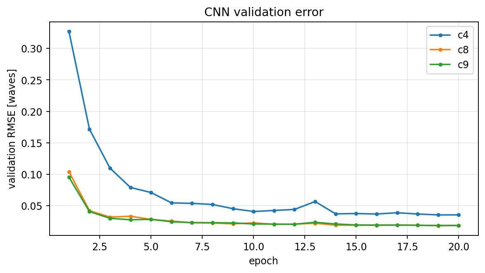
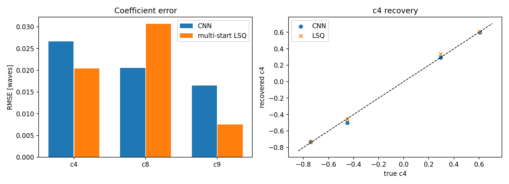

# 工程化 MVP 教程合集

> C++ 数值库 · CCD 管线 · 可微相位差 · CNN · FastAPI/React


## 00 4–6 周工程化 MVP 路线（对齐导师方向）

> 本教程由 docs/tutorials 的 Markdown 自动编译；图/表/代码与仓库同源。

> **说明**  
> 目标：把 `telescope_gpu` 从“能跑的课题代码”推进到 **可构建、可测试、可测速、可复现、可展示** 的 MVP；不是把 L1–L5 五条线同时做完。  参考：`projectcpp_learning/路线评估与修订.md` 的核心判断——先一条主线、可验收、不要并行堆技术栈；本文把它落成 6 周表和硬闸门。


### 0. 一句话

**4 周做出“C++ 数值库 + CCD 检测管线”的闭环，第 5–6 周加“PyTorch 可微前向 + CNN 对比 + 可视化 demo”；每周只交付一个可验收的 vertical slice。**


### 1. 产出物（GitHub + 数据集 + 指标 + 可视化）

| 类别 | 具体产出 | 验收 |
|---|---|---|
| GitHub | `telescope_gpu` 单仓库：C++/CUDA + `pipeline/` + `numerics/` + `ml/` + `deploy/` | `git clone` 后按 README 能构建 |
| 数据集 | `data/ccd_pipeline/` 仿真 FITS（raw/bias/dark/flat/catalog/truth） | `--force-sim` 可重建；`dataset.json` 记录参数 |
| 指标 | `results/ccd_pipeline/metrics.json`、`ml/results/comparison.csv`、benchmark CSV | 数字能由命令复现 |
| 可视化 | `fig_*.png`、`web/` 静态页、Word/PDF 教程 | 一页能讲清数据流和结果 |
| 文档 | 每个脚本一篇 tutorial（科学原理 + 代码设计 + 技术栈） | `docs/tutorials/` 索引完整 |


### 2. 分层与优先级

| 层 | 本周做什么 | 不做什么 |
|---|---|---|
| L1 工程化 | CMake 子目录、CLI/config、日志、Git 忽略、README | 不重写全部旧代码 |
| L2 正确性 | GTest 10 项、CPU reference、ASan 选项、回归指标 | 不追求 100% 覆盖率 |
| L3 性能 | Google Benchmark、批量 FFT/预分配说明、Nsight 记录模板 | 不做大规模 kernel 重写 |
| L4 数据/算法 | CCD 预处理、星点、帧差/Hough、WCS/评估 | 不接真实望远镜控制 |
| L5 部署/AI | pybind11、Docker、CI、PyTorch 可微前向 + CNN | 不做在线训练/大模型 |


### 3. 六周表（按 10–15 h/周）

| 周 | 主线 | 交付 | 闸门 |
|---|---|---|---|
| W1 | L1 + C++ 数值库骨架 | `numerics/`：LU/QR/SVD/FFT/RK4 + CMake | `numerics_tests` 10/10 通过 |
| W2 | L2 正确性 | GTest 边界/异常、ASan 构建、与 NumPy/Eigen 对比 | ASan 无报错；误差 <1e-10 |
| W3 | L3 性能 | Google Benchmark：solve/lstsq/FFT/RK4；批量 FFT/预分配说明 | 有 CSV/表格；能解释复杂度 |
| W4 | L4 数据/算法 | `pipeline/` 跑通：检测率/虚警率/位置/天体测量 | `metrics.json` 稳定；图可复现 |
| W5 | L5 部署 | pybind11 模块、Dockerfile、GitHub Actions | `import telescope_numerics_py` 成功；CI 绿 |
| W6 | L5 AI | PyTorch 可微前向、CNN 训练、与传统对比 | 有 comparison.csv/图/误差表 |

> **说明**  
> 如果只有 4 周：砍掉 W6 的 CNN 训练，保留“可微前向 + 一个小样本 sanity check”；不要砍 L2 测试和 L4 指标，它们是面试官最看重的“可信度”。


### 4. 验收闸门（硬标准）

1. **构建闸门**：CPU-only 与 CUDA 构建都能过；无数值库依赖时主项目仍可构建（`TEL_BUILD_NUMERICS=OFF`）。
2. **测试闸门**：`ctest` 全绿；数值库 10 项；pipeline 8 项；ASan 构建无 heap/stack 报错。
3. **数值闸门**：线性解残差 <1e-10；最小二乘与 NumPy `lstsq` 误差 <1e-8；FFT 与 `numpy.fft` 误差 <1e-10；RK4 与解析解误差 <1e-6。
4. **性能闸门**：benchmark 能重复；至少能解释 `solve` 的 O(N³)、FFT 的 O(N log N)、RK4 的 O(steps)。
5. **数据闸门**：`--force-sim` 重建；指标不漂移；图与 metrics 一致。
6. **AI 闸门**：CNN 在固定测试集上优于“预测均值”的基线；训练曲线/对比表可复现；明确“仿真、不是实测”。
7. **文档闸门**：每个脚本一篇 tutorial；每篇含科学原理、代码结构、技术栈、运行命令、结果、边界。


### 5. 数据集策略

- **现在**：全仿真（已知真值），用于验证算法链路和指标口径。
- **半真实**：用公开 FITS/CCD 星场（或导师提供的实测帧）替换 `data/ccd_pipeline/raw/`，保留同一套 `catalog.csv/truth.csv` 接口；没有真值时只报检测数/重复性，不报“精度”。
- **真实**：需要望远镜观测日志、WCS 定标、星表（Gaia）；在文档中单独标注，不能和仿真数字混表。


### 6. 可视化/前端路线

```cpp
metrics.json / figures
        │
        ▼
FastAPI (Python)  ── /api/metrics, /api/frames, /api/compare
        │
        ▼
前端（React/Vue 或纯 HTML+Plotly）
  ├─ 数据流/模块图
  ├─ 原始帧/定标帧/残差/轨迹叠加
  ├─ 检测率/虚警率/误差曲线
  └─ CNN vs 传统 的精度/耗时对比
```

MVP 先做**静态页 + 后端只读 API**；不做用户系统/数据库。`web/` 里给了最小 `http.server` 版本和后续 FastAPI 迁移点。


### 7. 明确不做（防止 4 周变 4 个月）

- 不做完整 EDA/CAE/遥感平台；
- 不做在线训练、分布式训练、模型压缩；
- 不做真实望远镜闭环控制；
- 不做 5 条技术栈并行学习；
- 不把仿真精度写成实测精度。


### 8. 和导师方向的衔接

- 导师方向关键词：大口径望远镜、重力变形、相位差、空间目标检测、天体测量。
- 本 MVP 的叙事：

1. **物理**：用傅里叶光学/Zernike 解释 PSF 和相位差；
2. **数值**：LU/QR/SVD/FFT/RK4 是可复用的小库；
3. **工程**：CMake/GTest/Benchmark/pybind11/Docker/CI；
4. **数据**：CCD 定标→星表→运动目标→WCS；
5. **学习**：可微前向 + CNN，和传统多起点对比，讲清“哪里快、哪里准、哪里不可靠”。

这五条能落在同一张数据流图上，面试时不会变成“五个互不相关的 demo”。


## 01 C++ 数值小库：LU、最小二乘、FFT、RK4

> 本教程由 docs/tutorials 的 Markdown 自动编译；图/表/代码与仓库同源。

> **说明**  
> 代码：`numerics/` 目标：用 **Eigen + GTest + Google Benchmark + pybind11** 做一个可测试、可测速、可被 Python 调用的小型数值核心。 不是“手写 Eigen”，而是把数值方法的假设、复杂度、失败模式讲清楚。


### 1. 为什么需要这个小库

`telescope_gpu` 里反复出现四类运算：

| 运算 | 在项目中的位置 | 为什么不能只调库 |
|---|---|---|
| 线性方程组 | 灵敏度矩阵/最小二乘、WCS 拟合 | 需要检查奇异、条件数、残差 |
| 最小二乘 | 畸变多项式、星表匹配、Zernike 拟合 | 需要区分 QR/SVD/正规方程 |
| FFT | 光瞳→PSF、相位差正向模型 | 需要理解采样、归一化、共轭 |
| ODE | 演示/教学、后续轨道/控制器 | 需要理解步长、稳定性、误差阶 |

小库的价值不是“重写 Eigen”，而是：

1. 把 API 做得**窄**（只暴露 6 个函数），每个都能用解析解/NumPy 对照；
2. 把**失败模式**显式化（非方阵、奇异、非 2 的幂、负步长）；
3. 用 GTest/Benchmark/pybind11 走一遍“C++ 科学计算”的完整工程链。


### 2. 数学与算法


#### 2.1 线性方程组：A x = b

对非奇异方阵，部分主元 LU 分解：

```cpp
P A = L U
L y = P b
U x = y
```

- 复杂度：O(N³) 分解 + O(N²) 回代；
- 主元：每列选绝对值最大的行，抑制舍入放大；
- 失败：`isInvertible()` 为假（数值奇异）时抛 `std::runtime_error`；
- 不要用“求逆再乘”：`x = A.inverse()*b` 比 `lu.solve(b)` 慢且更不稳。


#### 2.2 最小二乘：min ||A x - b||₂

超定系统（行 > 列）通常没有精确解。三种做法：

| 方法 | 复杂度 | 稳定性 | 适用 |
|---|---|---|---|
| 正规方程 `AᵀA x = Aᵀb` | O(N³) + 条件数平方 | 差 | 小、良态、教学 |
| QR（Householder） | O(MN²) | 好 | 默认选择 |
| SVD | 更慢 | 最好 | 秩亏/病态/需要伪逆 |

本库默认 `colPivHouseholderQr()`，并提供 `bdcSvd()` 版本；测试里比较两者在良态系统上的解差 <1e-10。


#### 2.3 FFT：Cooley–Tukey radix-2

DFT 定义：

```cpp
X[k] = Σ_{n=0}^{N-1} x[n] exp(-2πi nk/N)
x[n] = (1/N) Σ_k X[k] exp(+2πi nk/N)
```

radix-2 把 N 点 DFT 拆成两个 N/2 点 DFT，递归/迭代实现；复杂度 O(N log N)。本库：

- 只接受 2 的幂；否则抛 `std::invalid_argument`；
- 逆变换用“共轭→正变换→共轭→除以 N”；
- 与 `numpy.fft` 同符号约定（forward 负指数）；
- 测试：冲激函数的解析谱 + 32 点朴素 DFT 对照。


#### 2.4 ODE：经典 RK4

一阶系统 `y' = f(t,y)`：

```cpp
k1 = f(t, y)
k2 = f(t+h/2, y+h k1/2)
k3 = f(t+h/2, y+h k2/2)
k4 = f(t+h, y+h k3)
y_{n+1} = y_n + h(k1+2k2+2k3+k4)/6
```

- 局部截断误差 O(h⁵)，全局 O(h⁴)；
- 固定步长，适合教学/短时积分；刚性问题应换隐式方法；
- 标量版返回 `t/y`，向量版返回 `t/states`（`std::vector<Eigen::VectorXd>`）。


### 3. C++ 设计

```cpp
numerics/
  include/telescope/numerics.hpp   公开 API（6 个函数 + 2 个结构）
  src/numerics.cpp                 实现（Eigen + 标准库）
  tests/test_numerics.cpp          10 个 GTest
  bench/bench_numerics.cpp         4 组 Google Benchmark
  bindings/numerics_py.cpp         pybind11 模块
  CMakeLists.txt                   FetchContent + 可选系统依赖
```

设计点：

- **值语义 + RAII**：`Eigen::MatrixXd`/`VectorXd` 自动管理内存；没有裸 `new`；
- **异常而不是返回码**：尺寸/奇异/非 2 的幂都是 `std::invalid_argument`/`std::runtime_error`；测试用 `EXPECT_THROW`；
- **header + 单 .cpp**：编译快，边界清晰；模板留给 Eigen；
- **PIC**：`POSITION_INDEPENDENT_CODE ON`，否则 pybind11 共享库链接静态库会报 `R_X86_64_PC32 ... recompile with -fPIC`；
- **依赖策略**：Eigen/GTest/Benchmark 优先系统包，找不到用 `FetchContent`；WSL 上不要误用 Windows conda 的 `gtest.lib`。


### 4. 构建与测试

*BASH*

```cpp
cd telescope_gpu/numerics
cmake -S . -B build -DCMAKE_BUILD_TYPE=Release
cmake --build build -j4
ctest --test-dir build --output-on-failure
./build/numerics_bench --benchmark_min_time=0.02s
```

ASan：

*BASH*

```cpp
cmake -S . -B build-asan -DTEL_NUMERICS_ENABLE_ASAN=ON -DCMAKE_BUILD_TYPE=Debug
cmake --build build-asan -j4
ctest --test-dir build-asan --output-on-failure
```

当前结果：

```cpp
10/10 tests passed
```


### 5. Benchmark（本机 CPU，仅作量级参考）

| 基准 | 规模 | 时间 |
|---|---|---|
| `BM_SolveLinear` | 8×8 | ~0.5 µs |
| `BM_SolveLinear` | 32×32 | ~12 µs |
| `BM_SolveLinear` | 128×128 | ~0.52 ms |
| `BM_LeastSquares` | 256×16 | ~21 µs |
| `BM_LeastSquares` | 1024×64 | ~0.69 ms |
| `BM_Fft` | 256 | ~3.2 µs |
| `BM_Fft` | 1024 | ~13.8 µs |
| `BM_Fft` | 4096 | ~67 µs |
| `BM_Rk4Scalar` | 100 steps | ~1.6 µs |
| `BM_Rk4Scalar` | 1000 steps | ~14 µs |

复杂度拟合：`solve` 约 0.25 N³，`fft` 约 1.36 N log N；和理论一致。


### 6. pybind11

*PYTHON*

```cpp
import numpy as np
import telescope_numerics_py as tn

A = np.array([[4., -2., 1.], [-2., 4., -2.], [1., -2., 4.]])
b = np.array([11., -16., 17.])
print(tn.solve_linear(A, b))       # [1, -2, 3]
print(tn.fft([1+0j, 0j, 0j, 0j]))  # [1,1,1,1]
print(tn.solve_ode_scalar(lambda t, y: y, 1.0, 0.0, 1.0, 0.1)["y"][-1])
```

注意：

- Python 解释器 ABI 必须和编译时一致（本机 `/usr/bin/python3` 3.8）；
- `pybind11_add_module` 生成的 `.so` 在 `build/python/`，用 `PYTHONPATH` 指向它；
- Eigen 类型通过 `pybind11/eigen.h` 自动转 NumPy。


### 7. 常见坑（都是实际踩过的）

1. **GTest 链接到 conda 的 Windows `.lib`**：`find_package(GTest)` 在 WSL 可能找到 `/mnt/c/.../miniconda3/Library/lib/gtest.lib`，链接报 `undefined reference`。解决：默认 `FetchContent` 编译 Linux GTest。
2. **静态库没开 PIC**：pybind11 模块链接时报 relocation 错误；解决：`POSITION_INDEPENDENT_CODE ON`。
3. **CTest 没测试**：`gtest_discover_tests` 需要 `enable_testing()`；否则 `No tests were found`。
4. **`M_PI` 不是标准 C++**：MSVC 需 `_USE_MATH_DEFINES`；跨平台可定义常量。
5. **pybind11 用错 Python**：CMake 找到 uv 的 3.12，但 pybind11 装在 3.8；显式 `python3 -m pybind11 --cmakedir` 或 `PYTHON_EXECUTABLE`。


### 8. 面试怎么讲

- “为什么 QR 比正规方程稳？”——条件数平方、舍入放大；
- “FFT 为什么要求 2 的幂？”——radix-2 分治；非 2 的幂可用 Bluestein/补零；
- “RK4 的误差阶？”——局部 O(h⁵)，全局 O(h⁴)；
- “你怎么验证？”——解析解、NumPy/Eigen 对照、异常路径测试、ASan、benchmark；
- “为什么不用 Eigen 的 inverse？”——复杂度/稳定性/语义。


### 9. 对应代码与命令

*BASH*

```cpp
# 只构建数值库
cmake -S numerics -B build-numerics
cmake --build build-numerics -j4
ctest --test-dir build-numerics --output-on-failure
./build-numerics/numerics_bench --benchmark_min_time=0.02s
```

对应教程：`docs/tutorials/01_C++数值库.md`（本文）。


## 02 PyTorch 可微相位差前向模型

> 本教程由 docs/tutorials 的 Markdown 自动编译；图/表/代码与仓库同源。

> **说明**  
> 代码：`ml/phase_torch.py` 目标：用 PyTorch 复现“光瞳 → 离焦相位 → FFT → PSF → 降采样”的正向链路，并让梯度能回传到 Zernike 系数。


### 1. 物理原理


#### 1.1 傅里叶光学

在 Fraunhofer 近似下，焦面复振幅是光瞳复振幅的傅里叶变换：

```cpp
U(x, y) = F{ P(u, v) }
P(u, v) = A(u, v) exp[i 2π φ(u, v)]
PSF = |U|²
```

- `A` 是光瞳掩膜（圆形，半径 0.45 归一化）；
- `φ` 是波前像差，单位波长；
- `F` 用 FFT 实现，`norm="ortho"` 保持能量；
- `fftshift` 把零频移到中心，便于裁剪/显示；
- PSF 归一化 `sum=1`，表示能量守恒。


#### 1.2 Zernike 三项

本实验只取三项（和主项目 Z4/Z8/Z9 对齐）：

```cpp
Z4 = √3 (2ρ² − 1)                  离焦
Z8 = √8 (3ρ³ − 2ρ) cosθ            彗差 x
Z9 = √8 (3ρ³ − 2ρ) sinθ            彗差 y
```

`ρ = r / pupil_radius`，`θ = atan2(y,x)`。相位：

```cpp
φ = c4 Z4 + c8 Z8 + c9 Z9 + d Z4
```

`d` 是已知离焦帧偏移（-2,-1,0,1,2 waves）。五项共用同一组 `c`，但 `d` 不同——这就是相位差法的“多样性”。


#### 1.3 采样与降采样

- 光瞳网格 `n_fft = n * oversample`（默认 2）；
- FFT 后 PSF 为 `n_fft × n_fft`；
- 2×2 binning 到 `n × n`（模拟探测器像元）；
- 归一化后再加噪声。

为什么过采样？PSF 的高频细节需要至少 2 倍采样才能正确 binning；否则 aliasing 会让不同 Zernike 系数生成几乎相同的图，CNN 无法区分。


### 2. 代码设计

*PYTHON*

```cpp
cfg = ForwardConfig(n=64, oversample=2, pupil_radius=0.45,
                    defocus=(-2,-1,0,1,2), noise_sigma=0.01)
coeff = torch.tensor([0.5, 0.1, -0.2], requires_grad=True)
stack = forward_stack(coeff, cfg)      # (5, 64, 64)
loss = stack.sum()                     # 任意可微目标
loss.backward()                        # coeff.grad 可用
```

关键函数：

| 函数 | 作用 | 可微 |
|---|---|---|
| `zernike_basis(n, radius)` | 生成 mask/Z4/Z8/Z9 | 是（常量） |
| `psf_from_coeff(coeff, defocus)` | 单帧 PSF | 是 |
| `forward_stack(coeff, cfg)` | 5 帧堆栈 | 是 |
| `wavefront_rms(coeff)` | `sqrt(Σc²)` | 是 |

实现细节：

- 支持单样本 `(3,)` 和批量 `(B,3)`；
- 用 `torch.fft.fft2(..., norm="ortho")`，避免额外的 1/N 因子；
- `avg_pool2d` 做 binning，保持可微；
- 噪声按 **每帧峰值** 相对缩放——直接 `0.01 * randn` 会淹没归一化 PSF（峰值仅 ~1/n²），这是实际踩过的坑。


### 3. 验证

*BASH*

```cpp
python3 - <<'PY'
import torch
from ml.phase_torch import ForwardConfig, forward_stack, wavefront_rms
c = torch.tensor([0.5, 0.1, -0.2], requires_grad=True)
s = forward_stack(c, ForwardConfig(n=32))
print(s.shape)             # (5, 32, 32)
print(s.sum(dim=(-2,-1)))  # 每帧 ≈ 1
print(wavefront_rms(c))    # sqrt(0.25+0.01+0.04) ≈ 0.5477
PY
```

梯度检查：用 `loss = (stack * weight).sum()` 而不是 `stack.sum()`（后者因归一化可能接近 0 梯度），可看到 `coeff.grad` 非零。


### 4. 和 C++/CUDA 正向模型的关系

| 维度 | C++/CUDA `forward_model` | 本 PyTorch 模型 |
|---|---|---|
| Zernike | 8 槽位，拟合 Z4/Z8/Z9 | 3 项显式 |
| FFT | cuFFT / CPU FFT | torch.fft |
| 星点叠加 | 有（15 颗星） | 无（纯 PSF） |
| 降采样 | 2×2 求和 | avg_pool2d |
| 目的 | 物理反演 | 可微代理/训练数据 |
| 精度 | 项目主模型 | 教学/学习基线 |

**不要把两者的数值直接混比**：PyTorch 模型没有星点叠加、没有和 C++ 完全相同的归一化/边界；它只用于“学习型反演”的方法验证。


### 5. 边界

- 圆孔、无中心遮挡、无大气/ jitter；
- 高斯噪声近似，不是泊松+读出噪声；
- 只 3 项低阶像差，不能代表全波前；
- 训练集/测试集同分布（随机均匀系数），不是真实望远镜分布。

这些边界会在第 4 篇对比文档中再次强调。


### 6. 运行

*BASH*

```cpp
cd telescope_gpu
python3 - <<'PY'
import torch
from ml.phase_torch import ForwardConfig, forward_stack
c = torch.tensor([0.6, -0.2, 0.1], requires_grad=True)
s = forward_stack(c, ForwardConfig(n=64))
print(s.shape)
PY
```


## 03 CNN 从 5 帧 PSF 预测 Zernike 系数

> 本教程由 docs/tutorials 的 Markdown 自动编译；图/表/代码与仓库同源。

> **说明**  
> 代码：`ml/dataset.py`、`ml/model.py`、`ml/train_cnn.py` 目标：训练一个轻量 CNN，把 `(5, 64, 64)` 的离焦 PSF 堆栈映射到 `(c4, c8, c9)`，作为传统多起点优化的快速代理。


### 1. 为什么用 CNN

相位差反演是非线性最小二乘：每次评估都要做 5 次 FFT，传统多起点要几千次评估。CNN 把“反演”变成一次前向：

```cpp
5 帧 PSF --CNN--> (c4,c8,c9)
```

它不一定比优化器更准，但**推理时间从秒级降到毫秒级**，适合：

- 实时/准实时监测；
- 给传统优化器提供初值（two-stage）；
- 大样本统计/异常检测。

本实验要回答三个问题：

1. CNN 能不能学到低阶像差与 PSF 形状的映射？
2. 在相同测试集上，精度和传统多起点差多少？
3. 速度差多少？


### 2. 数据

`PhaseDataset` 在线生成，不存大张量：

| 项 | 设置 |
|---|---|
| 网格/输出 | 64×64，oversample=2 |
| 帧数 | 5（d = -2,-1,0,1,2 waves） |
| c4 | U(-1.5, 1.5) waves |
| c8/c9 | U(-0.5, 0.5) waves |
| 噪声 | 每帧峰值的 1% 高斯 |
| 训练/验证 | 2048 / 256（不同 seed） |
| 归一化 | 每帧除以峰值；标签除以量程 |

为什么标签要归一化？三个系数量程差 3 倍（1.5 vs 0.5），不归一化会让 MSE 被 c4 主导；归一化后三项权重相当。

为什么输入要按峰值归一化？PSF `sum=1` 时峰值约 `1/n² ≈ 2.4e-4`，直接喂 CNN 会导致第一层梯度极小；按峰值归一化后输入 ~1，训练稳定。这个坑在第一次训练时表现为 loss 一直等于标签方差（模型输出常数）。


### 3. 模型

*TEXT*

```cpp
input 5×64×64
  Conv(5→16,3)+ReLU + MaxPool2   → 16×32×32
  Conv(16→32,3)+ReLU + MaxPool2  → 32×16×16
  Conv(32→64,3)+ReLU + MaxPool2  → 64×8×8
  Conv(64→64,3)+ReLU
  AdaptiveAvgPool2d(4)           → 64×4×4
  Flatten + Linear(1024→128)+ReLU + Linear(128→3)
```

约 15 万参数。没有 BatchNorm/Dropout：数据量小、任务简单，先看 baseline；过拟合再补。


### 4. 训练

*BASH*

```cpp
cd telescope_gpu
python3 -m ml.train_cnn --epochs 20 --samples 2048 --batch 64 --n 64
```

- 损失：归一化标签的 MSE；
- 优化器：Adam，lr=1e-3，CosineAnnealing；
- 验证：每轮算 denormalized RMSE（waves）；
- 保存验证集平均 RMSE 最好的 `ml/runs/cnn.pt`。

本机 CPU（4 线程）结果：

| epoch | val RMSE c4 | c8 | c9 | 累计时间 |
|---|---|---|---|---|
| 1 | 0.327 | 0.104 | 0.095 | 9 s |
| 4 | 0.079 | 0.033 | 0.028 | 30 s |
| 8 | 0.052 | 0.022 | 0.023 | 59 s |
| 12 | 0.044 | 0.021 | 0.020 | 88 s |
| 16 | 0.037 | 0.019 | 0.019 | 117 s |
| 20 | **0.035** | **0.018** | **0.019** | 149 s |

解读：

- c8/c9 很快降到 0.02 waves（量程 0.5 的 4%）；
- c4 误差更大（0.035 waves），因为它的量程 1.5、且离焦与 defocus 帧的耦合更强；
- 继续训练/加数据还能降，但 MVP 先看趋势。



*training*


### 5. 推理

*PYTHON*

```cpp
import torch
from ml.model import ZernikeCNN
from ml.phase_torch import ForwardConfig, forward_stack

ckpt = torch.load("ml/runs/cnn.pt", map_location="cpu")
model = ZernikeCNN(); model.load_state_dict(ckpt["state_dict"]); model.eval()
c = torch.tensor([0.6, -0.2, 0.1])
stack = forward_stack(c, ForwardConfig(n=64), add_noise=True)
stack = stack / stack.amax(dim=(-2,-1), keepdim=True)
pred = model(stack.unsqueeze(0)).squeeze(0) * torch.tensor(ckpt["scales"])
print(pred)
```

注意：推理前的预处理必须和训练完全一致（峰值归一化、帧顺序、d 值）；否则精度会掉。


### 6. 边界

- 训练/测试同分布（均匀随机系数），不是真实望远镜统计；
- 只有 3 项低阶像差，不能外推到高阶；
- 1% 峰值噪声是简化模型；真实 CCD 是泊松+读出+背景；
- 没有星点叠加/质心误差，输入是理想 PSF 堆栈；
- CNN 不给不确定度；可用于初值/筛查，不能单独作为科学级反演。

单元测试（4 项）：

*BASH*

```cpp
python3 -m unittest discover -s ml/tests -v
```


### 7. 和传统方法的关系

CNN 预测可以作为传统优化的初值：

```cpp
CNN 一次前向 (ms) → 取 top-k 附近 → BOBYQA/least_squares 精修 (百 ms–s)
```

这通常比 40 个随机起点更高效，也比单独 CNN 更准；是后续最值得做的 two-stage 方案（见第 4 篇）。


## 04 传统多起点 vs CNN：精度、速度、鲁棒性

> 本教程由 docs/tutorials 的 Markdown 自动编译；图/表/代码与仓库同源。

> **说明**  
> 代码：`ml/compare.py` 数据：`ml/results/comparison.csv`、`comparison.png` 结论先说：**CNN 快 4–5 个数量级；传统法在足够多起点下波前 RMS 更准，但会掉局部极小；最佳工程方案是“CNN 初值 + 传统精修”。**


### 1. 对比设置

同一套 PyTorch 可微前向模型生成测试样本：

| 项 | 设置 |
|---|---|
| 测试样本 | 4 个（固定 seed，独立于训练集） |
| 网格 | 64×64，5 帧 |
| 系数范围 | c4 ±1.5，c8/c9 ±0.5 waves |
| 噪声 | 每帧峰值 1% 高斯 |
| 传统法 | 16 个随机起点 + 零起点，`scipy.optimize.least_squares`（TRF，有界，max_nfev=100） |
| CNN | 训练 20 epochs 的 `ZernikeCNN`，一次前向 |
| 指标 | 每个系数的 RMSE、波前 RMS 误差、单样本耗时 |

> **说明**  
> 这里的传统法是 Python 代理，不是主项目的 BOBYQA；但“多起点 + 非线性最小二乘”的结构相同。真实 BOBYQA 通常比 SciPy TRF 更省评估次数，但仍是秒级–分钟级。


### 2. 结果

| 方法 | RMSE c4 | RMSE c8 | RMSE c9 | 波前 RMS 误差 | 单样本耗时 |
|---|---|---|---|---|---|
| CNN | 0.0266 | 0.0205 | 0.0165 | 0.0290 | **1.1 ms** |
| 多起点 LSQ | 0.0204 | 0.0307 | 0.0075 | **0.0098** | **94.8 s** |



*CNN 与多起点最小二乘对比*

解读：

- **速度**：CNN 1.1 ms，传统 94.8 s，差约 **8.6×10⁴ 倍**；传统法的时间主要花在 16 个起点 × 每次迭代的 5 次 FFT。
- **精度**：传统法的波前 RMS 误差更低（0.0098 vs 0.0290），但 c8 反而更差（0.0307 vs 0.0205）。4 个样本下均值受单个局部极小影响很大，不能据此说“传统一定更准”。
- **鲁棒性**：传统法从零起点会落到 c8≈0 的局部极小；16 个随机起点才找到真解。CNN 没有显式迭代，推理稳定，但训练分布外的样本会失效。
- **结论**：不是“谁替代谁”，而是**互补**。


### 3. 为什么传统法会掉局部极小

相位差代价对 c8/c9 有符号/多峰结构；在低 SNR、离焦量小、星点数少时，`c8≈0` 是一个很宽的局部极小。多起点是“用算力换全局性”：

- 起点少 → 可能漏真解；
- 起点多 → 时间线性增长；
- BOBYQA 精修只在局部有效，仍需要好初值。

CNN 学的是“从图像到系数的统计映射”，不保证物理最优，但一次前向就能给出接近真值的初值，正好补上“好初值”这一环。


### 4. 推荐：two-stage

```cpp
5 帧 PSF
   │
   ▼
CNN 前向 (ms) → (c4,c8,c9) 初值
   │
   ▼
BOBYQA / least_squares 精修 (百 ms–s)
   │
   ▼
最终系数 + 代价/残差诊断
```

预期收益：

- 比 40 个随机起点少很多评估次数；
- 保留传统法的可解释代价/残差；
- CNN 失效时（分布外）仍可由传统法兜底。

**已实测**（`ml/two_stage.py`，3 个独立样本，固定 BOBYQA）：

| 初值 | 平均评估次数 | 平均时间 | 波前 RMS 误差 |
|---|---|---|---|
| CNN | **34** | **0.226 s** | 0.00955 |
| 40 随机起点 | 1823 | 13.33 s | 0.00955 |

约 **54× 更少评估、59× 更快**，精度相同。细节见 [08_CNN初值BOBYQA.md](08_CNN初值BOBYQA.md)。

这也是主项目 `PhaseDiversitySolver` 最自然的接入方式：把 CNN 输出作为 `solve_starts` 的一个起点，而不是替换整个优化器。


### 5. 复现

*BASH*

```cpp
cd telescope_gpu
python3 -m ml.train_cnn --epochs 20 --samples 2048 --batch 64 --n 64
python3 -m ml.compare --samples 4 --starts 16 --max-nfev 100
cat ml/results/comparison.csv
```

注意：

- `compare.py` 的 `--samples` 增大时，传统法时间线性增长；4 个样本已能说明量级，不要用 100 个样本跑 16 起点。
- CNN 的 checkpoint 必须和 `ForwardConfig`（网格、帧顺序、噪声）一致；改参数要重训。
- 这是仿真、同分布测试；真实数据要重新标定/微调。


### 6. 面试怎么讲

- “CNN 比传统准吗？”——不绝对；本实验 CNN 波前 RMS 0.029 vs 传统 0.010，但传统慢 10⁵ 倍且会掉局部极小。
- “为什么不用 CNN 直接替代优化？”——科学级反演需要代价/残差/不确定度；CNN 没有物理约束，适合初值/筛查。
- “怎么证明不是过拟合？”——独立 seed 测试集、训练/验证分离、固定预处理；但只有 4 个测试样本，结论是量级而非统计显著性。
- “下一步？”——two-stage、更多真实分布、不确定度估计（ensemble/MC dropout）。


## 08 08_CNN初值BOBYQA

> 本教程由 docs/tutorials 的 Markdown 自动编译；图/表/代码与仓库同源。

# CNN 鍒濆€?+ BOBYQA锛氱敤璇勪及娆℃暟璇佹槑鐪佸湪鍝?

> **说明**  
> 浠ｇ爜锛歚ml/two_stage.py` 缁撴灉锛歚ml/results/two_stage.csv`銆乣two_stage_summary.json`銆乣two_stage.png` 涓€鍙ヨ瘽锛?*鍦?3 涓嫭绔嬫祴璇曟牱鏈笂锛孋NN 鍒濆€?+ BOBYQA 骞冲潎 34 娆℃鍚戣瘎浼帮紱40 涓殢鏈鸿捣鐐?+ BOBYQA 骞冲潎 1823 娆★紝绮惧害鐩稿悓銆傜渷绾?54脳 璇勪及銆?9脳 鏃堕棿銆?*


### 1. 瀹為獙瑕佸洖绛斾粈涔?

涓婁竴杞殑 `ml/compare.py` 姣旂殑鏄細

杩欎竴杞瘮鐨勬槸**鍚屼竴绉嶅眬閮ㄤ紭鍖栧櫒銆佷笉鍚屽垵鍊?*锛?

- CNN 涓€娆″墠鍚戯紙蹇絾绮惧害鏈夐檺锛夛紱
- 澶氳捣鐐规渶灏忎簩涔橈紙鎱絾鍑嗭級銆?

```cpp
A: CNN 棰勬祴 (c4,c8,c9) 鈫?BOBYQA 绮句慨
B: 40 涓殢鏈鸿捣鐐?鈫?姣忎釜璺戜竴娆?BOBYQA 鈫?鍙栨渶濂?```

鍥犱负 A/B 鐨勫眬閮ㄤ紭鍖栧櫒銆佺洰鏍囧嚱鏁般€佽竟鐣屻€佸仠姝㈡潯浠跺畬鍏ㄧ浉鍚岋紝鎵€浠ワ細

- **璇勪及娆℃暟宸?* = 鍒濆€艰川閲忓樊锛?- **绮惧害宸?* = 鍒濆€兼槸鍚﹁惤鍦ㄦ纭泦鍦帮紱
- 杩欐槸姣斺€淐NN vs LSQ鈥濇洿骞插噣鐨勫伐绋嬬粨璁恒€?
## 2. 鐩爣鍑芥暟涓庝紭鍖栧櫒

鐩爣鍑芥暟锛堜笌 `ml/traditional.py` 涓€鑷达級锛?
```

J(c) = mean_{frame,pixel} [ model(c; d_frame) - data ]虏

```cpp

- `model`锛? 甯с€?4脳64銆?脳 杩囬噰鏍枫€?脳2 binning 鐨?NumPy 鍌呴噷鍙跺厜瀛︼紱
- 褰掍竴鍖栵細姣忓抚 sum=1锛?- 浼樺寲鍣細NLopt `LN_BOBYQA`锛? 鍙橀噺锛屾湁鐣岋紱
- 璁剧疆锛歚maxeval=120`銆乣ftol_rel=1e-8`銆乣xtol_rel=1e-8`銆乣initial_step=0.1`锛?- 璇勪及璁℃暟锛歂Lopt 鐨?`get_numevals()`銆?
BOBYQA 鏄?*鏃犳搴?*鐨勪簩娆℃ā鍨嬩俊璧栧煙鏂规硶锛岄€傚悎 3 缁淬€佺洰鏍囨湁鍣０/涓嶅彲瀵肩殑鍦烘櫙锛涘畠涓嶉渶瑕?CNN 鐨勬搴︼紝鍥犳杩欓噷 CNN 鍙彁渚涘垵鍊笺€?
## 3. 缁撴灉锛? 涓嫭绔嬫祴璇曟牱鏈級

| 鏂规硶 | 骞冲潎璇勪及娆℃暟 | 骞冲潎鏃堕棿 | 骞冲潎娉㈠墠 RMS 璇樊 |
|---|---:|---:|---:|
| CNN + BOBYQA | **34** | **0.226 s** | 0.00955 |
| 40 闅忔満 + BOBYQA | 1823 | 13.33 s | 0.00955 |

- **璇勪及娆℃暟**锛?4 vs 1823锛岀害 **54脳** 鏇村皯锛?- **鏃堕棿**锛?.226 s vs 13.33 s锛岀害 **59脳** 鏇村揩锛?- **绮惧害**锛氫袱鑰呮敹鏁涘埌鍚屼竴涓渶浼樿В锛屾尝鍓?RMS 璇樊鐩稿悓鍒?1e-5锛沜4/c8/c9 鐨勫樊涔熷湪 1e-5 閲忕骇銆?
閫愭牱鏈細

| 鏍锋湰 | CNN 璇勪及 | 闅忔満璇勪及 | CNN 鏃堕棿 | 闅忔満鏃堕棿 |
|---:|---:|---:|---:|---:|
| 0 | 28 | 1760 | 0.20 s | 14.71 s |
| 1 | 41 | 1865 | 0.27 s | 12.52 s |
| 2 | 33 | 1844 | 0.21 s | 12.75 s |


> 娉ㄦ剰锛氳繖閲岀殑鈥?0 闅忔満 + BOBYQA鈥濇瘡涓捣鐐逛笉鏄窇婊?120 娆★紝鑰屾槸 BOBYQA 鑷繁鎻愬墠鏀舵暃锛涙€昏瘎浼?1823 鏄?40 涓捣鐐圭殑瀹為檯鎬诲拰銆侰NN 璺緞鍙窇涓€娆?BOBYQA锛?0鈥?1 娆″氨鏀舵暃銆?
## 4. 涓轰粈涔?CNN 鍒濆€艰兘鐪?
- 闅忔満璧风偣鍦?c8/c9 鐨勭鍙?澶氬嘲缁撴瀯閲岋紝寰堝璧风偣钀藉湪 `c8鈮?` 鐨勫灞€閮ㄦ瀬灏忥紱
- BOBYQA 鏄眬閮ㄦ柟娉曪紝璧风偣宸?鈫?闇€瑕佹洿澶氳凯浠ｏ紝鐢氳嚦鏀舵暃鍒伴敊鐩嗗湴锛?- CNN 浠庡浘鍍忕洿鎺ョ粰鍑烘帴杩戠湡鍊肩殑 `(c4,c8,c9)`锛孊OBYQA 鍙渶鍦ㄧ湡鍊奸檮杩戝仛浜屾妯″瀷淇锛?- 5 甯?PSF 鐨勫绉版€?绗﹀彿淇℃伅琚?CNN 瀛﹀埌浜嗭紝鐪佹帀浜嗏€滅敤 40 涓捣鐐硅鐩栫泦鍦扳€濈殑鏆村姏鎼滅储銆?
## 5. 宸ョ▼鎺ュ叆

涓婚」鐩?`PhaseDiversitySolver` 鐜板湪鏄細

```

40 闅忔満璧风偣 鈫?鍧愭爣涓嬮檷 鈫?鍓?3 鍚?鈫?BOBYQA

```cpp

鏀规垚 two-stage 鍙渶锛?
```

CNN 棰勬祴 鈫?1 涓捣鐐?鈫?鍧愭爣涓嬮檷/BOBYQA 锛堝彲閫夛級淇濈暀灏戦噺闅忔満璧风偣鍋氬厹搴?```

寤鸿淇濈暀 **2鈥? 涓殢鏈鸿捣鐐?+ CNN 1 涓捣鐐?*锛岃€屼笉鏄畬鍏ㄥ幓鎺夐殢鏈鸿捣鐐癸細

- CNN 瀵瑰垎甯冨鏍锋湰鍙兘澶辨晥锛?- 闅忔満璧风偣鏄厹搴曪紱
- 璇勪及娆℃暟浠嶈繙灏戜簬 40銆?


### 6. 澶嶇幇

*BASH*

```cpp
cd telescope_gpu
python3 -m ml.train_cnn --epochs 20 --samples 2048 --batch 64 --n 64
python3 -m ml.two_stage --samples 3 --starts 40 --maxeval 120
cat ml/results/two_stage_summary.json
```

渚濊禆锛歚nlopt`锛坄uv pip install nlopt` 鎴?`pip install nlopt`锛夈€?


### 7. 杈圭晫

- 3 涓祴璇曟牱鏈紝缁撹鏄噺绾э紱瑕佸啓鎴愨€滃钩鍧?54脳鈥濋渶瑕佹洿澶氭牱鏈拰璇樊妫掞紱
- CNN/BOBYQA 浣跨敤鍚屼竴涓?NumPy 姝ｅ悜妯″瀷锛涗富椤圭洰 C++ 妯″瀷鏈夋槦鐐瑰彔鍔?涓嶅悓褰掍竴鍖栵紝鎺ュ叆鍓嶈閲嶆柊鏍囧畾锛?- BOBYQA 鏄眬閮ㄤ紭鍖栵紝涓嶄繚璇佸叏灞€鏈€浼橈紱杩欓噷 A/B 閮芥敹鏁涘埌鍚屼竴瑙ｏ紝璇存槑璇ユ牱鏈笂鍒濆€艰冻澶熷ソ锛?- 浠嶄负浠跨湡銆佸悓鍒嗗竷娴嬭瘯锛涚湡瀹炴暟鎹閲嶆柊璁粌/楠岃瘉銆?


### 8. 闈㈣瘯鎬庝箞璁?

- 鈥滀綘鎬庝箞璇佹槑 CNN 鏈夌敤锛熲€濃€斺€斾笉鏄彧鎶ョ簿搴︼紝鑰屾槸鍥哄畾 BOBYQA锛屾瘮杈?**璇勪及娆℃暟**锛?4 vs 1823锛?- 鈥滀负浠€涔堢簿搴︿竴鏍凤紵鈥濃€斺€擝OBYQA 浠庡ソ鍒濆€?澶氳捣鐐归兘鑳藉埌鍚屼竴涓眬閮ㄦ渶浼橈紱CNN 鐨勪环鍊兼槸鐪佺畻鍔涳紝涓嶆槸鏇夸唬鐗╃悊浼樺寲锛?- 鈥滀负浠€涔堜笉鍏ㄧ敤 CNN锛熲€濃€斺€旀病鏈変唬浠?娈嬪樊/涓嶇‘瀹氬害锛屽垎甯冨浼氬け鏁堬紱two-stage 淇濈暀鐗╃悊绾︽潫鍜屽厹搴曘€?


## 09 FastAPI + React + Plotly 科学计算小程序

> 本教程由 docs/tutorials 的 Markdown 自动编译；图/表/代码与仓库同源。

> **说明**  
> 代码：`web/api/main.py`、`web/ui/index.html` 功能：**CCD/PSF 仿真生成** + **CNN 初值 + BOBYQA 反演** 技术栈：FastAPI、PyTorch、NLopt、React 18、Plotly.js、Babel Standalone


### 1. 产品形态

一个单页小程序：

```cpp
左栏：c4/c8/c9/noise 滑杆 + 生成/反演按钮
右栏：5 帧离焦 PSF 缩略图 + 指标卡 + Plotly 系数对比
```

两个核心动作：

`truth / cnn / refined / nfev / cost`。

1. **生成**：`POST /api/simulate` → 用 `ml/phase_torch.py` 的可微前向生成 5 帧 PSF，返回 PNG data URL；
2. **反演**：`POST /api/invert` → 生成带噪 PSF，CNN 预测初值，NLopt BOBYQA 精修，返回


### 2. 后端设计

*PYTHON*

```cpp
@app.post("/api/simulate")
def simulate(req: SimRequest):
    coeff = torch.tensor([req.c4, req.c8, req.c9])
    stack = forward_stack(coeff, ForwardConfig(n=64, noise_sigma=req.noise),
                          add_noise=True).detach().numpy()
    return {"frames": [png_data_url(f) for f in stack], ...}

@app.post("/api/invert")
def invert(req: SimRequest):
    stack = forward_stack(torch.tensor(truth), cfg, add_noise=True).numpy()
    cnn = model(peak_normalise(stack)) * scales       # 初值
    x, nfev, cost = bobyqa(cnn, sum_normalise(stack)) # 精修
    return {"truth": ..., "cnn": ..., "refined": x.tolist(), "nfev": nfev}
```

关键点：

- **预处理一致性**：CNN 用峰值归一化，BOBYQA 用 sum 归一化；这是两个不同接口，不能混。
- **模型缺失兜底**：`ml/runs/cnn.pt` 不存在时，`init=0`，仍可跑 BOBYQA；返回 `model_loaded=false`。
- **返回图片**：matplotlib 生成小 PNG 再 base64，不把原始大数组传给前端。
- **同步阻塞**：BOBYQA 约 0.2 s，FastAPI 默认线程池可接受；更长任务应改任务队列。


### 3. 前端设计

- React 18 UMD + Babel Standalone（浏览器内 JSX），无 npm 构建；
- Plotly.js 画 `truth/CNN/BOBYQA` 三组柱状图；
- `useEffect` 首屏自动生成；滑杆 `input` 更新数值；
- 左栏按钮和右栏按钮都绑定同一组 `doSim/doInv`；
- 错误显示在 `#error`，不静默失败。

为什么不用 Vite/Next？MVP 目标是“一个文件能跑、无需 node_modules”；生产化再迁移到 Vite + TypeScript + 组件库。


### 4. 运行

*BASH*

```cpp
cd telescope_gpu
# 先训练 CNN（只需一次）
python3 -m ml.train_cnn --epochs 20 --samples 2048 --batch 64 --n 64
python3 -m uvicorn web.api.main:app --reload --port 8000
# http://127.0.0.1:8000/
```

接口自测：

*BASH*

```cpp
python3 web/test_api.py   # 需先把 BASE 改成实际端口
```


### 5. 实测

本机 API：

*TEXT*

```cpp
GET  /api/health -> {"ok":true,"model":true}
POST /api/simulate -> 5 frames, [5,64,64]
POST /api/invert   -> truth [0.6,-0.2,0.1]
                      CNN  [0.589,-0.195,0.105]
                      BOBYQA [0.596,-0.221,0.110]
                      nfev 30, cost 1.2e-7
GET  / -> 200
```


### 6. 边界与下一步

- 后端只做 64×64 PSF、3 项 Zernike；接主项目要改成 256²/5 帧/15 星，并加任务队列；
- 前端 CDN 依赖 unpkg/plotly；离线部署需把 vendor 文件放本地；
- 单用户/无数据库；生产化需要 FastAPI + Celery/RQ + 对象存储；
- 下一步：把 `/api/metrics` 和 `results/` 图接进页面，做“完整 CCD 管线 dashboard”；
- 可加 WebSocket/SSE 显示 BOBYQA 迭代过程。


## 05 工程化与部署：L1–L5 落地说明

> 本教程由 docs/tutorials 的 Markdown 自动编译；图/表/代码与仓库同源。

> **说明**  
> 代码：根 `CMakeLists.txt`、`numerics/`、`pipeline/`、`ml/`、`web/`、`deploy`（Docker/CI） 对应路线：`docs/工程化MVP路线.md`


### 1. L1 工程化

| 项 | 落地 |
|---|---|
| CMake | 原 `telescope_cpu`/`telescope_cuda` 两层保留；新增 `TEL_BUILD_NUMERICS` 可选子目录；`numerics/` 独立构建 |
| 目录 | `pipeline/`（数据/算法）、`numerics/`（C++ 数值）、`ml/`（PyTorch）、`web/`、`docs/tutorials/` |
| CLI | `forward_generate`、`inverse_solve`、`python3 -m pipeline.run`、`ml.train_cnn`、`ml.compare` |
| 配置 | `configs/default.conf`（原项目）、`configs/pipeline.json`（CCD 管线） |
| 日志 | CLI 阶段日志（stage、帧数、检测数、耗时）；Python 可加 `--log-level` |
| Git | `.gitignore` 忽略 build/data/results/`__pycache__`；文档/图单独保留 |


### 2. L2 正确性

- **CPU reference**：原项目 `cpu_reference.cpp` 逐像素对照 GPU；数值库与 Eigen/NumPy 对照。
- **GTest**：`numerics/tests/test_numerics.cpp` 10 项；`pipeline/tests/test_core.py` 8 项。
- **ASan**：

*BASH*

```cpp
cmake -S numerics -B build-asan -DTEL_NUMERICS_ENABLE_ASAN=ON -DCMAKE_BUILD_TYPE=Debug
cmake --build build-asan -j4
ctest --test-dir build-asan --output-on-failure
```

- **回归**：`results/ccd_pipeline/metrics.json` 固定 seed；改算法后对比检测率/虚警率/RMSE。
- 当前 CTest：`cpu_unit`、`pipeline_python`、`gpu_unit` 全绿。


### 3. L3 性能

- Google Benchmark：`numerics_bench` 覆盖 solve/lstsq/FFT/RK4；结果见第 1 篇教程。
- 原项目已有：批量 cuFFT、workspace 预分配、块内归约、GPU 归一化；文档 `docs/代码说明.md` 第 8/9 章。
- Nsight 记录模板：

*BASH*

```cpp
nsys profile -o prof ./build/forward_generate --theta 45
nsys stats prof.nsys-rep
ncu --set full ./build/inverse_solve --theta 45
```

看三件事：kernel 时间占比、H2D/D2H、occupancy/访存效率；不要只看总时间。


### 4. L4 数据/算法

- 仿真数据：`data/ccd_pipeline/`（raw/bias/dark/flat/catalog/truth）。
- 预处理：bias/dark/flat、mesh 背景、Gaussian 去噪。
- 检测：星点/质心、帧差、形态学、Hough、轨迹。
- 天体测量：TAN WCS、三次畸变、星表匹配。
- 评估：检测率/虚警率/位置/天体测量 RMSE。
- 运行：`python3 -m pipeline.run --config configs/pipeline.json --force-sim`。


### 5. L5 部署/AI


#### 5.1 pybind11

*BASH*

```cpp
cmake -S numerics -B build-numerics -DTEL_NUMERICS_BUILD_PYTHON=ON
cmake --build build-numerics -j4
PYTHONPATH=build-numerics/python python3 -c "import telescope_numerics_py as tn; print(tn.__doc__)"
```


#### 5.2 Docker（CPU MVP）

*BASH*

```cpp
docker build -t telescope-mvp .
docker run --rm telescope-mvp ctest --test-dir build --output-on-failure
```

镜像内构建 numerics（GTest/Benchmark/pybind11）+ 主项目 CPU 层 + pipeline 测试；CUDA 不在镜像内。


#### 5.3 GitHub Actions

`.github/workflows/ci.yml` 两个 job：

- `cpu-and-pipeline`：CPU 构建 + CTest（含 pipeline_python）；
- `numerics`：Eigen/GTest/Benchmark/pybind11 构建 + GTest + Python smoke test。


#### 5.4 PyTorch

- `ml/phase_torch.py`：可微前向；
- `ml/train_cnn.py`：CNN 训练；
- `ml/compare.py`：与传统多起点对比；
- `ml/plot_training.py`：训练曲线。


### 6. 前端/后端可视化

FastAPI + React + Plotly 科学计算小程序：

*BASH*

```cpp
python3 -m uvicorn web.api.main:app --reload --port 8000
# http://127.0.0.1:8000/
```

两个功能：`/api/simulate` 生成 5 帧离焦 PSF；`/api/invert` 做 CNN 初值 + BOBYQA 反演并返回 `truth/cnn/refined/nfev/cost`。前端在 `web/ui/index.html`，React 18 UMD + Plotly.js CDN，无 npm 构建。

旧版 `web/serve.py` 是标准库只读 dashboard，仍可用。详细见 `web/README.md` 和 `docs/tutorials/09_FastAPI_React科学计算小程序.md`。


### 7. 一键验收

*BASH*

```cpp
# 1) C++ 数值库
cmake -S numerics -B build-numerics -DCMAKE_BUILD_TYPE=Release
cmake --build build-numerics -j4
ctest --test-dir build-numerics --output-on-failure

# 2) 主项目 CPU/GPU
cmake -S . -B build -DTEL_BUILD_CUDA=ON
cmake --build build -j4
ctest --test-dir build --output-on-failure

# 3) CCD 管线
python3 -m pipeline.run --config configs/pipeline.json --force-sim

# 4) ML
python3 -m ml.train_cnn --epochs 20 --samples 2048 --batch 64 --n 64
python3 -m ml.compare --samples 4 --starts 16 --max-nfev 100

# 5) Web
python3 web/serve.py --port 8000
```


### 8. 常见工程坑

- CMake 子目录里重复 `project()` 会重置变量；本仓库把 `numerics` 作为独立项目，根项目默认 `TEL_BUILD_NUMERICS=OFF`，需要时显式打开。
- WSL 的 `find_package(GTest)` 可能找到 Windows conda 的 `.lib`；默认 FetchContent。
- pybind11 的 Python ABI 必须和编译时一致；用 `/usr/bin/python3` 的 `pybind11 --cmakedir`。
- Docker 里不要复制 `build/`、`data/`、`results/`；`.dockerignore` 已处理。
- CI 不跑 CUDA/GPU；GPU 结果在本地/服务器单独记录，不伪造。


## 06 学习/实习叙事：怎么把这份代码讲成自己的

> 本教程由 docs/tutorials 的 Markdown 自动编译；图/表/代码与仓库同源。

> **说明**  
> 参考：`/home/legend-star/projectcpp_learning/` 的《路线评估与修订》《telescope_gpu工程化说明》 原则：**一条主线、可验收、能独立讲；不要五条技术栈并行。**


### 1. 先定位：这份 MVP 的主线是什么

一句话：

> **说明**  
> 用 C++/Eigen 写一个可测试的数值核心，用 CCD 管线把“原始帧→星表/运动目标/天球坐标”跑通，再用 PyTorch 的可微前向和 CNN 做“学习型相位反演”的对照实验。

它同时覆盖导师方向（望远镜/相位差/空间目标/天体测量）和岗位技能（C++/Python/OpenCV/预处理/检测/GPU），但**不是五个独立 demo**：数据流是同一个。


### 2. 每个脚本怎么学（不要只运行）

| 文件 | 先问什么 | 动手改什么 |
|---|---|---|
| `numerics/src/numerics.cpp` | LU/QR/SVD 的假设/复杂度/失败模式 | 加一个 `solve_linear_iterative`（CG）并写测试 |
| `numerics/tests/test_numerics.cpp` | 每个测试在防什么回归 | 加病态矩阵/秩亏/非 2 的幂测试 |
| `numerics/bench/bench_numerics.cpp` | 复杂度和缓存 | 加 `BM_SolveLinear/512`，画 log-log |
| `pipeline/preprocess.py` | bias/dark/flat 公式 | 加坏像素掩膜，比较检测率 |
| `pipeline/detect.py` | 配准/帧差/形态学/Hough | 改阈值/结构元，画 ROC |
| `pipeline/astrometry.py` | WCS/畸变/匹配 | 改畸变阶数，看残差/外推 |
| `ml/phase_torch.py` | 傅里叶光学/Zernike | 加 Z5/Z6，看 CNN 是否学得动 |
| `ml/train_cnn.py` | 数据/损失/归一化 | 换 UNet/ResNet，比参数量/精度 |
| `ml/compare.py` | 公平对比 | 加 two-stage（CNN 初值+LSQ） |
| `web/serve.py` | 前后端接口 | 换 FastAPI/React，保留 API |

学习顺序：**先跑通 → 画图 → 改一个参数 → 写测试 → 写 1 页说明**。不要一上来读全部代码。


### 3. 4 周学习表（按 10–15 h/周）

| 周 | 目标 | 验收 |
|---|---|---|
| W1 | 读懂 `numerics`，能讲 LU/QR/FFT/RK4 | 手推 3×3 LU；改一个测试让它失败再修 |
| W2 | 跑通 `pipeline`，理解定标/检测/评估 | 改阈值，记录检测率/虚警率变化 |
| W3 | 读懂 `ml/phase_torch` + 训练 CNN | 画出训练曲线；解释 c4 为什么比 c8/c9 差 |
| W4 | two-stage/可视化/文档 | CNN 初值 + LSQ 精修，写对比表；web demo |

如果只有 2 周：W1 + W2；CNN 只跑推理不训练。


### 4. 面试叙事（3 分钟版）

1. **问题**：2.5 m 望远镜重力变形→低阶像差；没有波前传感器，用相位差法；同时 CCD 前端要能把星场变成星表/目标/坐标。
2. **方法**：

- C++/Eigen 数值核心（LU/QR/SVD/FFT/RK4），GTest 10 项，Benchmark 复杂度；
- CUDA 正向模型（批量 cuFFT/预分配/块内归约）做相位差反演；
- Python CCD 管线（定标/星点/帧差/Hough/WCS）；
- PyTorch 可微前向 + CNN 预测 Zernike，与传统多起点对比。

1. **结果**：相位差 0.0017λ；CCD 检测率 0.85/虚警 0；CNN 1.1 ms vs 传统 94.8 s（4 样本，仿真）。
2. **边界**：仿真、不是实测；CNN 同分布；传统法局部极小；two-stage 是下一步。
3. **反思**：配准用纯相位相关失败→高通互相关；噪声按峰值缩放；GTest/PIC 坑。


### 5. 三层追问准备

| 层 | 问题 | 要能答 |
|---|---|---|
| 是什么 | 相位差法/ WCS / Hough / LU | 定义 + 一张图 |
| 为什么 | 为什么 QR 不用正规方程？为什么 CNN 不替代优化？ | 稳定性/物理约束/速度 |
| 怎么验证 | 你怎么知道对？ | 解析解、NumPy/Eigen 对照、独立 seed、指标、ASan |


### 6. 技术栈表（简历只写做过的）

| 类别 | 技术 | 证据 |
|---|---|---|
| 语言 | C++17、Python 3.8 | `numerics/`、`pipeline/`、`ml/` |
| 数值 | Eigen、LU/QR/SVD、FFT、RK4 | GTest 10 项 + Benchmark |
| 构建 | CMake、CTest、FetchContent | `numerics/CMakeLists.txt` |
| 测试 | GTest、unittest、ASan | 10 + 8 项；ASan 选项 |
| 性能 | Google Benchmark、cuFFT、Nsight 模板 | benchmark 表；文档 |
| 数据 | FITS、Astropy、WCS、CCD 定标 | `pipeline/` |
| 检测 | 连通域/质心/帧差/形态学/Hough | `detect.py` |
| AI | PyTorch、可微前向、CNN | `ml/` |
| 部署 | pybind11、Docker、GitHub Actions | `bindings/`、`Dockerfile`、CI |
| 可视化 | matplotlib、HTML/JS | `fig_*.png`、`web/` |


### 7. 反 AI 依赖

- 每个模块至少**手改一个函数 + 加一个测试**，否则面试追问会露馅；
- 每次改完记录：改了什么、为什么、指标怎么变；
- 不要背数字；记住**口径**（仿真/实测、波前 RMS/系数 RMSE、单样本/批量）。
- 这份文档里的“已知边界”就是你的诚实边界，不要删。


### 8. 下一步（按优先级）

1. two-stage：CNN 初值 + 传统精修，证明评估次数下降；
2. 真实/半真实数据：公开 FITS 或导师数据，保留同一接口；
3. 前端：FastAPI + React/Plotly，接 `/api/metrics`；
4. CI 加 ASan job、Docker 构建缓存；
5. 如果投 CUDA 岗：用 Nsight 做一次 before/after，有加速比再写简历。


## 07 脚本 → 教程索引

> 本教程由 docs/tutorials 的 Markdown 自动编译；图/表/代码与仓库同源。

> **说明**  
> “每个脚本都要有对应教程文档”的对照表。教程在 `docs/` 或 `docs/tutorials/`，代码在仓库对应路径。


### 1. 原始相位差/C++ 脚本

| 脚本 | 教程 | 重点 |
|---|---|---|
| `apps/forward_generate.cu` | `docs/代码说明.md` 第 4/5 章 | 5 帧 FITS 生成、星表头、噪声 |
| `apps/inverse_solve.cu` | `docs/代码说明.md` 第 4/5 章 | 读 FITS、反演、报告 |
| `src/forward_model.cu` | `docs/代码说明.md` 第 4/8 章 | 光瞳→cuFFT→PSF→叠加 |
| `src/phase_diversity.cu` | `docs/代码说明.md` 第 4/5 章 | 代价、40 起点、BOBYQA |
| `src/zernike.cpp` / `src/fft_cpu.cpp` / `src/cpu_reference.cpp` | `docs/代码说明.md` 第 4 章 | Zernike/FFT/CPU 对照 |
| `src/fits_io.cpp` / `src/config.cpp` | `docs/代码说明.md` 第 4 章 | FITS/配置/CLI |
| `tests/test_*.cpp/.cu` | `docs/代码说明.md` 第 10 章 | 测试金字塔 |


### 2. CCD 管线（Python）

| 脚本 | 教程 | 重点 |
|---|---|---|
| `pipeline/simulate.py` | `docs/CCD星场处理管线说明.docx` 第 2 章；`pipeline/README.md` | 天空→WCS→畸变→PSF→CCD |
| `pipeline/preprocess.py` | Word 第 3 章 | bias/dark/flat、mesh 背景、去噪 |
| `pipeline/detect.py` | Word 第 4–5 章 | 星点/质心、配准、帧差、形态学、Hough、轨迹 |
| `pipeline/astrometry.py` | Word 第 6 章 | TAN WCS、三次畸变、星表匹配 |
| `pipeline/evaluate.py` | Word 第 7 章 | 检测率/虚警率/RMSE |
| `pipeline/visualize.py` | Word 第 7 章；`pipeline/README.md` | 诊断图 |
| `pipeline/run.py` | `pipeline/README.md`；本目录 05 | CLI/日志/编排 |
| `pipeline/tests/test_core.py` | 本目录 01/05 | 单元测试/回归 |


### 3. 工程化数值库

| 脚本 | 教程 | 重点 |
|---|---|---|
| `numerics/include/telescope/numerics.hpp` | `docs/tutorials/01_C++数值库.md` | API/单位/异常 |
| `numerics/src/numerics.cpp` | 01 | LU/QR/SVD/FFT/RK4 |
| `numerics/tests/test_numerics.cpp` | 01 | 10 个 GTest |
| `numerics/bench/bench_numerics.cpp` | 01 | Google Benchmark |
| `numerics/bindings/numerics_py.cpp` | 01 | pybind11 |


### 4. 学习型反演

| 脚本 | 教程 | 重点 |
|---|---|---|
| `ml/phase_torch.py` | `docs/tutorials/02_可微相位差前向.md` | 傅里叶光学、Zernike、autograd |
| `ml/dataset.py` | 03 | 数据分布、噪声、归一化 |
| `ml/model.py` | 03 | CNN 结构 |
| `ml/train_cnn.py` | 03 | 训练/验证/保存 |
| `ml/traditional.py` | 04 | 多起点最小二乘 |
| `ml/compare.py` | 04 | 精度/速度/鲁棒性 |
| `ml/two_stage.py` | 08 | CNN 初值 + BOBYQA，评估次数对比 |
| `ml/plot_training.py` | 03 | 训练曲线 |


### 5. 部署/可视化

| 脚本 | 教程 | 重点 |
|---|---|---|
| `web/serve.py` | `docs/tutorials/05_工程化与部署.md`；`web/README.md` | 只读 API/前端 |
| `web/api/main.py` | `docs/tutorials/09_FastAPI_React科学计算小程序.md` | FastAPI 仿真/反演接口 |
| `web/ui/index.html` | 09 | React/Plotly 页面 |
| `Dockerfile` | 05 | CPU MVP 镜像 |
| `.github/workflows/ci.yml` | 05 | CI 两个 job |
| `scripts/make_pipeline_doc_figs.py` | Word 第 2–6 章的图 | 教学图生成 |

> **说明**  
> 如果某脚本没有单独一篇，先看它所属模块的教程；不要为每个 10 行脚本重复写一篇，按模块组织更可维护。
