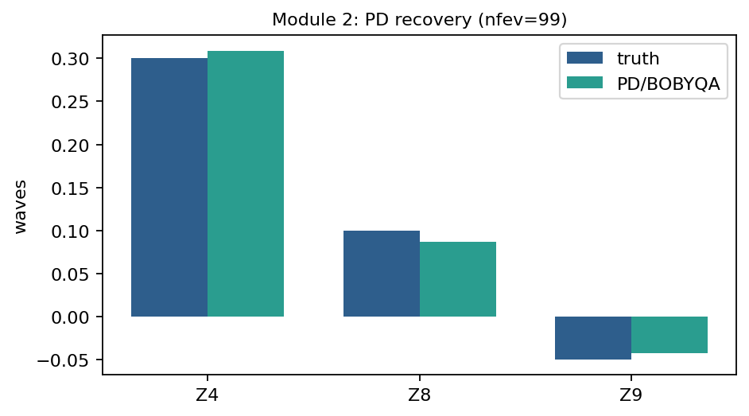

# 模块2：相位差反演

> 多帧 PSF → Z4/Z8/Z9


## 01 为什么需要多帧

> 单张 PSF 不是相位差。

PSF=|FFT(A exp(i2πφ))|²；离焦 d 提供相位分集。单张 PSF 存在符号/平移/局部极小歧义；至少 2 帧，推荐 5 帧（0、±1、±2λ）。

*代码 1-1  前向/代价*

```cpp
phase = 2*pi*(c4*z4 + c8*z8 + c9*z9 + defocus*z4)
psf = |fftshift(fft2(mask*exp(1j*phase)))|^2
objective = mean((normalize(model) - normalize(data))^2)
```


## 02 输入契约

> PSF + defocus 必须配套。

*代码 2-1  请求*

```cpp
{"psf": [[[64x64] x5]],
 "defocus": [-2,-1,0,1,2],
 "truth": [0.3,0.1,-0.05],
 "maxeval": 400}
```

PSF 已由模块1做背景扣除/归一化；若直接上传，需保证同一星、同一离焦序列、同一像素尺度。


## 03 求解器

> BOBYQA + 有界变量。

*表 3-1  BOBYQA*

| 设置 | 值 |
|---|---|
| 变量 | Z4/Z8/Z9 |
| bounds | [-1.5,1.5] / [-0.5,0.5] / [-0.5,0.5] |
| maxeval | 400 |
| ftol/xtol | 1e-9 / 1e-7 |
| 初始点 | 0（可选 CNN） |


## 04 实测效果

> C4/C8/C9 恢复。



*图 4-1  PD 恢复 vs truth（示例 nfev≈99）。*

*表 4-1  示例结果*

| 量 | truth | PD |
|---|---|---|
| Z4 | 0.300 | 0.309 |
| Z8 | 0.100 | 0.087 |
| Z9 | -0.050 | -0.043 |
| nfev | — | 99 |


## 05 界面与形态演示

> 保留原有 PSF 五帧。

①/② 仍是 c4/c8/c9 滑杆 → 5 帧 PSF 形态演示；⑤ 生成 CCD+PSF；⑥ 用⑤的 PSF 做 PD。两套入口共享同一前向模型。


## 06 边界

> 64×64 代理，不是 256² 主报告。

- 当前 64×64、3 项 Zernike；主报告是 256²/15 星/5 帧；
- PSF 来自合成数据；真实数据需要 WCS/像素尺度/星表；
- BOBYQA 有局部极小；工程上用多起点/CNN/诊断；
- 单帧只能做相位恢复，不能冒充 PD。
