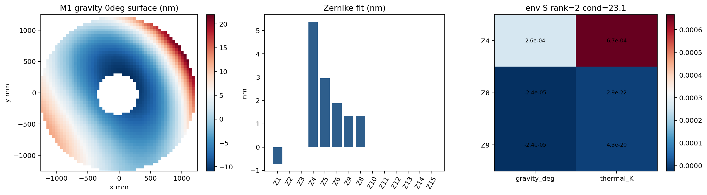

# 模块3：灵敏度矩阵与控制量

> FEA/Zemax/自定义 S → u


## 01 三套 S

> 不能混表。

*表 1-1  三套 S*

| 名称 | 输入 | 输出 | 状态 |
|---|---|---|---|
| 3A Zemax | ZMX + perturb.yaml | M2 5-DOF S | 待接 ZOS-API |
| 3B FEA | 重力/热工况 | 环境 3×2 S | 已跑通合成数据 |
| 3C 代理 | 3×5 线性 A | M2 代理 S | 已跑通 |


## 02 自定义矩阵

> 任意 m×n 输入。

*代码 2-1  分析*

```cpp
POST /api/sensitivity/custom
{"matrix":[[4.04,0.083,-0.083,0.976,-0.976],
           [0,-4.633,0,0,0],[0,0,-4.633,0,0]]}
-> rank/condition/nullspace/singular values
```

*代码 2-2  控制*

```cpp
POST /api/control/custom
{"matrix":..., "target":[0.23377,-0.09266,0.04633],
 "lam":1e-8, "use_bounds":false}
-> u, predicted, residual, cost
```


## 03 控制数学

> SVD + Tikhonov。

*代码 3-1  目标函数*

```cpp
min_u ||W(z - S u)||^2 + lambda||u||^2
u = argmin; residual = S u - z
```

3×5 秩 3、零空间 2；目标可复现但 u 不唯一。lambda 只选最小能量解，不是物理约束。


## 04 FEA/3B

> 面形 → Zernike → 环境 S。

模块1/3B 的 FEA case 是合成参考：M1 36+24 支撑、重力 0/90°、热 ±20 K。当前 15 项 Zernike、3×2 环境 S；真实 FEA 替换 CSV。



*图 4-1  M1 合成面形、Zernike、环境 S。*


## 05 Zemax/3A

> M2 5-DOF 的真实 S。

*表 5-1  M2 5-DOF*

| 控制量 | 物理含义 | 单位 |
|---|---|---|
| m2_focus | M2 轴向调焦 | mm |
| m2_decenter_x/y | M2 平移 | mm |
| m2_tilt_x/y | M2 倾斜 | mrad |

当前 ③ 是 3C 代理；3A 需要 ZMX/ZOS-API 或自研光线追迹。


## 06 界面

> ④ 与 ⑦。

④ FEA：工况下拉、面形热力图、Zernike、环境 S。⑦ 自定义：粘贴/上传 S、target，显示 rank/condition/nullspace、u、residual。


## 07 边界

> 合成/代理 vs 实测。

- FEA case 是合成参考，不是已求解的 2.5 m 模型；
- 3A Zemax S 尚未接 ZOS-API；
- 3C 代理的 tilt 交叉项不是 Zemax 实测；
- 控制边界是投影，不是 QP；
- 真实 S 必须用真实 FEA/Zemax 重新生成。
